# Retirement Income Planner — Architecture Spec

*This replaces `retire.md`'s topic-based structure entirely. It is organized to mirror the codebase
file-for-file: one section per source file, each a self-contained contract (what it reads, what it
produces, what rules it enforces). To change behavior, edit the section for the file that owns that
behavior, then hand this document (or just the changed section, plus the file it names) to an LLM or
developer with "update the code to match." The section headers double as a table of contents into
`js/`.*

---

## 0. How to Use This Document

- **Naming.** *Plan* means only the saved file (Save / Load, plan slots, the live bridge, `PLANNER_PLAN`, the `retirementPlanner*` storage keys, plan files imported by the Inheritance card or linked live). *Scenario* means everything the planner calculates from the inputs: the inputs as entered, the 🆎 scenarios A to F, stress tests, stress + Monte Carlo runs, saved market paths and Monte Carlo trials. The master list of all of them is `js/scenarios/` (`sc…` functions, `SC_…` constants, §12); the as-entered one has the run and ref id `entered` (the old `plan` is still accepted as a ref and a baseline).
- **One section = one file.** Every `###` heading below names the exact file it governs. If you're
  changing what a field does, find the field in this doc, edit the rule, then point the LLM at that
  file.
- **State schema (§2) is the contract between Input and Compute.** If you add a field here, both an
  Input file (to edit it) and Compute's `projection.js` (to use it) usually need updating — this doc
  tells you which.
- **Projection row schema (§4.6) is the contract between Compute and Display.** Every chart in §6 only
  reads fields listed there. If a chart needs a new number, add it to the row schema first, then wire
  the chart to it.
- **When you add a new file**, add a new section here in the matching part (§3–§6), add its exported
  names to that part's summary table, and add its `<script>` tag to `index.html` (see §7.2 for load
  order rules).
- Every rule below states current, intended behavior — not history. Where a past decision is worth
  preserving context on, it's called out as a *Design note*, not mixed into the rule itself.

- **Diagrams** are [Mermaid](https://mermaid.js.org) blocks (they render on GitHub, in VS Code's Markdown preview and in most Markdown viewers; in a plain viewer they show as readable source). Index: layers and load order (§1, §7.2), the state shape (§2), the per-year loop, the tax circularity and the funding waterfall (§4.6), guardrails and the medical shock (§4.6a, §4.6b), the UI update cycle (§7.1), the Excel pipeline and its LibreOffice check (§6.11), the Monte Carlo pipeline, trial views and return factor (§10), and the stress-test mechanism and medical-shock run (§11).

---

## 1. Architecture at a Glance

```
   INPUT (js/input/)              COMPUTE (js/compute/)             DISPLAY (js/display/)
   writes into `state`   ──────▶  reads `state`, produces  ──────▶  reads projection rows,
   via setPath()/onFieldInput      one row per projected year        draws Chart.js charts
                                   ("the projection")

        ▲                                                                   │
        │                                                                   │
        └──────────────────── js/app.js (recompute/renderCharts) ◀──────────┘
                     boots the app, wires input changes to recompute + rerender
```

- **`state`** (defined in `js/core/state.js`) is the single source of truth for every input value —
  household setup, every income source, every assumption. Nothing else holds input state.
- **The projection** (`computeProjection()` in `js/compute/projection.js`) is the single source of
  truth for every derived number — income, tax, balances, all in today's dollars, one row per
  projected year. Nothing in Display recomputes anything the projection already computed.
- **Display never touches `state` directly** and **Compute never touches the DOM**. If you're tempted
  to do either, the logic belongs in a different file.

**Layers and data flow.** Input writes `state`; Compute reads it and produces the projection; Display only reads the projection. The add-ons (Monte Carlo, stress tests) never touch the live `state`: they run `computeProjection()` on a private clone with the two engine hooks set.

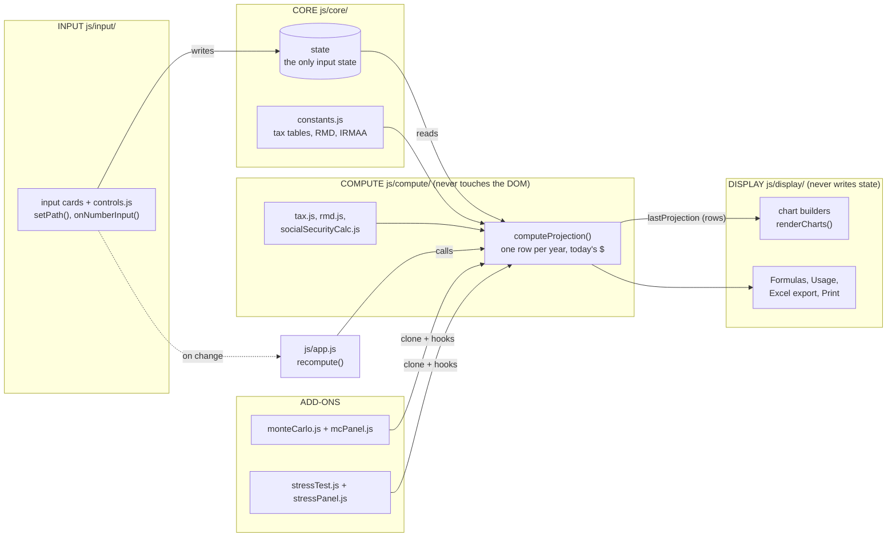

**Where the stress features plug in.** The three stress features each add one input, one place in the engine or sampler, and one set of measures that the existing cards, the Excel export and the Formulas page read.

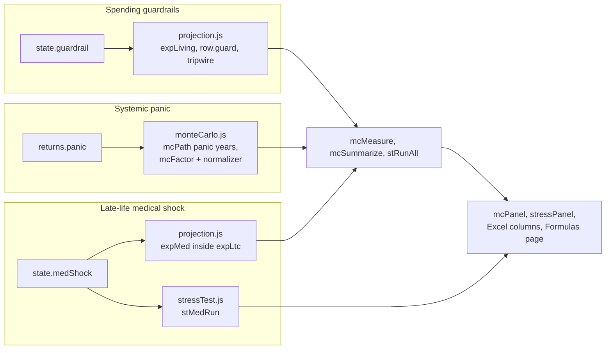

### File tree

```
index.html
css/
  styles.css    (all page styling; linked from index.html)
tests/
  check.js  snapshot.js  compare.js  baseline.json  README.md   (Node regression harness; not loaded by the app)
  chart_big_test.js   (enlarged-chart layout model: footprint, displacement, row compaction, 2×N round trip, save/load)
  market/       market_test.js  market_ui_test.js   (market path model, tool API, MCP shapes; chat tool → D view → Stress card, §13)
  llm/          runs_test.js  llm_ui_test.js  jobs_test.js  mcp_test.js  bridge_test.js  bridge_mcp_test.js  bridge_ui_test.js  openai_test.js  wsclient.js   (LLM integration, §13.5–13.7)
  mc/           mc_harness.js  mc_test.js  mc_inherit_test.js  mc_replay_test.js  mc_ui_test.js  mc_runplan.js  mc_sweep.js  mc_infl_cmp.js  stress_test.js  stress_mc_test.js  guardrail_test.js  guardrail_ui_test.js  panic_test.js  medshock_test.js  medshock_ui_test.js  xlsx_trial_test.js  xlsx_guardrail_test.js   (Monte Carlo tests, §10; stress tests, §11; guardrails §4.6a; panic §10.6; medical shock §4.6b)
  xlsx_e2e/     write_workbook.js  compare_recalc.py  README.md   (Excel export recalculated in LibreOffice, §6.11)
docs/           ARCHITECTURE.md  (this file)  MONTE_CARLO.md  (what the Monte Carlo add-on changed, how it works, how to test it)  LLM_INTEGRATION_DESIGN.md  + design spec and slide decks
js/
  core/         constants.js  helpers.js  markdown.js  planSlots.js  defaults.js  state.js  persistence.js
  compute/      socialSecurityCalc.js  rmd.js  tax.js  dates.js  ageRange.js
                projection.js  whatIf.js  donorTraj.js  monteCarlo.js  stressTest.js  marketScenario.js  scenarioSpec.js  scenarioApi.js  runRegistry.js
  input/        controls.js  household.js  assumptions.js  loadMenu.js
                wage.js  socialSecurity.js  pension.js  rental.js
                brokerage.js  realEstate.js  ira.js  roth.js  inheritance.js  liveLink.js  incomeForms.js
  display/      trialView.js  chartHelpers.js  chartPanels.js  chartInfo.js  overlayPlugin.js
                ssChart.js  incomeChart.js  tssChart.js  taxChart.js  expenseChart.js  assetChart.js  iraLtcgChart.js  inhIncomeChart.js  inflationChart.js  marketChart.js  footer.js  print.js
                formulasPage.js  formulasCss.js  formulasSections.js  mdPage.js  excelWorkbook.js  excelTaxSheet.js  excelInputsSheet.js  excelAccountSheets.js  excelMainSheet.js  excelExport.js  scenarios.js  userNotes.js  chatTools.js  chatCharts.js  chatSnapshot.js  chatProviders.js  chat.js  llmPanel.js  llmBridge.js  scenarioView.js  mcPanel.js  stressPanel.js  cardStack.js  llmPanel.js  llmBridge.js
  scenarios/    scenarioStore.js  scenarioRecord.js  scenarioSetProducer.js  stressProducer.js  monteCarloProducer.js  marketProducer.js  leverProducer.js  jobsProducer.js  scenarioTools.js   (the master scenario list: one record per scenario however it was made; docs/SCENARIO_STORE_DESIGN.md)
  app.js
server/    engine.js  mcp.js  bridge.js  build-mcpb.js   (Node only, not loaded by the page: the MCP stdio server and the live-bridge WebSocket, §13.4, §13.7)
mcpb/      manifest.json  icon.png   (the Claude Desktop extension, §13.8; `node server/build-mcpb.js` writes dist/retirement-planner.mcpb)
misc/      Usage.md            (how to use the app; rendered to HTML by the Usage button, §6.10)
           Note4User.md        (user-facing tips; rendered to HTML by the Tips button, §6.10)
Samples/   *.json  manifest.json (example saved plans: Widow.json, a single widow of 85 with LTC at the end of life, and Couple_Heir.json, a California married couple (community property) whose wife Susan inherits from Widow.json, with a 1% AUM fee on portfolios and IRAs; each .json is one entry in the Load file menu, §5.6)
```

All files are plain (non-module) scripts sharing one global scope, loaded via `<script src>` in
`index.html` in dependency order (see §7.2) — this is what lets the app run via `file://` as well as
GitHub Pages, with no build step.

---

## 2. State Schema

This is the full shape of the `state` object, as produced by `defaultState()` in `js/core/state.js`.
Every Input file (§5) writes into one piece of this; every Compute file (§4) reads from it.

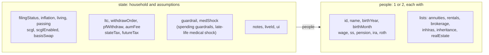

*Overview only; the full field-by-field schema follows.*


```js
state = {
  filingStatus: 'single' | 'married',
  inflation: number,              // e.g. 0.03 for 3%. SS COLA is assumed to equal this.
  people: [Person, Person],       // always length 2; only people[0] is used when single
  passing: { p1: number, p2: number },  // passing age per person id
  living: number,                 // household living expenses per year, today's $ (flat in real terms); funded income → dividends → asset sales → pre-tax IRA → Roth IRA (§4.6)
  scgl: number,                   // Suspended Capital-Gain Loss pool, today's $
  ltc: {                          // Long Term Care (§4.6, Expenses panel §5.3). Off by default
    enabled: boolean,
    people: [{startAge, cost}, {startAge, cost}],  // per person: the person's OWN age at which their LTC starts (default 85) and the LTC cost $/yr, today's $ (default 100000). people[1] is unused when single
    living1: number | null,       // household living expenses, today's $, once the 1st LTC has started (null = never set: married → follows `living`; single → $7,500, `LTC_SINGLE_LIVING`)
    living2: number               // household living expenses, today's $, once the 2nd person's LTC has also started (default $15,000, `LTC_LIVING2_DEFAULT`)
  },
  withdrawOrder: { enabled: boolean, steps: [{id, asset}] },  // expense-shortfall withdrawal order (§4.6, §5.3); asset = 'pf:<portfolio id>' | 'ira:<person id>' | 'roth:<person id>' | 're:<property id>'; off = the built-in order
  guardrail: { enabled, discPct, iwrMode:'initial'|'target', targetWR, band, cutPct, prosperity, raisePct, sunsetYears, excludeLtc },   // spending guardrails (§4.6a); off by default
  medShock:  { enabled, person:0|1, age, years, cost },   // late-life medical shock, added to the LTC cost line (§4.6b); off by default  aumFee: { mode: 'pct'|'fixed', value: number },  // AUM fee: 'pct' = % of the AUM balance (sum of balances of portfolios with `aum` checked); 'fixed' = $/yr in today's $ (flat nominal, so it shrinks with inflation). Household-level; UI is below SCGL in the Settings panel (§5.3)
  futureTax: {
    enabled: boolean,
    niitStartYear: number,
    niitSingle: number,           // today's $
    niitMarried: number           // today's $
  },
  ui: {                           // display-only flags that are nevertheless saved, autosaved, restored and reset with the plan
    chartHidden: { expense, incomeMagi, income, incomeOrd, incomeQual, tax, taxOrd, taxQual, asset, idgt, ira, ltcg, inhIncome, ss, tss: boolean }  // each chart panel's **Hide** checkbox (§6.1a). true = collapsed to its title bar. Default: true for `CHART_DEFAULT_HIDE_KEYS` = expense, income, tax, asset, idgt, ira, ltcg; false (shown) for every other chart (`defaultChartHidden`, `core/state.js`)
    gridCols: 2 | 3                      // the chart grid's column count, set by the **Grid: 2×N / 3×N** toggle right of the Same-scale buttons (§6.1a). Default 3 (`GRID_COLS_DEFAULT`). Older saves with no `gridCols` load as 3, keeping the fixed 3-column layout they were saved with
    chartPos: { <chart key>: {r, c, s?} }   // `s:2` (optional, 3×N only) = the chart is enlarged to a 2×2 block anchored at (r, c), column ≤ 1 (§6.1a); `hydrateState` copies it back after `merge()` (which keeps only the default keys). Each panel's grid row / column in the grid that is ON SCREEN (0-based, `gridCols` columns), moved by dragging its title bar; empty cells stay blank. Defaults per grid size in `CHART_DEFAULT_POS_BY_COLS`; an invalid / duplicate / missing position is repaired to the first free cell on load (`normalizeChartPos(p, cols)`)
    chartPosAlt: { <chart key>: {r, c, s?} }   // the same, for the OTHER grid size, so toggling 2×N ↔ 3×N brings back the arrangement that size had (`toggleGridCols` swaps `chartPos` and `chartPosAlt`)
    marketPaths: MarketPath[]   // saved market scenarios: full-horizon yearly stock returns and inflation (§13); plan-independent, carried across plan scenarios, written only by a user click, sanitized on load by `msSanitizeList`
    stressCfg: object | null, mcCfg: object | null   // the Stress test / Monte Carlo cards' settings and Hide boxes (null = defaults); cardOrder: ['stressPanel','mcPanel'] | reverse | null
    chartYMax: { [chartKey]: number | null }   // each chart's locked Y-axis maximum (null = fit on the next draw), saved/restored with the plan. Written by `captureChartYMax()` after every render, read by `restoreChartYMax()` in `renderAll()`. The **Same scale** buttons (§6.1) and each **Rescale** button change it
  }
}

Person = {
  id: 'p1' | 'p2',
  name: string,
  birthYear: number, birthMonth: 1-12,
  wage:    { enabled, hidden, amount, ar: AgeRange, change: Change },
  ss:      { enabled, hidden, pia, fra, started: boolean, claimAge },
  pension: { enabled, hidden, amount, ar: AgeRange, change: Change, bene: boolean },
  rentals: [ { id, enabled, hidden, name, amount /* TAXABLE (net of depreciation) rental income, today's $ */, depreciation: number /* annual non-cash depreciation, today's $; fixed nominal, so it shrinks by inflation */, ar: AgeRange, change: Change, bene: boolean } ],   // any number per person (Add/Remove); older saves' single `rental` object becomes rentals[0] in hydrateState (only if it was enabled or had an amount/depreciation)
  brokerage: [BrokeragePortfolio, ...],   // 0 or more
  realEstate: [ { id, enabled, hidden, name, balance /* value today, AFTER TAX counting exempt gains; today's $ */, basis /* cost basis, today's $, null = no unrealized gain (older saves' basisPct is converted on load) */, growth: Change /* default 'inflation' */, bene: boolean /* Joint owned with spouse */ }, ... ],   // 0 or more; passive: no yield, AUM, type or age range; never sold; basis erodes by inflation and steps up at the owner's passing
  ira:  { enabled, hidden, balance, growth: Change, ar: AgeRange, bene: boolean, conv: number /* ANNUAL WITHDRAW from the pre-tax IRA, today's $ (convMode 'fixed'); formerly "annual Roth conversion" */, convToRoth: boolean /* default true: the withdraw is a Roth conversion (enters the holder's Roth IRA, which must be enabled); false: an ordinary taxable withdrawal that is household cash income and needs no Roth IRA */, convMode: 'fixed'|'bracket' /* default 'fixed'; 'bracket' = convert as much as fits under the limits below */, convIrmaaPct: number|null /* 'bracket': stay BELOW the IRMAA line with this Part B % over standard — a stop of CONV_IRMAA_STOPS = [0,40,100,160,220,240,null]; 0 = no conversion, null = no limit; default 40 */, convOrdPct: number|null /* 'bracket': stay BELOW this ordinary bracket rate — a stop of CONV_ORD_STOPS = [0,10,12,22,24,32,35,37,null]; 0 = no conversion, null = no limit; default 32 */, convStartMode: 'rmd'|'now'|'custom' /* default 'rmd': conversions begin at the IRA's own Start age (RMD start); 'custom' uses convStart */, convStart: number /* age used only when convStartMode is 'custom' */, stretch: boolean },
  roth: { enabled, hidden, balance, growth: Change, bene: boolean, stretch: boolean, aum: boolean }   // aum (default false): counts toward the AUM balance (§4.6); the pre-tax `ira` and each `inhIras` entry carry the same `aum` flag
}

AgeRange = { startMode: 'now'|'custom'|'rmd', startVal: number,
             endMode: 'custom'|'passing',     endVal: number }

Change = { mode: 'fixed'|'inflation'|'offset'|'custom', value: number /* percent, for offset/custom */ }

BrokeragePortfolio = {
  id, name, balance, growth: Change, yield: number /* ODIV % */, qdivPct: number /* % of ODIV */,
  ar: AgeRange, bene: boolean, idgt: boolean,
  enabled: boolean,          // default true — whether this portfolio is used for compute/display
  hidden: boolean,           // default false — whether its card is collapsed on screen (§5.1)
  cgdMode: 'pct'|'amt', cgdPct: number /* default 0: % of the start-of-year balance */, cgdAmt: number /* today's $/yr */,   // Distributed LTCG: realized LTCG each year (added to `x.ltcg` → `ltcgGross`, taxed like any LTCG) and spendable like a dividend (counted in the waterfall's `x.odiv`, so unspent amounts are reinvested and add basis); capped at the balance. Row entry field `cgd`
  teYield: number,           // default 0 (%): tax-exempt income paid out of the portfolio each year = start balance × teYield — untaxed, but part of `cashIncome` (§4.6); lowers the balance by the same amount
  reinvest: boolean,         // default FALSE — "Reinvest excess income": household income left after ALL expenses are paid is added (pro rata to start-of-year balance) to the in-range portfolios with this checked (§4.6). Older saves load as false via the `defaultBrokeragePortfolio` merge
  payExp: boolean,           // default FALSE — "Pay expenses": only portfolios with this checked (IDGT or not) contribute dividends and asset sales to household expenses (§4.6). Saves that predate the field load as true for non-IDGT portfolios (their old behavior)
  aum: boolean,              // default false; off by default, IDGT or not (switching a portfolio to IDGT clears it) — this portfolio's balance counts toward the AUM balance the household AUM fee (`state.aumFee`) is charged on. Older saves' per-portfolio `expense`/`fee`/`irmaa` are dropped by `hydrateState` (a portfolio that had a fee on becomes `aum: true`; the household `aumFee` takes the first % fee found, or the sum of fixed fees)
  basisPct: number | null,   // cost basis as a % of the start balance (0–100). null/blank = not entered. Older saves' dollar `basis` is converted to a % in `hydrateState`. Every portfolio is tracked (§4.6); a blank basis means no unrealized gain today. Realized LTCG has no input: it is always derived from basis (§4.6). Older saves' `ltcg`/`ltcgMode`, per-portfolio `taxDrag` and `living` withdrawal are dropped on load (the withdrawals are summed into `state.living` by `hydrateState`)
  foreignPct: number,        // % of portfolio that's foreign assets — always active, ungated
  ftcPct: number,            // foreign tax credit %, default 0.25 — always active, ungated
}

// Portfolio withdraw is NOT per portfolio any more: it is the household setting `state.pfWithdraw = { enabled, ltcgPct, acceptNiit, acceptTorpedo }` (`acceptTorpedo` default false: a sale is also capped so it does not raise `taxableSS` above its value before the sale; the two checkboxes call `onPfAccept(field,on)`, a plain `recompute()` like `onEnableToggle`, so the charts tween; see `updateChartInPlace` for why a toggle no longer rebuilds the Total tax card) (`acceptNiit` default false: a sale is also capped so MAGI stays at or under the NIIT threshold, `niitThreshold()` in tax.js; a portfolio with no unrealized gain is not capped; true = accept the NIIT) (Tax & Optimizations panel,
// `renderPfWithdrawPanel`). When enabled, EVERY live, in-range, non-IDGT portfolio gets a 'bracket' withdraw: `ltcgPct` is a stop of LTCG_STOPS (core/constants.js,
// 0 | 15 | 20; 20 = no limit). There is no start / end age and no fixed amount. Proceeds are household cash income (`cashIncome`, so they pay expenses first, ahead
// of dividends and asset sales; any excess is reinvested per the portfolio's `reinvest` flag). The sale realizes LTCG on the gain share and removes basis like any
// sale (§4.6). Solved after the Roth conversions: the largest sale for which taxable ordinary income + qualified income stays within the top of the chosen bracket
// (MFJ_QDIV / SGL_QDIV), portfolio by portfolio. Row fields: `brokerageWd`, `brokerageWdByPerson`, portfolio entry `withdrawn`. Older saves' per-portfolio `withdraws`
// are migrated in `hydrateState`: the first enabled bracket withdraw turns `pfWithdraw` on at that bracket; fixed-amount withdraws are dropped.
```

**`enabled` vs. `hidden` (every income item above has both — see §5.1):** `enabled` controls whether
that item's data is used for compute (§4) and therefore appears in any chart (§6) at all. `hidden`
controls only whether that item's *input card* is visually collapsed to save screen space — it has
zero effect on compute or on any chart. The two are fully independent: an item can be enabled and
hidden (computed and charted, but its input card collapsed), enabled and shown, disabled and hidden,
or disabled and shown (its fields still visible/editable, just not yet counted).

- `resolveAgeRange(ar, person)` (§4.5) is the only place that turns an `AgeRange` into concrete ages —
  every consumer of an age range goes through it, never reads `startMode`/`endMode` directly.
- `realGrowth(change, inflation)` (§4.6) is the only place that turns a `Change` into a real
  (today's-$) annual growth rate.

---

## 3. Core (`js/core/`)

### 3.1 `constants.js`
**Purpose:** pure data tables — nothing in this file computes anything. Data only, no logic.
| Export | Contents |
|---|---|
| `MFJ_ORD`, `SGL_ORD` | Ordinary tax brackets `[{lim, r}]`, married/single |
| `STD_MFJ`, `STD_SGL`, `STD_AGE65_MFJ`, `STD_AGE65_SGL` | Basic standard deduction, married/single; additional standard deduction per living person age 65+ ($1,650 joint / $2,050 single, tax year 2026). `projection.js` builds `std = basic + additional × age65N` (`age65N` = living people with `birthYear + 65 ≤ tax year`; row fields `stdDeduction`, `age65Eligible`) |
| `MFJ_QDIV`, `SGL_QDIV` | Qualified-dividend/LTCG brackets |
| `IRMAA_MFJ`, `IRMAA_SGL` | IRMAA tiers `[{magi, label, surch}]` |
| `NIIT_RATE`, `NIIT_THRESH_MFJ`, `NIIT_THRESH_SGL` | NIIT rate + un-indexed thresholds |
| `RMD_TABLE` | IRS Uniform Lifetime Table, age → divisor |
| `THIS_YEAR`, `THIS_MONTH` | Anchor for all age/date math |

**Rule:** when the IRS publishes new brackets/IRMAA tiers for a new tax year, this is the only file
that changes.

### 3.2 `helpers.js`
**Purpose:** generic, dependency-free utilities used everywhere.
| Export | Contract |
|---|---|
| `fmt(n)` | `$1,234` / `-$1,234` — rounds to whole dollars |
| `fmtM(n)` | `fmt(n)+'/mo'` |
| `clamp(v,lo,hi)` | numeric clamp |
| `uid()` | short random id string, for new list items (e.g. a new brokerage portfolio) |
| `escHtml(s)`, `escAttr(s)` | HTML/attribute escaping for any user-entered string rendered into a template literal |

### 3.3 `state.js`
**Purpose:** owns `state` (§2) end to end — defaults, save/restore, autosave, dot-path mutation. It is four files, loaded in this order: `planSlots.js` (which autosave slot this tab uses, `planKeys`), `defaults.js` (the `default*()` builders and the chart-grid layout defaults), `state.js` (`defaultState()`, `hydrateState()`, the `state` variable, `setPath`) and `persistence.js` (autosave, `loadAutosave`, reset, save / load of a plan file). They share one global scope; the split is by job only.
| Export | Contract |
|---|---|
| `defaultState()`, `defaultPerson(idx)`, `defaultBrokeragePortfolio(balance,n)`, `defaultChange`, `defaultAgeRange`, `defaultAgeRangedItem` | Canonical default shapes (§2). **If you add a field to the schema, add its default here.** |
| `pfBasisEntered(b)`, `pfTracksBasis(b)` | Cost-basis predicates (§4.6): a cost basis was entered (`basisPct` is a number; `null`/blank is *not* the same as `0`); and whether basis is tracked — now true for every portfolio, since household expenses can force a sale from any of them |
| `CHART_KEYS`, `GRID_COLS_DEFAULT`, `CHART_DEFAULT_POS_BY_COLS`, `CHART_DEFAULT_HIDE_KEYS`, `ASSUMP_HIDE_DEFAULT`, `otherGridCols(cols)`, `defaultChartHidden(hidden?)`, `defaultChartPos(cols)`, `normalizeChartPos(p, cols)` (also validates enlarged blocks: anchor column clamped, overlapping blocks lose `s`) | The keys of `state.ui.chartHidden` / `chartPos` / `chartPosAlt` (the `charts` registry keys, §6.1), the 2- or 3-column grid and its default layout per size, the charts that start with Hide checked (`CHART_DEFAULT_HIDE_KEYS`: Annual expenses, Annual income, Total tax, Asset value, IDGT value), and the default Hide state of every settings feature card (`ASSUMP_HIDE_DEFAULT`: General open, every Expenses / Tax & Optimizations feature hidden) |
| `hydrateState(loaded)` | Deep-merges a loaded/imported object onto `defaultState()`: missing fields get defaults, unknown/stale fields are dropped, arrays keep every entry (not just as many as the default has). Migration: if a loaded file has no `living`, it is set to the sum of the old enabled portfolios' `living` withdrawals. Hide migration (`fillLegacyHide`): a card with **no** `hidden` flag gets `!enabled`, — a `hidden` value that *is* in the file is never overridden. LTC migration: an old single-person `ltc {startAge, cost, living}` becomes `people[0]` + `living1`; an old per-person `ltc.people[i].living` becomes `living1` (the earlier-starting person's) and `living2` (the later's). A file with no `ltc` just gets the defaults. Conversion-start migration: a save with no `ira.convStartMode` that already converts (`conv`>0) keeps its old behaviour (`convStart`>0 → `custom`, else `now`); one that does not convert takes the new default `rmd` |
| `state` | The live, mutable object every other file reads/writes |
| `autosave()` / `loadAutosave()` | Silent per-browser `localStorage` save/restore, so a reload doesn't lose work |
| `resetState()` | Confirms, then resets `state` to defaults (with `applyDefaultHiddenFromEnabled`) and re-renders |
| `saveToFile()` | Saves the plan (every scenario). **Supported browser: Chrome** (all testing was done there; the Usage page says so at the top): only it has the File System Access API for an in-place overwrite, while Safari / Firefox fall back to a download that asks for a name and goes to Downloads each time. With the File System Access API it overwrites the file remembered by `setSaveTarget()` (set by Load file or a first Save As; cleared by Reset, never kept across a reload) with no dialog, and asks Save As for a sample plan or when nothing is remembered; `saveDone()` shows the green "✓ Saved" button and toast. Without the API it prompts for a file name and downloads |
| `loadFromFile()` | The **Choose file from local directory…** menu entry's action (§5.6). Uses `showOpenFilePicker` (with a stable `id: 'retirementPlannerLoad'`, so browsers that support it remember the last-used folder across sessions) when available; otherwise clicks the hidden `<input type="file" id="importFile">`. **Limitation (browser security, not fixable here):** no web API lets a page force its *first-ever* file dialog to open in a chosen folder such as `Samples/` — the Load file menu (§5.6) lists the shipped `Samples/` folder instead; after the user opens a file from it once, supporting browsers remember it. |
| `applyLoadedFileText(text)` | Shared by both load paths: parse JSON → **destroy every chart → reset to defaults → hydrate the loaded file on top** — always in that order, so no stale state or chart instance survives a restore. Every Hide flag (per card and `state.ui.chartHidden` / `chartPos` / `scaleLinks`) comes back exactly as saved |
| `applyDefaultHiddenFromEnabled(s)` | Sets `hidden = true` on every income-source / asset card and the Inheritance card (§8 "Reset to defaults"). Called by **Reset to defaults only** — never by load or autosave-restore, which keep the saved `hidden` values |
| `setPath(path, value)` | Dot-path set into `state`, e.g. `setPath('people.0.wage.amount', 5000)` — every input control's `onchange` goes through this (via `onFieldInput`/`onNumberInput` in `controls.js`) |

**Rule:** this is the *only* file allowed to declare what a default value is. Every Input file reads
a value from `state`; none of them invent a fallback default inline.

---

## 4. Compute (`js/compute/`)

Nothing in this part touches the DOM. Every function here is a pure function of its arguments and/or
`state`.

### 4.1 `socialSecurityCalc.js`
| Export | Rule |
|---|---|
| `fraForBirthYear(y)` | SSA's Full Retirement Age table (65 → 67 by birth year) |
| `ssOwnFactor(claimAge, fra)` | Early claim: −5/9%/mo for first 36 months early, −5/12%/mo beyond; delayed claim: +8%/yr up to age 70 |
| `ssSpousalFactor(claimAge, fra)` | Same shape, different statutory rate for a spousal benefit: −25/36%/mo first 36 months, −5/12%/mo beyond; no delayed credit past FRA |

### 4.2 `rmd.js`
| Export | Rule |
|---|---|
| `rmdDivisor(age)` | IRS Uniform Lifetime Table lookup for age ≥ 72; below 72, a linear approximation for voluntary early withdrawals |
| `rmdAgeForBirthYear(y, m)` | 70.5 (born before Jul 1 1949) / 72 (Jul 1949–1950) / 73 (1951–1959) / 75 (1960+); `m` = birth month |
| `rmdFirstDistribution(y, m)` | `{age, year, firstDeadline:{year,month:4,day:1}}`: the year the RMD age is reached and the April 1 deadline for the first RMD |

### 4.3 `tax.js`
| Export | Rule |
|---|---|
| `calcOrdTax(ti, brackets)` | Standard marginal-bracket tax on taxable income |
| `calcQualTax(ordTI, qualIncome, qdivBrackets)` | Qualified income (QDIV+LTCG) taxed at its own brackets, stacked on top of ordinary taxable income |
| `qualTaxTiers(ordTI, qualIncome, qBrackets)` | Same as above but returns the per-tier dollar amounts (0%/15%/20% bands), for the tax chart's stacked segments |
| `computeTaxableSS(nonSS, totalSS, filing, f)` | Provisional-income formula → taxable SS dollar amount. `f` deflates the un-indexed $25k/$32k/$34k/$44k thresholds since everything else here is in today's $ |
| `computeSSTAndMarginal(...)` | **SST** = the incremental tax caused by taxable SS (actual total tax minus a hypothetical with no SS taxed) — not the taxable-SS dollar amount itself. **marginalRate** = true marginal rate on the next dollar of ordinary income, via a $100 numerical derivative — this is what captures the "torpedo effect" (an extra dollar pushing more SS into taxability, taxed on top of itself) |
| `computeNIIT(nii, magi, filing, f, futureTax, year)` | 3.8% of lesser of net investment income or MAGI-over-threshold. If `futureTax.enabled` and `year >= futureTax.niitStartYear`, uses the configured today's-$ threshold instead of the statutory (deflated) one |

**Design note:** foreign tax credit (from brokerage portfolios) is *not* computed here — it's computed
per-portfolio in `projection.js` (§4.6) since it depends on portfolio balance, and subtracted from
Total Tax there, not folded into any of these functions.

### 4.4 `dates.js`
| Export | Rule |
|---|---|
| `currentAge(person)` | From `birthYear`/`birthMonth` and `THIS_YEAR`/`THIS_MONTH` |
| `olderPersonIndex()` | Which person is P0 — married households only; anchors every chart's X axis |

### 4.5 `ageRange.js`
| Export | Rule |
|---|---|
| `resolveAgeRange(ar, person)` | `startMode`: `'now'`→current age, `'rmd'`→`rmdAgeForBirthYear(birthYear, birthMonth)`, `'custom'`→`startVal`. `endMode`: `'passing'`→that person's passing age, `'custom'`→`endVal`. Returns `[startAge, endAge]` |

### 4.6 `projection.js`
**Purpose:** the core year-by-year model. `computeProjection()` takes no arguments (reads `state`
directly) and returns `{ rows, stretch, people, idxP0, married }` (`stretch`: the 10 post-passing legacy years — non-IDGT brokerage and stretch-flagged IRAs — see §6.7). **This is the contract every Display file
consumes — nothing in `js/display/` should recompute anything listed in the row schema below.**

**Inside `computeProjection()`.** The function is a short driver. Setup is built once by module-level factories, `projSocialSecurity`, `projIraSims`, `projRothSims`, `projInheritedIras`, `projAnnuities`, `projPersonAgedItemActive`, `projPortfolioState`, `projEventRows`, `projWithdrawOrder` and `projStretch`, each `projX({inputs}) → {exports}`; their results form `c`, the read-only setup object. The year loop then calls 13 `projYear*` phase functions in order (accounts, income, solve tax, … `projYearRow`, which returns the row). State passes between phases in three places: `c` (read-only), `carry` (values that live across years: `scglRemaining, gMult, gIwr, gCutYears`) and `m` (the current year's mutable record), plus group objects that a phase returns for later phases. `tests/projection_golden_test.js` hashes 77 projections, so a refactor of this file is checked for byte-identical output.


**`realGrowth(change, inflation)`** — converts a `Change` spec (§2) into a real (today's-$) annual
rate: `fixed`→erodes with inflation, `inflation`→0% real, `offset`→`value/(1+inflation)`,
`custom`→`(1+value)/(1+inflation)-1`.

**One year at a glance.** The numbered list below is the exact order; this is its shape. The tax is solved as a fixed point inside the year because the expenses include the tax.

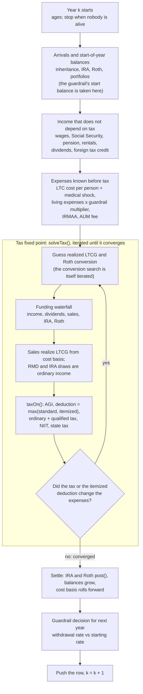

**Why the tax is iterated.** Paying a larger expense by selling shares realizes gain, which raises AGI, which raises tax and shrinks the medical deduction (the 7.5% floor rises), which raises the expense again.

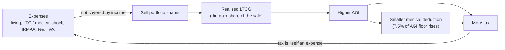

**Per-year order of operations** (one iteration of the row loop, `k` = years from now):
1. Compute each living person's age this year; stop the whole loop once nobody is alive.
2. Wages, per person, gated by their age range.
3. Social Security per person: own benefit (with early/delayed factor) or spousal benefit if higher,
   gated by claim age; on a spouse's death, the survivor gets the larger of the two amounts (SSSBR).
4. Pension / rentals (summed over every rental property), per person, via the shared `personAgedItemActive()` — respects survivor-benefit
   continuation using the *deceased's last living year's* age range, so a `passing`-mode end age
   doesn't cut a survivor benefit off immediately.
5. Brokerage portfolios, per portfolio: ODIV, QDIV and **foreign tax credit** (`balance × foreignPct × ftcPct`) —
   the credit is always active, independent of the `expense` toggle and `idgt` flag. A portfolio outside its age
   range (or an owner who has passed with no `bene`) produces no dividends and is not sold; it just compounds.
   **Realized LTCG is not an input and is not computed per portfolio here** — it falls out of the household expense
   waterfall (step 5a).
5a. **Household expense funding waterfall + tax fixed point** (see *Expense funding* and *Tax ↔ LTCG iteration* below): expenses —
   living, the IRMAA surcharge, the AUM fee and **this year's income tax** — are paid by household income, then portfolio dividends (leftovers
   reinvested), then portfolio asset sales, which realize LTCG from tracked cost basis. Because that LTCG changes the tax,
   steps 5a–12 are iterated to convergence (`solveTax(convTotal)`). The ordinary side of the return that does not depend on LTCG or the conversion (`nonSSBase`) is computed once, before the loop; `taxOn(ltcgGross, conv)` adds the Roth conversion.
   **Roth conversion solve** (`convMode:'bracket'`): `fixed` people convert their flat amount; `bracket` people are processed in person order, each given the conversions already settled.
   For one person the search finds the largest `c` in [0, room after RMD] with `slack(c) = min(ordTop − ordTI, magiCap − MAGI) ≥ 0` over the active limits (an inactive IRMAA limit — nobody IRMAA-exposed in k+2 — is left out of the min); every trial `c` runs the full tax ↔ LTCG iteration
   (`slack` is non-increasing in `c`; the bracket stops, `convStopIndex` and the two limit helpers live in `core/constants.js`), and the search over `c` is itself iterated (false position / Illinois with bisection safeguards) until the bracket is under a cent or the
   headroom is within $0.005. If the slack is already negative at `c = 0` nothing converts that year; if the whole balance fits it all converts. Row field `convTrials` counts the trial solves.
6. Pre-tax IRA: RMD (or voluntary early withdrawal) via `rmdDivisor`, plus a separate **Roth
   conversion withdrawal** (`rothConvByPerson`/`rothConvTotal`) — a real withdrawal on top of the RMD,
   taxed exactly like the RMD, continuing until the balance hits $0. Begins at the later of the owner's current age
   and the conversion start (`ira.convStartMode`: `rmd` (default) = the IRA `ar` Start age as resolved by `resolveAgeRange`, `now`, or `custom` = `ira.convStart`; effective start = max(current age, that age); or a **trigger** — `bracket` (household `ordTI` with no conversion ≤ the start of the `ira.convStartBracket` % bracket, `convOrdTop`, slider over `CONV_START_BRACKET_STOPS`), `itemized` (`itemized` with no conversion > `ira.convStartItemized`, today's $) or `ltc` (`ltcStarted ≥ 1`) — evaluated in the year loop just before the conversion solve against `solveTax(0)`; the first year it is met sets `iraSim[i].started` and that IRA converts every later year, like `now`; the no-conversion `ordTI` / `itemized` and the year each trigger fires are exported on the row as `noConvOrdTI`, `noConvItemized`, `convTriggerStartedByPerson`); before that age the conversion is $0 (RMDs are unaffected). Requires the matching Roth IRA
   to be enabled. On the owner's death, conversions stop; RMDs continue to a surviving spouse if the
   IRA is marked to continue. **Two conversion modes** (`ira.convMode`): `fixed` = the flat today's-$ `conv` (capped at the balance left after the RMD);
   `bracket` = the largest amount that fits under **both** entered limits (AND — the stricter wins) — ordinary taxable income (`ordTI`) ≤ the start of the `convOrdPct` bracket (`convOrdTop`) and MAGI < the IRMAA
   line labeled `convIrmaaPct` (null stop = no limit, both null = the whole balance converts; the IRMAA limit — `convMagiCap` — applies to anyone alive and 63+ because this year's MAGI sets the premium two years later, so it keeps applying to the end of the scenario (no last-years conversion spike); filing status = this year's, since this year's return sets that premium). The conversion changes taxable SS, the tax, asset sales and so realized LTCG,
   so it is part of the circular dependence: see "Roth conversion solve" in the year loop. Because of that, the pre-tax IRA and Roth IRA are **advanced one year at a
   time** inside the year loop (`iraSim[i]` / `rothSim[i]`: `pre(k)` = start-of-year balance, RMD and the room to convert; `post(k, conv)` = apply the
   conversion and grow), not simulated up front.
7. Roth IRA: grows tax-free, receiving that year's conversion amount (if any) from step 6 and paying out any last-resort expense draw (`rothSim[i].post(k, conv, draw)`, run after the final tax solve).
8. Rental depreciation (`rentalDep`, `rentalDepByPerson`): `Σ personAgedItemActive(r,i,k,true)` over `p.rentals` = `depreciation/(1+inflation)^k`, same on/off, age-range and survivor rules as rental income. It is a non-cash expense already inside the entered taxable rental amount, so it is **added to `cashIncome`** (funds expenses, feeds excess-income reinvestment) and **never taxed** (not in `nonSSOrdinary`/AGI).
   Ordinary income = wages + pension + rental (taxable) + IRA RMD + **Roth conversion (pre-tax IRA withdraw)**
   + (ODIV − QDIV).
9. Taxable Social Security via `computeTaxableSS(nonSSOrdinary + qdiv + ltcg + teIncome, …)` (upper tier = `min(50%×SS, $6,000/$4,500×f) + 85%×(PI−T2)`, capped at 85%×SS — the first-tier part is capped at 50% of benefits, which matters for benefits under $12,000 MFJ / $9,000 single) **inside `taxOn()`** (provisional income = all non-SS AGI items, so it depends on the realized LTCG and is solved in the tax ↔ LTCG iteration; `taxOn` returns `taxableSS`, `provisional`, `ordIncome`) — tax-exempt income is untaxed but counts toward provisional income (and is passed to `computeSSTAndMarginal` as `teIncome` for its marginal-rate bump); filing status for the year is `'single'` the
   moment either spouse has died. **Deduction** = `max(standard deduction, itemized)` — the standard deduction includes the additional amount for each living person 65+ (see constants) — where itemized =
   `max(0, LTC expense − 7.5% × AGI)` (see *Long Term Care* below); ordinary taxable income = `max(0, ordinary income − deduction)`.
   AGI includes realized LTCG, so the deduction is computed inside `taxOn()` and is solved with the tax.
   **Enhanced senior deduction** (Schedule 1-A Part V, IRC §151(d)(5)(C); constants `SENIOR_*` in `core/constants.js`, `computeSeniorDeduction` in `compute/tax.js`):
   tax years 2025–2028 only; each living person with `birthYear + 65 ≤ tax year` (65 by year-end; the 2025 case is "born before 1/2/1961") counts (`seniorEligible`).
   Per person `max(0, 6000 − 6% × max(0, MAGI − threshold))`, threshold $75,000 single / $150,000 MFJ (by that year's filing status), MAGI ≈ AGI; each eligible
   person gets the same reduced amount (Schedule 1-A lines 35–36, so it reaches $0 at $250k MFJ). The $6,000 and thresholds are un-indexed, so they are scaled by
   `ssThresholdFactor` (1/(1+inflation)^k). It is taken **on top of** the standard/itemized deduction: `ordTI = max(0, ordIncome − deduction − seniorDed)`; it does not reduce AGI.
   `taxOn()` returns `seniorDed`; the row carries `seniorDeduction` (and `std` stays the standard/itemized amount). `computeSSTAndMarginal` receives `seniorFn(agi)` so the no-SS
   hypothetical and the marginal-rate bump use the deduction that AGI earns (the marginal rate therefore includes the 6%-per-person phase-out). Not modelled: the age-65+ additional
   standard deduction, SSN/filing-status conditions (married = joint only), foreign-income MAGI add-backs, and a Jan 1 birthday exactly 65 years earlier (only year and month are known).
10. AGI = ordinary income + taxable SS + QDIV + LTCG (net of SCGL, see next point).
11. LTCG net of SCGL: available `scgl` shields realized LTCG dollar-for-dollar (pool depletes across
    years); only the net amount is taxed/displayed.
12. Total Tax = ordinary+qualified tax (via `calcOrdTax`/`calcQualTax`) **minus foreign tax credit**
    (floored at 0) **plus NIIT** (`computeNIIT`, calculated on the *pre-credit* ordinary+qualified tax
    basis — the credit doesn't offset NIIT).
13. SST/marginal rate via `computeSSTAndMarginal`, using the pre-credit ordinary+qualified tax as its
    basis (foreign tax credit is unrelated to SS taxation).
14. Roll every brokerage balance forward: `+growth −(dividends used for expenses + shares sold)`, from the step-5a
   waterfall. Foreign tax credit doesn't touch the balance. Every portfolio also rolls its cost basis forward (below).

**Long Term Care (LTC)** (`state.ltc`, off by default; Expenses panel §5.3). Each row, for each person `i` (only if `ltc.enabled`):
- **Started** if their LTC start age is *before* their passing age (`startAge < passing`, so an LTC that would begin after they pass never happens) **and** their age this year ≥ `startAge`. Once started it stays started for the rest of the projection, even after that person passes (`ltcStarted` counts started people, 0–2).
- **Cost:** a started person who is still **alive** adds `max(0, cost)` (today's $, flat in real terms) to `expLtc`; the row keeps each person's amount in `ltcCostByPerson`. The cost stops the year they pass.
- **Living expenses switch:** `expLiving` = `state.living` until anyone's LTC starts; `ltc.living1` (or, if `living1` is `null`, `state.living` when married / $7,500 when single) once exactly one person has started; `ltc.living2` once both have. A single-person household only ever uses `living1`.
- **LTC is a household expense**, added to the expense pool (see *Expense funding*) and paid income → dividends → asset sales → pre-tax IRA → Roth IRA like everything else.
- **Itemized deduction:** the LTC cost is also the only itemized deduction modelled: `itemized = max(0, expLtc − 7.5% × AGI)` (`agiFloor` = 7.5% × AGI). `usedItemized` is true when `itemized` exceeds the standard deduction; the deduction actually applied is `max(standard, itemized)`. Because AGI depends on LTCG, this sits inside the tax↔LTCG iteration.

**IRMAA as an expense** (always a household expense — there is no per-portfolio checkbox):
- **Household surcharge** = `irmaaSurcharge` = surcharge of the IRMAA tier (`IRMAA_MFJ`/`IRMAA_SGL`, chosen by the **filing status of the same year's return the MAGI comes from**, `rows[k−2].filing` — so a survivor is still looked up in the joint table until the lookback year is a single return; SSA's life-changing-event request is not modeled) reached by the **MAGI from two years earlier** (`rows[k−2].agi + rows[k−2].teIncome`; MAGI = AGI + tax-exempt interest; the tax-free part of annuity payouts is NOT added; also stored as `magi` on each row) × the number of living people age ≥ 65. Years 0 and 1 are `$0`, because the model has no AGI from before the projection starts. The 2-year lag is IRMAA's real look-back (the premium for year Y is set from the Y−2 return); the tier table follows the filing status of that Y−2 return. Tier tables are indexed, so no deflation. The row reports it as `irmaaSurcharge` and it is included in `expIrmaa`.
- **Payment:** part of the household expense pool below, so it is paid income → dividends → sales → pre-tax IRA → Roth IRA like everything else (the portfolio steps by portfolios with Pay expenses checked).

**AUM fee** (household assumption `state.aumFee`; per-portfolio `aum` box):
- **AUM balance** (`aumBalance`) = sum of start-of-year balances of every brokerage portfolio (Living expense & income or IDGT) that has `aum` checked and is enabled, alive, inside its age range and funded (`aumBalPf`), **plus** every pre-tax IRA (`aumBalIra`), Roth IRA (`aumBalRoth`) and inherited IRA (`aumBalInh`) whose own `aum` box is checked and that the household holds that year. An IRA counts at its balance BEFORE that year's RMD / forced withdrawal (captured before `pre(k)`; inherited IRAs as `sm.aumB`); it is not counted once it is `done`, or held by heirs under *IRA stretch*. **IDGT portfolios are never charged** — the AUM box is hidden on IDGTs (and cleared when a portfolio is switched to IDGT or loaded from an older save), and the engine ignores `aum` on an IDGT. The IRA is not debited for the fee: it stays one household expense paid by the pool.
- **Fee** (`aumFee` on the row) = `aumBalance × value/100` (mode `pct`, "% AUM balance") or `value ÷ (1+inflation)^k` (mode `fixed`, charged only when `aumBalance > 0`).
- **Allocation:** split across the checked portfolios pro rata to balance. Each account's share is informational (`feeDrag` on a portfolio row): the **whole fee is one household expense** (`expAum = aumFee`) paid by the pool, i.e. only by portfolios with **Pay expenses** checked — not by the account it is charged on unless that account also pays expenses. No portfolio pays a fee share on its own account, and no IDGT is ever charged.

**Expense shortfall withdrawal order** (`state.withdrawOrder`, Expenses panel). Applies only to what remains after household cash income and portfolio dividends (steps 1–2 below, which never change). **Off** (default): the built-in order, steps 3–5 below. **On:** the built-in steps 3–5 are replaced by the user's `steps`, tried top to bottom; each step names ONE asset and takes `min(still needed, what that asset can give)` before the next step runs. An asset that is not listed is never drawn on; a step whose asset no longer exists (or is not in the household) is skipped, as is a repeat of an asset. Tax follows the asset: **portfolio** (`pf:`) — a sale realizing LTCG on its gain share, limited as before to in-range, enabled portfolios of type *Living expense & income* (an IDGT never pays expenses; internally `payExp`, derived from the portfolio type) and to the balance left after dividends and tax-exempt income; **pre-tax IRA** (`ira:`, per person) — ordinary income, grossed up by the tax iteration, limited to the start-of-year balance after the RMD and any conversion; **Roth IRA** (`roth:`) — tax-free; **real estate** (`re:`) — a **sell event**: the whole property is sold at the START of the year at its start-of-year value (`reShortInfo()`), the basis is stepped up first if the owner has passed, the gain over basis and exemption is realized LTCG that year (taxed like any other LTCG; its tax is an ordinary household expense funded by the same waterfall, not netted out of the sale), the sale proceeds pay the shortfall (`expFromRe`), and whatever they do not use joins the property's designated portfolio at a 100% basis from next year (`saleIn`; with no portfolio able to take it, it leaves the model). A property whose scheduled sale (age / LTC / passing) falls in the same year is left to that sale. Once sold the property is gone (`sold`/`dead`) and a later scheduled sale is skipped. Row fields: `expFromRe`, and the sold property's `realEstateByPerson[i][ri].sale` carries `{shortfall:true, value, basis, gain, exempt, tax (informational), applied, net}`; `reSaleGain` includes the gain. The default-seeded list when the card is first switched on is every enabled Living expense & income portfolio, then the pre-tax IRAs, then the Roth IRAs.

**Funding waterfall.** Steps 1 and 2 never change; the withdrawal order card replaces steps 3 to 5.

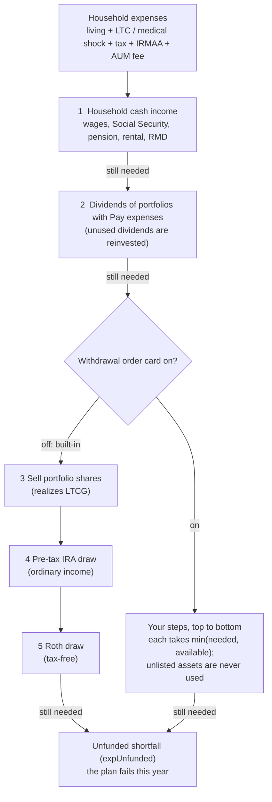

**Expense funding** (household-level; replaces the old per-portfolio withdrawal / tax-drag / own-money waterfall):
- **Expenses** = `expLiving` (`state.living`, flat in today's $, or the post-LTC living amount once LTC has started) + **`expLtc`** (Long Term Care cost, above) + **the year's income tax (`totalTax`, "tax drag")** + the **IRMAA surcharge** + the **AUM fee** (charged on the AUM-checked Living expense & income portfolios, above). Income tax is an expense again, at household level (there is no per-portfolio *tax drag %* input);
  it is charged to the household pool only. Because it depends on this year's LTCG, it is solved by iteration (below), not lagged.
- **Funding order** (portfolio sources are only the in-range portfolios with **Pay expenses** checked — default off, IDGT or not; an unchecked portfolio reinvests all its dividends and is never sold for expenses, and if none is checked the shortfall shows as `expUnfunded`): (1) **household cash income** = wages + Social Security + pension + rental + IRA RMDs (the
  Roth-conversion amount is excluded — it moves to the Roth, it isn't spendable; it is gross, since the tax it triggers is itself one of the expenses), then
  (2) **portfolio dividends** (ODIV of the non-IDGT in-range portfolios), shared pro rata to each portfolio's ODIV — any dividend not
  needed is **reinvested** (adds basis), then (3) **asset sales**, shared pro rata to balance (a portfolio that runs out
  hands the remainder to the others), then (4) **pre-tax IRA** and (5) **Roth IRA** for what the portfolios could not cover. Anything still unpaid is reported as `expUnfunded`.
  Steps 4–5 (in `runWaterfall`): each is shared pro rata across the people's accounts (`drawPro`). Available = the start-of-year balance after the RMD, captured right after `pre(k)` as `iraStart` / `rothStart` (the sims' `post()` runs later), minus this year's conversion for the pre-tax IRA and plus it for the Roth IRA. Only `open` accounts count (owner alive, or inherited by the living spouse; not heirs' stretch accounts). The pre-tax IRA amount (`expFromIra`, per person `iraExpByPerson`, total `iraExpTotal`) is ordinary income: `taxOn(ltcgGross, conv, iraExp)` adds it to `nonSSOrdinary`, so it flows into taxable SS, AGI, MAGI, `ordTI` and the tax, and the tax ↔ expense iteration grosses it up. The Roth amount (`expFromRoth`, `rothExpByPerson`, `rothExpTotal`) is untaxed and not in AGI. Neither is in `cashIncome`, so neither creates `excessIncome`. `iraSim[i].post(k, conv, draw)` and `rothSim[i].post(k, conv, draw)` now run AFTER the final `solveTax`, applying `bal = (bal − conv − draw) × (1+g)` (Roth: `+ conv − draw`); the spouse-inherited paths apply their growth in `post()` too (they set `open=true` with no conversion room). No early-withdrawal penalty or age limit is modeled.
- **Reinvest excess income** (`brokerage[].reinvest`, default off): `excessIncome = max(0, cashIncome − expTotal)`, computed in `computeProjection` right after the tax ↔ LTCG
  iteration converges (so it never feeds back into that year's tax). It is only > 0 when household income covered every expense, so no dividends were used and nothing sold that year.
  It is split pro rata to start-of-year balance across the live, in-range portfolios with `reinvest` checked (IDGT or not; `x.excessIn`), and added at year-end:
  `bal_next = bal×(1+g) − divUsed − sold + excessIn`, `basis_next = (basis − sold×(1−f) + reinvested dividends + excessIn)/(1+inflation)`. With no eligible portfolio the excess
  leaves the model (`excessReinvested = 0`). Row fields: `excessIncome`, `excessReinvested`; per-portfolio entry: `excessReinvested`, `reinvest`. Shown in the asset-chart tooltip (Show details),
  the expense-chart popup (when > $1), the Excel export (main sheet + portfolio sheets) and the chat data (`excess_reinvested`). Stretch years do not model it.
- **IDGT:** follows the same rule as any portfolio — it pays household expenses only if its own **Pay expenses** box is checked (off by default); otherwise it reinvests all its dividends and is never sold for expenses. It keeps carryover basis (no step-up) and its own chart.
- **Realized LTCG** = amount sold × the portfolio's gain fraction `f`, for every portfolio (IDGT on its own sales), feeding
  SCGL → qualified income → AGI → NIIT as before.

**Tax ↔ LTCG iteration** (per year; constants `TAX_TOL = 0.005`, `TAX_MAX_ITERS = 60` in `projection.js`). Tax → expenses → asset sales → LTCG → tax
is circular. `runWaterfall(taxExp)` runs the funding waterfall for a given tax expense and returns the funding split and gross LTCG;
`taxOn(ltcgGross, conv, iraExp)` returns the year's tax (SCGL applied without consuming the pool, AGI, the LTC itemized-vs-standard deduction, ordinary and qualified tax, NIIT, FTC, `totalTax`). The solver:
`T₀` = prior year's `totalTax` (0 in year 0); `Tₙ₊₁ = taxOn(w.ltcgGross, conv, w.expFromIra).totalTax` with `w = runWaterfall(Tₙ)`; stop when `|Tₙ₊₁ − Tₙ| < TAX_TOL`.
Each extra tax dollar produces well under a dollar of new tax (only the gain share of a sale is LTCG, taxed ≤ ~24% with NIIT), so the map is a
contraction and converges in ~6–8 rounds (a pre-tax IRA dollar is taxed at the ordinary rate plus the SS torpedo, still below 100%, so it converges too, only more slowly — hence the 60-round cap). After it settles, the SCGL pool is drawn down **once**, and SST/marginal rate are computed from the converged
LTCG. `expTax` is the tax that was funded; `totalTax` is the tax it produces (equal within `TAX_TOL`). `taxIters` / `taxConverged` report the solve.
The IRMAA surcharge uses the MAGI (AGI + tax-exempt income) from two years earlier — that is IRMAA's real look-back, and it also keeps IRMAA out of the circularity.

**Cost basis & unrealized gain** (every portfolio; average-cost method, all in today's $):
- **Start:** `basis` = `basisPct / 100 × balance`, clamped to `[0, balance]`; a blank basis starts at `basis = balance`
  (no unrealized gain today). **Gain fraction** `f = max(0, (bal − basis) / bal)`.
- **Basis roll-forward, each year:** `basis ← (basis − sold×(1 − f) + reinvested) / (1 + inflation)`, clamped to
  `[0, end-of-year balance]`. Sales remove basis in proportion to cost share (expenses paid by income or dividends remove
  none); reinvested dividends (already-taxed income) add basis; and because basis is a fixed nominal amount while the
  model is in today's $, it **erodes by inflation** each year (so gains — and LTCG on later sales — grow in real terms).
  `balance ← bal×(1+g) − dividends used − sold`.
- **Step-up at death:** in the first year either the owner has passed *and* the portfolio continues to a surviving spouse (`bene`), or
  the portfolio is jointly owned (`bene`) and the owner's **spouse** has passed (`jointSpousePassed`; the owner is still alive; the whole balance
  is treated as joint, i.e. a full step-up as for community property), a **non-IDGT** portfolio's basis resets to its balance (unrealized gain → 0; that year's LTCG is $0). **IDGT** portfolios keep
  carryover basis and are never stepped up. A portfolio that does not continue leaves the model at the owner's death. Real estate follows the same rule (`jointSpouseGone` in the sale paths and the row builder). It happens once (`stepped`); the stretch years then step up again for heirs at the last passing.
- **Asset / basis swap** (`state.basisSwap`, default `false`, and `state.basisSwapYears`, default `BASIS_SWAP_YEARS_DEFAULT` = 3; Tax & Optimizations panel, below SCGL, `renderSwapPanel`, Hide key `ui.assumpHide.swap`): `projection.js` swaps living-expense (non-IDGT) portfolio assets value-for-value with IDGT portfolios (enabled, not dead, funded, tracked), basis moving in proportion to the assets traded: `S = min(living left, total IDGT value left)` prorated across all eligible IDGTs by the value each has left (`S × cap ÷ Σcap`), living basis −= `S × (rL − rI)`, IDGT basis += the same (`rL`, `rI` = basis ÷ balance), only where `rI < rL`; living highest ratio first. Balances do not change and total basis is conserved. It runs at the start of the year (A) for living portfolios whose basis stepped up that year (`steppedNow`, after the first passing; married, no setting) and (B) in row `swapRow` = last passing row (`lastPassRow`) − `basisSwapYears` (≥ 1, ≥ row 0), single or married. A swap is only between portfolios with the same current holder (`holder(i,b)`: the owner while alive; after the owner passes, the spouse if the portfolio's `bene` — the "Joint owned with spouse" box (IRAs and pension: "Inherited by spouse") — is checked and the spouse is alive; otherwise the portfolio is `dead` and skipped). The amount is reported per portfolio as `swapAmt` (asset tooltip under Show details; Excel portfolio sheet "Swapped with IDGT this year").
- **Embedded gain:** each row reports per-portfolio `basis`/`unrealizedGain` and household totals `embeddedGain`
  (non-IDGT) and `embeddedGainIdgt`, all at start of year after any step-up.

**Row schema** (every field on each element of `rows[]`):

| Field | Meaning |
|---|---|
| `k`, `age0`, `ages`, `alive` | Year index, P0's age this row, each person's age, each person's alive flag |
| `filing` | `'married'` or `'single'` for this year |
| `wageByPerson`, `wageTotal` | Wage income |
| `ssByPerson`, `totalSS` | Social Security income |
| `pension`, `pensionByPerson`, `rental`, `rentalByPerson` | Pension/rental income (rental = taxable amount) |
| `rentalDep`, `rentalDepByPerson` | Rental depreciation: non-cash, in `cashIncome`, untaxed |
| `teIncome`, `teByPerson`, `magi` | Tax-exempt interest from portfolios' `teYield`: untaxed (not in AGI, taxable income or the senior-deduction MAGI), in `cashIncome`, added to provisional income (taxable SS) and to `magi = agi + teIncome` (IRMAA). The tax-free part of annuity payouts (`annuityTE`) is cash income only — it is in neither provisional income nor `magi`; per-portfolio entry has `taxExempt` |
| `seniorDeduction`, `seniorEligible` | Enhanced senior deduction applied this year (Schedule 1-A) and how many living people were eligible |
| `odiv`, `qdiv`, `odivNQ`, `odivByPerson`, `qdivByPerson`, `odivNQByPerson` | Dividend income (total, qualified, non-qualified) |
| `ltcg`, `ltcgGross`, `ltcgByPerson`, `scglUsed`, `scglRemaining` | Realized LTCG net/gross of SCGL, and the SCGL pool's state |
| `ftcByPerson`, `foreignTaxCredit` | Foreign tax credit per person and household total |
| `iraByPerson`, `iraTotal`, `iraBalByPerson` | IRA RMD/withdrawal and end-of-year balance |
| `rothConvByPerson`, `rothConvTotal`, `rothInByPerson`, `rothInTotal`, `convCashTotal`, `rothBalByPerson`, `convTrials` | Annual pre-tax IRA withdraw (the solved amount in `bracket` mode; Roth conversion or not), the part of it entering the Roth IRA (`convToRoth`), the part that is spendable cash (adds to `cashIncome`), Roth balance, and the number of trial tax solves the search used |
| `portfoliosByPerson` | Per-portfolio detail: `{id, name, balance, idgt, aum, feeDrag, ltcg, growthPct, netGrowthPct, tracked, basis, unrealizedGain, steppedUp, divUsed, divReinvested, sold}` — the last seven are the cost-basis / expense-waterfall fields (§4.6): `basis`/`unrealizedGain` are `null` when `tracked` is false; `steppedUp` is true only in the year the death step-up applied; `divUsed`/`divReinvested`/`sold` are this portfolio's share of the household waterfall (dividends used, dividends reinvested, shares sold), so `divUsed + sold` is what this portfolio paid toward expenses (household income pays the rest) |
| `embeddedGain`, `embeddedGainIdgt` | Household unrealized gain across tracked portfolios, non-IDGT / IDGT (start of year, after any step-up) |
| `nonSSOrdinary`, `taxableSS`, `provisional` | Ordinary income ex-SS; taxable SS; provisional income |
| `ordIncome`, `std`, `stdDeduction`, `ordTI`, `ordTax` | Ordinary income (incl. taxable SS) → deduction → ordinary taxable income → ordinary tax. **`std` is the deduction actually applied** (the larger of standard and itemized); `stdDeduction` is always the standard-deduction amount for the filing status |
| `ltcStarted`, `ltcCostByPerson`, `agiFloor`, `itemized`, `usedItemized` | LTC (§4.6): how many people's LTC has started (0–2); each person's LTC cost this year (0 if not started or passed); 7.5% × AGI; the itemized deduction `max(0, expLtc − agiFloor)`; whether it beat the standard deduction |
| `qualIncome`, `qualTax` | QDIV+LTCG and its tax |
| `sst`, `marginalRate` | Social Security tax and true marginal rate (torpedo effect) |
| `niiIncome`, `niit` | Net investment income and NIIT |
| `expLiving`, `expLtc`, `expIrmaa`, `expAum`, `expTax` (= `expTaxFed` + `expTaxState`), `expTotal` | Household living expenses (the post-LTC amount once LTC has started); Long Term Care cost; IRMAA surcharge; the AUM fee (all of it — a household expense); income tax paid as an expense (tax drag); their sum |
| `aumBalance`, `aumFee` | AUM balance (start of year) and the total AUM fee charged this year (equals `expAum`). `aumBalance` = `aumBalPf` + `aumBalIra` + `aumBalRoth` + `aumBalInh` (portfolios, pre-tax IRAs, Roth IRAs, inherited IRAs) |
| `taxIters`, `taxConverged` | Rounds the tax↔LTCG iteration took (≥1) and whether it met `TAX_TOL` |
| `cashIncome`, `expFromIncome`, `expFromDiv`, `expFromSales`, `expFromIra`, `expFromRoth`, `expFromRe`, `expUnfunded` | The expense-funding waterfall (§4.6): household cash income available (wage+SS+pension+rental+RMD), and the expense amount paid by income, by dividends, by asset sales, by pre-tax IRA, by Roth IRA, and left unfunded (`expTotal = expFromIncome + expFromDiv + expFromSales + expFromIra + expFromRoth + expUnfunded`) |
| `iraExpByPerson`, `iraExpTotal`, `rothExpByPerson`, `rothExpTotal` | Pre-tax IRA withdrawn / Roth IRA withdrawn to pay expenses (per person and total). `iraExpTotal` is taxable ordinary income (income chart key `iraExp`, "Pre-tax IRA withdraw (for expenses)"; also in the MAGI and taxable-income stacks); `rothExpTotal` is untaxed, not in AGI/MAGI: shown in the funding split and as the income-chart key `rothExp` ("Roth IRA withdraw (tax-exempt, untaxed)", primary chart only — excluded from the MAGI stack via `mKeys`). `buildExpenseAlert` (expenseChart.js) fills `#expenseAlert` (`.unfunded-alert`, bold red, the single word UNFUNDED, in the Annual expenses panel's tools row right of the Rescale button) when any `expUnfunded > 1`; the first/last age, who is living, the year count and the total shortfall are in its Chart Element popup; hidden when nothing is unfunded |
| `irmaaSurcharge` | Household IRMAA surcharge for the year (tier of the MAGI from two years earlier × enrolled people 65+; $0 in years 0 and 1) ; always charged as a household expense (`expIrmaa`) |
| `totalTax` | Final Total Tax: `max(0, ordTax+qualTax−foreignTaxCredit) + niit` |
| `agi` | Adjusted gross income |

Also exported: `displayPersonName(person, idx)` (falls back to `"Person N"`), `p0Name(proj)`,
`ageAxisNames(proj)` (older person's name, then the younger's) and `ageAxisLabel(proj)` (`"Older, Younger age"`, plain text; one person: `"Older age"`) — the X-axis title text of every age-axis chart (Excel header, other charts). On the time-based charts the title is painted in two colours by the `ageAxisTitle` plugin (older name black, younger dark blue).

### 4.6a Spending guardrails (`state.guardrail`, `projection.js`)
Loop-carried state before the year loop: `G` (the settings, or `null` = off and then nothing changes: with it off every row and every chart is identical to before, which `tests/check.js` confirms), `gMult` (multiplier on the discretionary part of living expenses, 1 = the scenario), `gIwr` (initial withdrawal rate; preset from `targetWR` in `target` mode).
**Decision flow** (end of every year; the result applies to the next year):

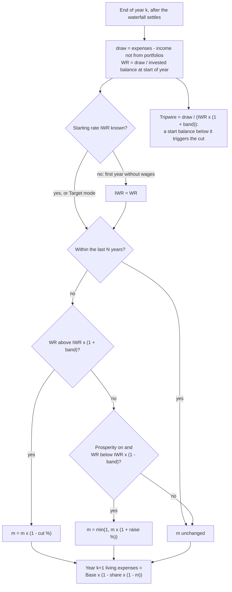

- **Used this year:** `baseLiving = ltcActive ? ltcLiving : state.living`; `expLiving = baseLiving − baseLiving × discPct% × (1 − gMult)`. Only living expenses are cut: LTC, IRMAA, fees and tax are not.
- **Decided at the end of the year, for the next one** (right after the funding waterfall settles, so there is no circularity with the tax iteration): `draw = max(0, expTotal − (excludeLtc ? expLtc : 0) − (wageTotal + totalSS + pension + rental + rentalDep + annuity + annuityTE))` (what the portfolios must fund; independent of which account paid, so planned withdraws and Roth conversions do not distort it), `bal0` = invested balance at the **start** of the year (portfolios, pre-tax / Roth IRAs, open inherited IRAs; the same set as `mcMeasure`'s `fin`), `wr = draw / bal0`. `gIwr` is set by the first year with `wageTotal < 0.5` and `draw > 0`. Then `wr > gIwr × (1+band)` ⇒ `gMult *= 1 − cutPct`; else with `prosperity` and `wr < gIwr × (1−band)` ⇒ `gMult = min(1, gMult × (1+raisePct))`. No decision when `k+1 > lastRowK − sunsetYears`.
- **Row field `guard`** (present only when on): `{mult, nextMult, wr, iwr, bandPct, draw, bal0, move (−1 cut / 0 / +1 raise), cutAmt (discretionary spending given up this year), tripwire = draw / (iwr × (1+band)), cutYears}`. A cut is decided exactly when `bal0 < tripwire`; `guardrail_test.js` asserts that on every row.
- **Consumers:** `mcMeasure` (`guard`: `firstCutK`, `firstCutAge`, `firstCutBal`, `minMult`, `cutYears`, `cutTotal`, `liv[]`), `mcSummarize` (`S.guard`: share of trials that cut, median first-cut age, depth, years, total given up, living-expense fan), `stRunAll` (each result's `guard` incl. `off` = the same scenario with the guardrail switched off), `mcPanel.js` (`mcGuardRows`), `stressPanel.js` (the second table), `excelExport.js` (§6.11). A trial or scenario counts as failed only if even the essential spending cannot be paid, so the success rate must be read with the cut statistics.
- **Not done:** a tripwire line on the asset chart (the data is in `row.guard.tripwire`).

### 4.6b Late-life medical shock (`state.medShock`, `projection.js`)
Right after the LTC loop: when enabled, the chosen person (`person`, 0 or 1; 0 if single) is alive and `age ∈ [age, age+years)`, `expMed = cost` is added to `ltcCostByPerson[person]` and to `expLtc` — **not** to `ltcStarted`, so living expenses do not switch to the LTC amount. Because it sits inside `expLtc`, it reaches `expTotal`, the itemized deduction (`max(0, expLtc − 7.5% AGI)` inside `solveTax`'s iteration, so the gain → AGI → deduction circularity is solved as for any LTC cost), the California medical deduction, the funding waterfall / withdrawal order, the expense chart (legend "Long Term Care / medical shock" while enabled) and the Excel sheet with no further changes. The row has `expMed` only in shock years; `mcMeasure`'s `ltcAtFail` subtracts it, so a failure caused by the shock is not reported as a care event. Monte Carlo trials keep the shock as entered (random timing / size is not modelled; use the Random Long Term Care group). Stress diagnostic: `stMedRun` (§11.7).

**Where the cost goes** once `expMed` is set:

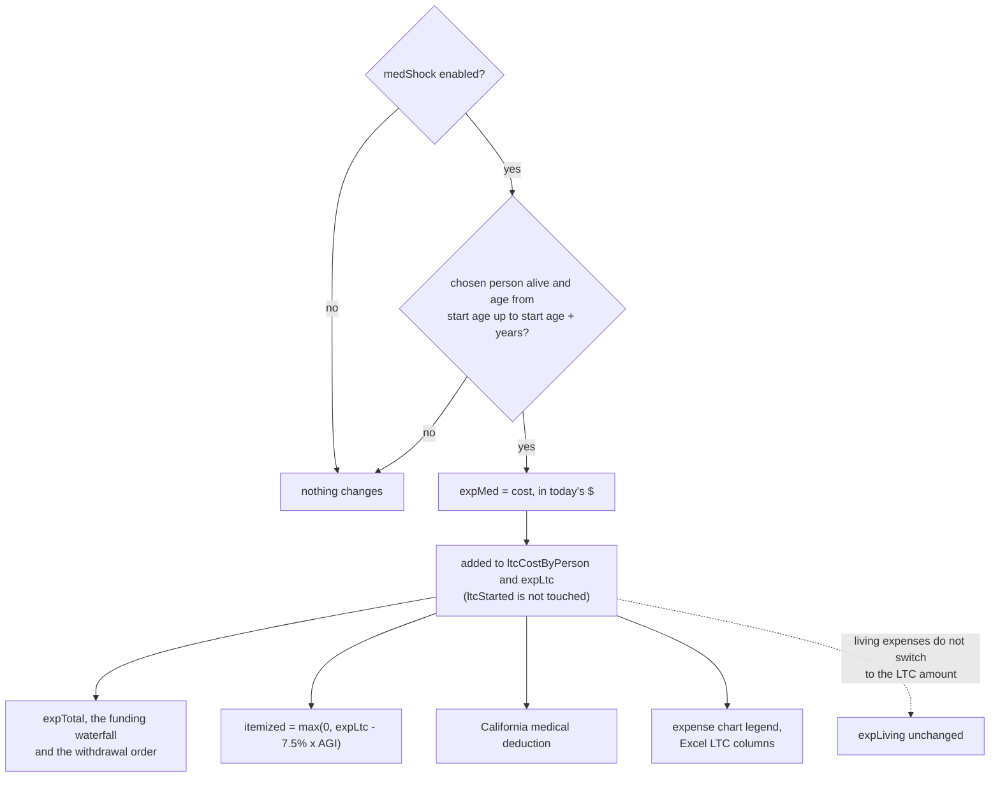

### 4.7 `whatIf.js`
**Purpose:** runs the projection engine against a *temporary* clone of `state`, without touching the
real `state`, real inputs, or any on-screen chart — used exclusively by the SS breakeven chart (§6.3).
| Export | Contract |
|---|---|
| `pickIdxP0FromState()` | Which person index is P0, from the real `state` |
| `withTempState(mutator, fn)` | Clones `state`, applies `mutator` to the clone, runs `fn(tempState)`, restores the real `state` (built on `withState(st, fn, adopt)` in `whatIf.js`, the one place the global `state` is swapped; it restores in `finally`) — used so `computeProjection()` can be called with a hypothetical without any side effects |
| `computeSSScenario(claimAge)` | Runs a full projection with P0's SS claim age forced to `claimAge`; returns lifetime household SS total and the per-year series |
| `ssROI(scenarioA, scenarioB)` | Real annualized ROI of choosing one claiming age's cash flows over another's |

---

## 5. Input (`js/input/`)

Every file here renders HTML into the DOM and writes into `state` via `setPath`/`onFieldInput`/
`onNumberInput` (from `controls.js`). None of them compute anything beyond what's needed to render a
default or a label — all real computation happens in Compute (§4).

### 5.1 `controls.js` — shared widgets
| Export | Contract |
|---|---|
| `onFieldInput(path, val)`, `onNumberInput(path, val)` | Generic `setPath` + recompute + autosave, used by nearly every input in the app |
| `renderChangeRow(path, change, defaultPct?, fixedLabel?)` / `onChangeMode(...)` | Renders/handles the shared **Annual change** selector (§2 `Change`) |
| `renderAgeRangeRow(path, ar, startOptions, endOptions)` / `onAgeRangeMode(...)` | Renders/handles the shared **Age range** selector (§2 `AgeRange`) |
| `toggleItem(el)` | Expand/collapse an element with no persisted state of its own — currently only the outer "Brokerage portfolio income" section header (§5.4), which has no single enabled/hidden flag of its own since it's a container for multiple portfolios |
| `cardHeader(title, enablePath, enabled, hidePath, hidden, extraRight?)` | **The enable/hide header every income-source card uses** (§2's `enabled`/`hidden` convention). Renders an Enable checkbox (left, wraps `title`) and a Hide checkbox (right, labeled "Hide"), with `extraRight` (e.g. a brokerage portfolio's Remove button) placed between them. Every card in §5.4 calls this instead of hand-rolling its own header. |
| `onEnableToggle(path, checked)` | Sets `enabled`, then `recompute()` — does **not** touch the card's collapsed state; enabling/disabling never changes what's on screen, only what's computed |
| `onHideToggle(path, checked, itemEl)` | Sets `hidden`, then toggles that item's `.item-body`'s `open` class directly (no recompute — hiding is purely visual, so there's nothing to recompute) |
| *(chart Hide handling moved to `display/chartPanels.js`, §6.1a; `controls.js` no longer owns section Hide or the Asset Value devalue sliders, both removed)* | |
| `pairHtml(id, path, min, max, step, value, bounds?, moneyCls?)` / `onPair(id, path, val, src)` / `setPair(id, v)` | **Paired slider + number input** that always track each other (ids `<id>_r` range, `<id>_n` number), writing `path` via `setPath`. Dragging the slider sets `window.liveDrag` for that recompute so charts redraw without animation (§6.1); typing uses the debounced recompute. Used for the IRA **Annual Roth conversion** and **Conversion start age** (§5.4) and the LTC start ages (§5.3) |
| `personAgeBounds(i)` / `pairBounds(el)` / `refreshPairBounds()` | Dynamic slider limits. A range tagged `bounds={kind:'person',i}` runs from the person's current age (rounded up) to their passing age; `{kind:'ira',i}` runs 0 → 4 × that person's IRA balance. `refreshPairBounds()` re-applies them to every tagged slider; it is called when birth date, passing age or (for the IRA range) balance change |
| `agedItemCard(pid, key, title, item, checkboxPath)` | Shared card builder for the two income types that are just "amount + age range + change + survivor benefit": Pension and Rental. Calls `cardHeader` internally. |

**Rule:** any new income-type field that needs an age range, an annual-change mode, or an
enable/hide header uses these — don't hand-roll a new version of any of them. A card's body is open
(visible) whenever `!item.hidden`, full stop — never conditioned on `enabled`.

### 5.2 `household.js`
Renders: filing status radios, per-person name/birth year/birth month, read-only current-age display,
passing-age sliders (30–100, default 85/90), inflation slider (default 3%). `relabel()` pushes a name
change into every place a person's name appears (including the LTC panel headers) without a full re-render (so typing doesn't lose
focus). Birth year / month are applied only when they are a real value (year 1920–this year, month 1–12) — partial keystrokes such as "196" are ignored, and `onBirthCommit` restores the last valid value if the field is left invalid. `refreshAgeDependentUI()` updates the read-only age, raises any passing-age slider below the person's current age, and calls `refreshPairBounds()` (§5.1).

### 5.3 `assumptions.js` (+ the General / Expenses / Tax & Optimizations panels in `index.html`)
**Expense shortfall withdrawal order** (`#withdrawPanel`, Expenses card, below Long Term Care; `renderWithdrawOrderPanel()`). Enable = `state.withdrawOrder.enabled`; the first time it is switched on with no steps it is seeded with the built-in order (`defaultWithdrawKeys()`). Each step is a drop-down over the asset list (`withdrawAssets()`: every portfolio, each person's pre-tax IRA and Roth IRA, and every property marked "(sell)" — spouse assets only when married; assets already used in another step are disabled), with ▲ / ▼ (`moveWithdrawStep`), ✕ (`removeWithdrawStep`), and a one-line note of how that asset is taxed or why it would be skipped (disabled asset, IDGT portfolio). **＋ Add step** (`addWithdrawStep`) adds the first unused asset; **Reset to built-in order** (`resetWithdrawSteps`). The card is re-drawn after every recompute (`refreshWithdrawOrderPanel`, skipped while focus is inside it) and after the income forms are rebuilt, so asset names stay current. Compute rules: §4.6.
**Spending guardrails** (`#guardrailPanel`, `renderGuardrailPanel()`) and **Late-life medical shock** (`#medShockPanel`, `renderMedShockPanel()`), two more Expenses cards under the withdrawal order, each a `featureBlock` (`state.ui.assumpHide.guardrail` / `.medShock`, both hidden by default; `ASSUMP_HIDE_DEFAULT`). Fields write with `onNumberInput('guardrail.<field>', …)` / `('medShock.<field>', …)`; the mode select, the check boxes and the person select have their own handlers (`onGuardrailMode`, `onGuardrailFlag`, `onMedShockWho`); `syncAssumpEnable` greys the fields while the card is off, `syncGuardrailFields` the target-rate and raise % fields.
**Three panels (General / Expenses / Tax & Optimizations).** `index.html` has three `.panel.assump-card` panels (no wrapping panel or header). *General* has a **Hide** box in its title (`state.ui.assumpHide.general`; `syncAssumpHide()` in `controls.js` puts its checkbox/body in that state on every `renderAll`): filing-status radios (`name=filingStatus`, `onFilingChange`), the people setup (`#peopleSetup`), inflation slider and passing-age sliders. *Expenses* holds Living expenses (`#livingInput`, always shown) and then the features LTC (`#ltcPanel`), Expense shortfall withdrawal order (`#withdrawPanel`), AUM fee (`#aumPanel`). *Tax & Optimizations* (in this order): State income tax (`#stateTaxPanel`), SCGL (`#scglPanel`), Asset / basis swap (`#swapPanel`), Portfolio withdraw (`#pfWithdrawPanel`, `renderPfWithdrawPanel`), Speculative future exemptions and brackets (`#futureTaxPanel`). These two panels each have a **Hide** box in their title (`state.ui.assumpHide.expenses` / `.taxOpt`, default hidden; collapses the whole panel; also synced by `syncAssumpHide()`), and **every feature in them is also its own card** rendered with `featureBlock(hideKey, title, enablePath, enabled, bodyHtml)` (`controls.js`) — an `.item` card with the income-card header (`cardHeader`): **Enable** on the left (the feature's own flag, e.g. `state.ltc.enabled`; decides whether the projection uses it) and **Hide** on the right (`state.ui.assumpHide[hideKey]`, `hideKey` = `ltc | withdraw | aum | stateTax | scgl | swap | pfWithdraw | futureTax`; collapses only that card's body and is never read by compute). **Every feature card starts hidden** (`ASSUMP_HIDE_DEFAULT`, also what `assumpHidden(hideKey)` returns for a missing flag), on a fresh session, on **Reset to defaults** and for older saves; the Hide state is saved, autosaved and restored like every other `state.ui` flag, and survives the card being re-rendered (`refreshWithdrawOrderPanel` runs after every recompute). Older saves' `assumpHide.expenses` / `assumpHide.tax` are dropped.

The panels in `index.html` hold two household fields, in this order below the passing-age sliders: **Living expenses** (`state.living`, `#livingInput`, $/yr in today's $, `onNumberInput('living', …)`) directly **above** the **SCGL** input (`state.scgl`), followed **below SCGL** by the **AUM fee** (`state.aumFee`): a mode select (`#aumFeeMode`: **% AUM balance** / **Fixed $ / yr**, `onAumFeeMode` resets the value because the units change) and a value input (`#aumFeeValue`, `onNumberInput('aumFee.value', …)`); `renderAumFee()` (in `assumptions.js`) writes both from `state`. AUM balance = sum of the balances of portfolios with their **AUM** box checked (§4.6). `renderAll()` writes both from `state`. The General panel holds the inflation and passing-age sliders. Typing in Living expenses goes through `onLivingInput`, which also updates the **1st LTC living expenses** box while `ltc.living1` is still `null` (i.e. the user has not set it).

**Long Term Care panel** (`#ltcPanel`, between the AUM fee note and the future-tax panel; `renderLtcPanel()` / `onLtcToggle()`): an **LTC** checkbox (`state.ltc.enabled`). When on it shows, per person (one block when single; the person's name is the block header and is kept live by `relabel()`): **LTC start age** (paired slider/number, `pairHtml`, range = current age → passing age, written to `ltc.people.i.startAge`) and **LTC cost** ($/yr, today's $, `ltc.people.i.cost`). Below those: **1st LTC living expenses** (`ltc.living1`; labelled just "LTC living expenses" when single) and, when married, **2nd LTC living expenses** (`ltc.living2`). Compute rules are in §4.6.

Renders the speculative future-tax-threshold panel: a checkbox that, when on, reveals `niitStartYear`
+ `niitSingle`/`niitMarried` (today's $) fields feeding `state.futureTax` (§2), consumed by
`computeNIIT` (§4.3).

### 5.4 Income-source cards
One file per income type; `incomeForms.js` (§5.5) calls each in sequence. **Every card below has an
Enable + Hide header via `cardHeader` (§5.1)** — omitted from the Fields column since it's identical
across all of them; the brokerage row calls it out separately since it applies per-portfolio, not once
for the whole "Brokerage portfolio income" card.

| File | Card | Fields |
|---|---|---|
| `wage.js` | Wage | Age range (default end 65), annual change |
| `socialSecurity.js` | Social Security | Already-started flag (else FRA, default 67), PIA, claim-age slider (62–70, default = FRA or started age) |
| `pension.js` | Pension | `agedItemCard` — amount, age range, change (the fixed option is worded **Fixed $ (no COLA)** here via `renderChangeRow`'s `fixedLabel`; elsewhere **Fixed $ (no growth)**), survivor benefit |
| `rental.js` | Rental income | One card with **＋ Add**; each rental property is a sub-card (name, taxable amount, annual depreciation, age range, annual change, survivor flag, Enable / Hide / **Remove**), like brokerage portfolios; `addRental` / `removeRental` / `onRentalName` in `incomeForms.js` |
| `brokerage.js` | Brokerage portfolio(s) | Add/remove multiple; **each portfolio has its own Enable + Hide header** (name, **age range (start/end) directly below the name**, **start balance**, growth (default inflation+4%), ODIV yield % (default 1.5%), QDIV % of ODIV (default 70%), foreign asset % + foreign tax credit % (default 0.25%) — always active, independent of the AUM box and IDGT flag —, IDGT flag, **AUM checkbox** (counts this balance toward the AUM fee base), **Pay expenses checkbox** (`payExp`, default **off**; only checked portfolios' dividends and sales fund household expenses), **Reinvest excess income checkbox** (`reinvest`, default **off**; receives leftover household income after all expenses, §4.6), **optional cost basis (% of start balance, 0–100; blank = no unrealized gain today)** right under the balance, there is **no** fee, IRMAA, tax drag or withdrawal field on the card (fee and IRMAA are household-level, §5.3) (living expenses are household-level, §5.3), and LTCG has **no input**: the panel just notes that expenses are paid household income → dividends → asset sales, and that sales realize gain from the cost basis —, age range, survivor benefit). A new portfolio's `name` starts blank; both the card title and the name field's placeholder fall back to position-based "Portfolio N", and `onPortfolioName` patches the title live as you type (no re-render, so focus is kept). The outer "Brokerage portfolio income" card itself has no enable/hide of its own — it's just a container with an Add button, collapsed via the older `toggleItem` (no persisted state, since there's no single flag to persist for a container of several independently-enabled portfolios). |
| `realEstate.js` | Real estate | One card with **＋ Add**; each property is a sub-card (name, value, optional cost basis in $, annual change default *Tracks inflation*, *Joint owned with spouse*, **Exemption per owner** (`exempt`, a fixed nominal amount, so `exempt`/(1+inflation)^(k+1) in today's $ at a year-end sale like the basis: taxable gain = value − that × owners alive − basis), **Sell** (`sellMode` never | ltc | passing | age, `sellAge`, `sellTo` portfolio id; `reSellFields` / `onRealEstateSell`), Enable / Hide / **Remove**). No portfolio type, yields, foreign credit, AUM box or age range. `addRealEstate` / `removeRealEstate` / `onRealEstateName` / `onRealEstateBasis` in `incomeForms.js`; each row and stretch row carries `realEstateByPerson[person][property] = {balance, basis, unrealizedGain, steppedUp, growthPct, sold, soldValue, soldBasis}` for the asset chart. A sale (`reSaleRow` in `computeProjection`) goes in three steps: basis stepped up if the owner passed; the gain is added to `ltcgGross` (`reGainTotal`, so it is taxed through `taxOn` with the SCGL shield) and the tax it adds (`reSaleTax` = TT with − TT without the gain, computed in `solveTax`) is paid out of the sale, so the waterfall funds only `totalTax − reSaleTax` (`expTax`); the net value is added to the target portfolio's `pfState` (`bal`, `basis`, 100% basis) and the property is dead. Age / LTC sales (`reSales`) are made at year-end and arrive next year (`saleIn` → the portfolio entry's `reSaleIn`); a 'passing' sale is at the start of the last row, stepped up, no gain. Rows carry `reSaleGain` / `reSaleTax`; the property entry carries `sale:{valEnd,basEnd,gain,tax,net}` |
| `ira.js` | Pre-tax IRA / 401(k) | Balance, age range (default start = RMD age), growth (default inflation+3%), survivor benefit, **IRA stretch** checkbox, **Annual withdraw** (label formerly "Annual Roth conversion"; the **Withdraw is Roth conversion** checkbox `convToRoth` sits under the amount; dropdown: **$/yr, today's $** = paired slider + number, range 0 → balance, initial 0, `onIraBalance` re-ranges it and clamps the value when the balance is lowered; or **Below IRMAA & tax brackets** = two discrete sliders side by side (`convSliderHtml` / `onConvStop`), ordinary bracket and IRMAA bracket (Part B %), `onConvMode` re-renders) and **Withdraw start** (formerly "Conversion start"; dropdown: **RMD start (age N)** default, Now, Custom age; the paired age slider shows only for Custom; conversions begin at the later of the chosen age and the current age, §4.6) |
| `roth.js` | Roth IRA | Balance, growth (default inflation+3%), survivor benefit — no withdrawal fields; grows, fed by the linked IRA's conversion, and is withdrawn only as the last-resort expense source (after the pre-tax IRA) |

### 5.4a `annuity.js` — Annuity card

`buildAnnuityCard(pid,i,p,married)` renders one card per `person.annuities[]` entry (same Enable/Hide/Remove header as portfolios): name, `value`, optional `premium` (null = value), `growth` (annual-change spec, default custom 4% nominal, **net of fees**), `ar` (payout Start–End, default custom 67 → passing), `payoutMode` (`'fixed'` nominal $ `payout` | `'pct'` `payoutPct` of account value), `tax` (`'lifo'` default | `'exclusion'` | `'taxable'` | `'exempt'`, with `exemptPct`), `pb` passing benefit (`'value'` default | `'fixed'` with `pbFixed` | `'initial'`) and `bene`. Handlers (`addAnnuity`, `removeAnnuity`, `onAnnuityName`, `onAnnuityOptional`, `onAnnuitySelect`) live in `incomeForms.js`. The model is `simulateAnnuity` in `projection.js` (run once up front per annuity; independent of tax). Row outputs: `annuity` / `annuityTE` (+ `ByPerson`), `annuityBalance`, `annuitiesByPerson[i][ai]` = `{balance, payout, taxable, taxFree, taxableEmbedded, passing:{amount,taxable,taxFree,option}|null, nonQual, live}` (`passing` is set on the contract's last live year). `cashIncome` gets taxable + tax-exempt payouts; taxable goes into `nonSSOrdinary` (non-qualified also into NII); tax-exempt joins provisional income, MAGI and the IRMAA look-back. The passing benefit is informational (not household cash flow). The asset chart plots `balance` as an `'annuity'` series on the main chart, haircut by the ordinary-income withdraw cost on `taxableEmbedded`.

### 5.4b `inheritance.js`

The **Inheritance** card (`state.people[i].inheritance`) and the **Inherited IRA** card (`state.people[i].inhIras`); card keys `inheritance` and `inhira` in `INCOME_CARD_KEYS`.

- **State.** `person.inheritance.sources[] = {id, file, importedAt, startYear, assets:[{key, type:'pf'|'re'|'ira'|'roth', label, value, snap, pct}]}`; `pct` defaults to 0. A created asset lives in the normal list (`brokerage`, `realEstate`, or `inhIras = {id, enabled, hidden, name, kind, balance, startYear, growth, rmdStarted, bene, conv…, convToRoth, inh}`) and carries `inh = {file, key, base}` and `startYear`. `base` holds the inherited value of every field in `INH_FIELDS[type]`.
- **Import.** `inhExtractFromState(parent)` swaps the other plan in as `state` (via `withState`), runs `computeProjection()`, and reads the last row: portfolio balance × (1+growth) (the stretch block's balance at the passing), property likewise, IRA / Roth end-of-year balance. `startYear = THIS_YEAR + last.k + 1`. Basis is stepped up (IDGT: carryover %). Annuities are not imported.
- **Identity.** A source is its file name (`inhFileBase`, case-insensitive). Re-importing replaces the snapshot, keeps each asset's `pct`, and calls `syncInheritance(i)`.
- **`syncInheritance(i)`.** For each asset with `pct > 0`: create it, or update it — a field equal to its old `inh.base` value follows the new base; a field that differs was changed by the user and is kept. Assets with `pct = 0` or no longer in the file are removed. Removing a source removes all of its assets.
- **Changed-field flag.** `markInheritedChanges(root)` maps each control to the asset field its handler edits and adds `.inh-changed` (light grey) when it differs from `inh.base`; run after every render and on every `input` / `change`.
- **Compute** (`projection.js`): a portfolio / property with `inh` has no balance before row `inhStartRow(item)`, then arrives at its balance with the stepped-up basis. An inherited IRA arrives in its start row and is emptied by `INH_IRA_YEARS` (10) rows later. The schedule is automatic (there is no withdraw option): with `rmdStarted` (set on import by `inhRmdStarted`: the source plan's last holder was past the IRA's RMD start age, or held it as the surviving spouse; pre-tax only) the current holder takes an RMD every year from year 1 by the Single Life Expectancy table (`SLE_TABLE` in `constants.js`, `sleFactor(age)` in `rmd.js`): fixed-term method — `sm.sle` = the factor for the holder's age in year 1, divisor = `max(1, sm.sle − (k − kS − 1))`; after the holder passes with `bene` the spouse continues the same schedule; year 10 takes the rest; otherwise (and always for a Roth IRA) only year 10 withdraws, everything. Saves lacking `rmdStarted` behave as true. Pre-tax withdrawals are added to `iraW` (ordinary income, cash income); Roth withdrawals go to cash only (`inhRothWd`, not in MAGI). Row fields: `inhIraWdByPerson`, `inhIraWd`, `inhRothWdByPerson`, `inhRothWd`, `inhIraByPerson[i][j] = {balance, live, wd, kind, name}`. Settings it takes from the Pre-tax IRA / Roth IRA cards: the annual-withdraw fields (pre-tax: `conv`, `convToRoth`, `convMode`, `convOrdPct`, `convIrmaaPct`, `convStartMode` ('now' = when inherited, custom age or a trigger), `convStart`, `convStartBracket`, `convStartItemized`) and `bene`. `convToRoth` is not offered on an inherited IRA and the projection ignores it (`hydrateState` forces it `false` on load): an inherited pre-tax IRA's annual withdraw is always an ordinary taxable withdrawal and becomes household cash (`convCashTotal`). Not offered: a start / end age (it starts when inherited, from the year after arrival a pre-tax one also takes an RMD by the holder's age, larger of it and the 10-year schedule) and IRA stretch (the 10 years never extend). Conversions are *units* in the Roth conversion solve (`convUnits`: each person's own IRA, then every pending inherited pre-tax IRA, converted into its holder's Roth IRA; `convMainByPerson` is the part that leaves the people's own IRAs). `bene`: when the holder passes with the spouse alive, `sm.holder` switches to the spouse with the same year-10 deadline; otherwise the account ends. The ira.js conversion helpers (`convSliderHtml`, `convStartTriggerHtml`, `onConvMode`, `onConvStop`, `onConvStartBracket`) take a state path (`people.0.ira` or `people.0.inhIras.2`) so both cards share them.
- **Portfolio Start age.** An inherited portfolio's `ar` is `{startMode:'custom', startVal: inheritance age, endMode:'passing'}` (`inhPfAgeRange`, built in `inhBase`). Changing the inherited-at age (`onInhAge` → `inhFollowPortfolioStart`) and re-imports move `ar` and `inh.base.ar` together while the user has not edited `ar`; a user-edited Start/End differs from `inh.base.ar` and is kept. `inhAlignPortfolioStarts` (called at the end of `hydrateState`) converts an older save's untouched `Now` start.
- **Inherited-at-age field.** The start of an inherited portfolio / property / IRA is edited as the holder's age that year (`inhAgeField` / `onInhAge`): it converts to and from `startYear`, which is still what the projection and the saved file use; a note under the field shows the calendar year. Inherited balances, property values and the stepped-up basis are whole dollars. The Inheritance card has a Hide box (`people[i].inheritance.hidden`, starts hidden, also for older saves).
- **Display.** Income chart bands `inhIra` and `inhRoth`; one Asset-chart band per inherited IRA (`type:'inhira'`). The income chart also splits the annual pre-tax IRA withdraw into **Roth conversion (taxed as ordinary income)** (`rothInByPerson`) and the plain **Pre-tax IRA withdraw** (`rothWdOnlyByPerson` = `rothConvByPerson − rothInByPerson`); both are in MAGI. The Taxable ordinary income chart stacks the Roth conversion and Inherited IRA withdraw bands as well. Row field `convMainByPerson` = the part of each person's annual withdraw that leaves their *own* pre-tax IRA (the rest leaves an inherited IRA); `iraByPerson` / `rothConvByPerson` also include inherited-IRA withdraws / conversions held by that person, so the Excel export subtracts `inhIraWdByPerson` (`ownRmd`) and uses `convMainByPerson` (`ownConv`) for a person's own IRA sheet.
- **Reference lines.** `crowdedBracketKeep` (`chartHelpers.js`) keeps only the bracket / IRMAA / qualified lines that matter: those crossing the stack, the first one above it and the last one below it, at most 3 per filing status, none far above or buried far below. Every bracket, deduction, IRMAA and effective-rate line is thin (`THIN_W` = 1.6) and solid with a thin white line drawn *under* the colored one (`thinLinePlugin`, and the IRMAA overlay); labels sit on a white pill above the pair (`LINE_LABEL_LIFT`), and neighbouring labels are pushed up, never down. The lines on the Social Security (claiming-age) and Social Security tax charts are 1.5 px (the selected start age 2 px, dashed).
- **Excel.** `excelExport.js` also adds reference columns on "Projection by year" — `Inheritance asset income: <component>` (one per non-zero component, `INH_INC_KINDS`) and `Inheritance asset income: total (as on the chart)` — values from `inhIncomeAssets` / `inhIncomeComps`; no formula uses them. It writes one sheet per inherited IRA (`xlsxInheritedIraSheet`: year, holder age, withdraw, EOY balance = `MAX(0, prior − withdraw) × (1 + growth)` as a formula where it reproduces the app, else a value), an Inputs block per inherited IRA, `Inherited IRA withdraw` / `Inherited Roth IRA withdraw` columns on "Projection by year" (the first is in ordinary income and total income, the second only in total income), and two balance columns summed from those sheets by Year. Inherited portfolios and properties already get the normal sheets; their Inputs rows carry a note with the source file and start year.

### 5.4c `liveLink.js` — live link between two open plans (A → B)
Two tabs of the same page, each its own plan, linked through a `BroadcastChannel` (`retirementPlannerLive_v1`; same origin and browser, no server; serve the app from `localhost` or a host — `file://` origins are unreliable for it). The parent plan **A** publishes the snapshot the Inheritance card imports from a file; the heir plan **B**, which has already imported A (source row, `%` per asset, edited fields), refreshes that source from the stream instead of from a re-imported file.
- **Plan slot (`state.js`, `claimPlanSlot()`, awaited first thing in the `DOMContentLoaded` handler in `app.js`).** Each tab uses its own autosave slot: `''` = the 1st app (original keys, so an existing session loads as before), `'2'`…`'9'` further apps, `?plan=NAME` a named slot (`PLAN_EXPLICIT`). `planKeys(slot)` gives the keys (`STORAGE_KEY`, `SCN_STORAGE_KEY`, and `…_ts` = last autosave time); `planApplySlot` switches them. The slot is chosen with the **Web Locks API** (lock `retirementPlannerSlot:<slot>` held until the tab closes; atomic, a crash releases it): ?plan= > the slot this tab used before (`sessionStorage 'planSlot'`, so a reload keeps it) > the 1st app > the first free number. A tab that gets a numbered slot it did not use before starts in the default state; if that slot holds an autosave, `planSlotAsk` (overlay dialog, "Restore previous 2nd app session?", Start fresh is the focused default; the answer *fresh* runs `planSlotWipe`) asks first. A duplicated tab (copied `sessionStorage`) finds its slot locked and takes the next free one. Without Web Locks only `?plan=` separates tabs, and the same-slot warning below applies. The tab title gets the slot label (`planSlotLabel`: 2nd app …). `state.liveId` (default `''`, made on first use by `liveEnsureId`, saved with the plan file) is the plan's identity on the link.
- **Publisher.** `liveAfterRecompute()` (called at the end of `recompute()`) debounces (`LIVE_PUBLISH_MS`) `livePublish()`: `inhExtractFromProj(state, lastProjection)` (the refactored core of `inhExtractFromState`, no second projection run) → `{startYear, assets}`; sent as `snapshot` only when its hash changed **and** a subscriber is alive (`liveSubs`, expiry `LIVE_STALE_MS`).
- **Messages** (`v:1`, sender tab `inst`): `sub` (B → all, every `LIVE_HEARTBEAT_MS`, with `targetId`, `fileName`, `have` = hash B holds), `snapshot` / `pong` (A → B; `pong` when `have` is current), `discover` / `ann` (who is open; also detects two tabs on the same slot → alert), `bye`.
- **Matching.** A source follows a scenario by `liveId`, else — as in the file import — by file name (`saveName` of A, `inhSameFile`); a same-name scenario takes over a stale `liveId` only when the old publisher has not been heard for `LIVE_STALE_MS`. The **Link…** button (`liveLinkClick`) lists the open plans (`discover`) for a manual choice.
- **Applying (B).** `liveSanitize` validates the assets (types, finite numbers, ≤ 200); newest snapshot per source wins (`livePending`); `liveFlush` waits (≤ `LIVE_DEFER_MAX_MS`) while a text/number/range/select box has focus, because `renderIncomeForms()` rebuilds the forms; then `inhApplySource` (keeps `%`, live fields), `syncInheritance(i)` (a field the user changed stays), `renderIncomeForms(); recompute(); saveDebounced()`.
- **State on the source** (`person.inheritance.sources[]`, kept by `inhApplySource`): `live` (`false` = off; absent = on), `liveId`, `liveName`, `liveHash`, `liveChain`. Runtime only (`liveRt`): when the publisher was last heard. A closed A leaves B on its last snapshot ("Waiting for …").
- **One-way guarantee.** A snapshot carries `chain` (the publisher's id plus its own live upstream ids); a scenario refuses a snapshot whose chain holds its own `liveId` (an A ← B ← A loop). B can itself publish to a third scenario (C), because every scenario can publish.
- **UI.** Each source: its own row below the source title (`liveSourceHtml`, class `.live-src`; the status text wraps inside the card): status (`● Live from …` / `○ Waiting for …` / off), **Live** checkbox, **Link…** button. **Live bar** `#liveBar` (index.html, a row of its own under the top buttons, so it is always in the same place; `liveChip()` fills it): hidden without a live link, green while receiving / sending, amber while every source waits for its scenario. Becoming active runs a few pulses (`.attn`, ~6 s); every update sent or received flashes it (`liveFlash`); `prefers-reduced-motion` gets a static outline. The tab title gets a 🔗 prefix while connected (visible from the other tab) and the slot name.
- **Not done.** B → A information (B's `%`) and a remote transport (WebSocket/WebRTC behind `liveSend`/`liveOnMessage`).

### 5.5 `incomeForms.js`

(Hiding a column: `state.ui.hidePerson` = `null | 0 | 1` (married only; normalized in `hydrateState`, cleared by `onFilingChange` and Reset). `renderIncomeForms` adds `hide-0` / `hide-1` to `#perPersonIncome` and `col-hidden` to that person's `.person-col`, whose header row (`.pcol-head`: name, `Hide` button, `Show` tab) stays while every card is hidden by CSS, so ids, handlers, card order and compute are untouched; `setHiddenPerson(i|null)` sets it and re-renders the forms. The vertical tab is absolutely positioned so it does not stretch the subgrid's header row.)
(Card order: `state.ui.incomeOrder` — a permutation of `INCOME_CARD_KEYS`, normalized in `hydrateState` — is shared by all person columns. `renderIncomeForms` builds each column in that order and `dndCard` tags each top-level card with `data-card` and a ⋮⋮ drag handle. Delegated HTML5 drag events on `#perPersonIncome` call the pure `moveIncomeCard`, highlight both spouses' cards of the type, then re-render and save. `dndCardAt` makes the whole income grid a drop zone: over a gap, a column heading or padding it snaps to the vertically nearest card. Display-only: no recompute.)
**Purpose:** orchestrates the person-column(s), calling each §5.4 builder in the same fixed order for
every person-column, so the two-column grid (married) keeps every income type's row aligned via CSS
subgrid. Also owns every handler shared by more than one card: SS-started toggle, SS claim-age slider,
cost-basis % input (`onBasisInput`: blank → `null`, not `0`; clamped to 0–100), survivor-benefit toggle, portfolio name/add/remove.

**Rule:** a handler used by exactly one card lives in that card's own file (§5.4); a handler used by
two or more cards lives here.

### 5.6 `loadMenu.js` — the **Load file ▾** dropdown
Replaces the old single "Load from file" button (now labeled **Load file ▾**, `#loadMenuBtn`). Menu entries:
1. **Choose file from local directory…** → `loadFromFile()` (§3.3).
2. A **Samples** group: one entry per saved-plan JSON in `Samples/`, labeled with the file name minus
   `.json`; clicking fetches `Samples/<name>` and feeds it to `applyLoadedFileText()` (§3.3), so a sample
   loads exactly like a local file (reset → hydrate → collapse disabled cards).

| Export | Contract |
|---|---|
| `discoverSamples()` | Returns the sample file names. Tries **`Samples/manifest.json`** (a JSON array of names — authoritative, required on hosts with no folder listing such as GitHub Pages), then falls back to parsing the server's directory-listing page for `.json` links. Throws if neither is readable. |
| `toggleLoadMenu(ev)` / `closeLoadMenu()` | Opens the menu instantly with the local-file entry, then fills in Samples when discovery resolves; closes on outside click or Escape |
| `buildLoadMenu(menu, samples)` | `null` = still looking, `undefined` = discovery failed (shows an explanation), array = entries. Builds via DOM `textContent`, never HTML strings, so odd file names can't inject markup |
| `loadSample(name)` | Fetch + `applyLoadedFileText`; failures `alert` |

**To add a sample:** put the `.json` in `Samples/` and add its name to `Samples/manifest.json`.
**Limitation:** the browser can't list a folder, and Chrome blocks `fetch` of sibling files under
`file://` — there the Samples group shows an explanatory note, while *Choose file from local directory…*
keeps working.

---

### 5.x Input-card layout rules (`css/styles.css`, "Compact input cards" block; `controls.js` `clampNotes`)
- **Containers are named.** The input column is `container: col`, every `.item` card is `container: card`, the General panel's `.person-col` is `pcol` (inline-size containers). Queries must name theirs (`@container col (max-width:560px)`, `@container card (…)`): an unnamed query matches the *nearest* container of any name.
- **Nothing leaves its card.** `cardHeader` wraps the title in `<span class="ttl">` (flex-shrink, ellipsis) so a long name never pushes Remove / Hide out; `.btn` never wraps; the Hide box has room for its focus ring and the ring shows for keyboard focus only (`:focus-visible`).
- **Input sizes.** Money ≤ 10.5em, other numbers ≤ 9.5em, number inputs with a placeholder ≤ 11em; `.field.inline` = label left, 128px input right (single-number fields: living expenses, LTC cost, SCGL, swap years); `.field.align-end` keeps paired fields whose labels wrap differently on one input line; Custom % / Custom age sit beside their select (`.arow` does not wrap).
- **Narrow cards.** `@container card (max-width:330px)`: the 2-column field grid becomes one column; `(max-width:420px)`: the two bracket sliders (`.conv-sliders`) stack. General panel person box ≥ 430px: Name · Birth year · Birth month · Current age on one row.
- **"not used".** An unchecked enable box prints "not used" after the card title (`:has()` rule on the title label), so an empty partner card is explained; the two-partner rows stay aligned (subgrid) — cards are never sized independently.
- **Long notes.** `.item-note` / `.cn` text of 170+ characters is clamped to two lines with a More / Less button (`clampNotes`, one `MutationObserver` over `perPersonIncome`, `assumpGeneral`, `assumpExpenses`, `assumpTax` started by `initNoteClamp()` in `app.js`); printing shows the full text.
- **Inheritance card.** Each asset row: name and % box on one line (styled like the other fields), its detail on a muted line below (`.inh-asset` grid).
- Layout was verified in headless Chrome (married and single, narrow and wide input columns): no element extends past its card.

## 6. Display (`js/display/`)

Every chart here reads projection rows (§4.6) — nothing here reads `state` directly, and nothing here
computes a number the projection doesn't already provide (chart-local formatting/aggregation for
presentation is fine; new financial logic is not).

### 6.1 `chartHelpers.js` — shared conventions (read this before touching any chart file)

**Equal plot widths:** every chart's left Y axis has the same fixed width (`Y_AXIS_W`, via `afterFit` in `upsertLineChart`) and every chart reserves the same right strip (`RIGHT_PAD`; on the Total tax chart that strip is the rotated title of its hidden 0–100 effective-tax-rate axis, `y1`, which has no tick labels), so all X axes are exactly the same width.

**Chart panels:** every chart is in its own panel on a 2- or 3-column grid (§6.1a) with its own **Hide** checkbox, **Rescale** button and drag handle. There are no legends, notes or explanatory text anywhere in the chart area (`legendItem`/`hasValue` and every `#…Legend` / `#…Note` element are gone); the only text besides the panel title is the red *unfunded expenses* alert inside the Annual expenses panel. All charts use the compact axis labeling (≤7 age labels, ≤5 $ labels in $k / $M, `yAxisTicks`) and the external HTML popup (`externalTooltip`), since every panel is at most half of the chart area wide.

**Age range box.** `#ageRangeInput`, left of `#gridToggle` in `#scaleBar`: `onAgeRangeInput` stores `state.ui.maxAge` (null = default) and calls `renderCharts()`; `syncAgeRangeInput` shows the effective value. Not used by the Excel export.

**Grid size toggle (2×N / 3×N).** `#gridToggle`, a two-state button at the right end of `#scaleBar` (label `Grid: 2×N` / `Grid: 3×N` = the size on screen; `syncGridButton`), calls `toggleGridCols()`: it flips `state.ui.gridCols` between 2 and 3 and swaps `state.ui.chartPos` with `state.ui.chartPosAlt`, so each size keeps its own arrangement (including dragged charts). `layoutChartGrid()` sets the CSS variable `--cols` on `#chartGrid` (`grid-template-columns: repeat(var(--cols,2), …)`, also used by the print layout) and fills the free cells of that many columns with blank drop targets; `chartCols()` is the one place that reads the size. Default layouts (`CHART_DEFAULT_POS_BY_COLS`, `core/state.js`) — **2×N**: expense · income / IRA · LTCG / total tax · asset / taxable ordinary · taxable qualified / MAGI · (blank) / ordinary income tax · QDIV/LTCG/NIIT tax / IDGT · (blank) / cumulative household SS · SS tax. **3×N**: expense · (blank) · MAGI / income · taxable ordinary · taxable qualified / (blank) · IRA · LTCG / total tax · ordinary income tax · QDIV/LTCG/NIIT tax / asset · IDGT · (blank) / cumulative household SS · SS tax. Default Hide: checked for Annual expenses, Annual income, Total tax, Asset value, IDGT value, IRA and LTCG; unchecked (shown) for every other chart.
| Export | Contract |
|---|---|
| `TIP_THEME` / `tipTheme()` | The one fixed popup look (see-through dark background, white text, light border; the former light-to-dark slider and its `tipBg` localStorage key are gone). `TIP_STYLE` uses it as scriptable Chart.js options (built-in tooltips); `externalTooltip`, `chartInfo.js` and the input-element popup read it too. |
| `chartTipOff` | Global flag set by the header's Chart Tooltip menu (`#chartTipSelect`) when it is on None; `externalTooltip` and the `chartInfoGate` plugin draw nothing. `showDetails` is true in Complete mode, `chartInfo` in Components mode (`setChartTip`, `chartInfo.js`). |
| `showDetails` / `viewIrmaaAsTax` / `OVERLAY_COLOR` | The `show_details` flag, the Total Income Tax "view IRMAA as tax" flag, and the single (black) color of every dashed reference line — read live by the charts' tooltips/plugins |
| `mrow`, `tipLines`, `tipPad`, `justifyTip`, `TIP_STYLE` | Tooltip layout: label left-justified, value right-justified |
| `CHART_BASE`, `ageXAxis`, `yAxisTicks`, `fmtAxisK`, `AXIS_COLOR`, `AXIS_TICKS`, `axisTitle` | Shared Chart.js base config — every panel is 1:1; X axis = P0's age from current age to `chartMaxAge` (the Age range box `state.ui.maxAge`, default and cap = last passing + IRA stretch, `chartDefaultMaxAge`; display only) (≤7 labels); Y ticks ≤5, `$k` / `$M` |
| `chartMaxAge()` | The locked X-axis upper bound described above |
| `ageAxisInfo(proj)` / `ageAxisTick(proj,label)` / `passingYears(proj)`, `AGE_C_OLD/YOUNG/YEAR`, `ageXAxis(text, plain)` | **Age-axis model.** The axis stays the older person's age (category labels), but each tick is drawn by `ageAxisTick`: older alive → their age, black; else younger alive → the younger's age (`ages[iy]` at that calendar offset), dark blue; else the last two digits of `THIS_YEAR + k`, red. Offsets come from the first row each person is no longer `alive` (rows end at the last passing, so later years are extrapolated). The callbacks read `lastProjection`, so a loaded Monte Carlo trial / stress scenario uses its own passing ages. `ageXAxis(text,true)` gives plain grey ticks (no chart uses it now; the Social Security chart also has the new axis). `passingYears` feeds the `passLines` plugin |
| `centeredAvg(vals,n)`, `AVG_W` | 5-year centred moving average (window shrinks at the ends, null stays null) used by the Market return and Inflation charts; thick line, same colour as the yearly line |
| `charts` / `allCharts()` | **Chart registry**: one live Chart.js instance per key (`ss`, `income`, `incomeMagi`, `incomeOrd`, `incomeQual`, `tss`, `tax`, `taxOrd`, `taxQual`, `expense`, `asset`, `idgt`, `ira`, `ltcg`), `null` until first drawn. Chart files never declare their own chart variable; destroy/resize walk the registry, so adding a chart means adding a key here, not editing hand-written lists |
| `upsertLineChart(key, {canvasId, labels, datasets, yMax, tooltip, createOptions, refresh})` | The one create-or-update step every chart's builder ends with: the first call builds the chart from `createOptions()`; later calls update it via `updateChartInPlace`, set `scales.y.max`, apply the optional `refresh(options)` (per-render option changes, e.g. the income overlay), wrap `tooltip` in `justifyTip`, and `update()` — with animation suppressed (`update('none')`) while `window.liveDrag` is set, i.e. while a paired slider (§5.1) is being dragged, so charts follow the thumb without lag |
| `chartYMax` / `lockedYMax(key, compute)` / `niceMax(max, floor)` | Per-chart locked Y-max: computed once, then held; `restoreChartYMax()` sets every key from the plan being shown (null when it has none, so Reset to defaults and a file load re-fit). Every one of the charts has its own key and its own natural maximum |
| `SCALE_LINK_GROUPS` / `applySameScale(name)` / `rescaleChart(key)` / `toggleScaleLink(name)` / `captureChartYMax()` / `restoreChartYMax()` | **Scales.** `SCALE_LINK_GROUPS` lists the charts each Same-scale button covers: `incomeExpense` = expense, income, MAGI, taxable ordinary, taxable qualified, IRA, LTCG, inhIncome; `tax` = exactly three charts: total tax, ordinary tax, QDIV/LTCG/NIIT tax (the Annual expenses chart has an income-tax component but counts as income & expense only, and Social Security tax is in no group); `incomeExpenseTax` = all of the income, expense and tax charts above (plus IRA, LTCG and Inheritance asset income); `asset` = asset value + IDGT. A button is a **one-shot action** (`toggleScaleLink` → `applySameScale`): every drawn chart of the group takes the group's largest current `chartYMax`; nothing stays linked afterwards. **Rescale** clears only that chart's lock. Cumulative household SS (`ss`) and SS tax (`tss`) are in no group; the asset & IDGT button leaves IRA, LTCG and SS tax out. A new scenario's starting common scale (`DEFAULT_SAME_SCALE`) is the income, expense and tax charts only. The locked maxima are saved in `state.ui.chartYMax` (`captureChartYMax` at the end of `renderCharts`, `restoreChartYMax` at the start of `renderAll`). `renderCharts()` (app.js): when no income/expense/tax chart has a lock (new plan, Reset, older file) it runs a **dry pass** (`window.dryPass`) and applies `incomeExpenseTax` once so those charts start on one scale. Bracket / IRMAA line datasets on the taxable ordinary and qualified charts are always present (all-null when off-scale) so Chart.js updates in place |
| `popupPersonAgeLines(proj, r)` / `alignToAges(ages, values, labels)` / `ageLabelRange(fromAge, toAge)` | Shared tooltip title (each person's age in the row, or "-" once passed); aligning a series to the locked age labels (missing ages → `null`); building the integer age-label array for the X axis |
| `externalTooltip(context)` | Chart.js `external` tooltip handler used by every chart (title, body, afterBody and footer lines). Chart.js clips its built-in tooltip to the canvas, so this renders the same pre-padded lines (see `justifyTip`) into a floating monospace `<div>` that can overflow the chart, flips left near the window edge, and glides between positions with a CSS transition (appears in place when first shown) |
| `resizeAllCharts()` / `destroyAllCharts()` | `resize()` / `destroy()` every live chart in the registry; `destroyAllCharts()` also nulls each entry. Resize is used after a hidden panel is shown again |
| `updateChartInPlace(chart, labels, datasets)` | Mutates an existing Chart.js instance's data arrays in place (instead of replacing the chart) so points animate smoothly from their prior value instead of resetting to zero |

### 6.1a `chartPanels.js` — chart panels, layout and Same-scale buttons
`CHART_PANELS` lists the 17 panels (key, title, optional extra tool/body HTML). `buildChartPanels()` creates them once inside `#chartGrid` (`index.html`): each is a `.chart-panel` with a title bar (`.cp-head`, the drag handle, plus the **Hide** checkbox), a tool row (**↕ Rescale** → `rescaleChart(key)`; the Total tax panel adds **view IRMAA as tax**) and `.cp-body` holding `<canvas id="<key>Chart">`. Panels are never re-parented (the Chart.js instances hold their canvas); a move only changes the panel's `grid-row` / `grid-column`.
**Enlarged charts.** `chartPos[key].s===2` is a 2×2 block in the 3-column grid (`chartSpan`, `footprintCells`, `chartOccupancy`, `placeBigChart`, `toggleChartBig`). Panels are placed with CSS variables `--gr`/`--gc` (`row / span n`); `.is-big` stretches the panel over both rows and `resizeAllCharts()` sets `maintainAspectRatio=false` for it. `normalizeChartPos` places blocks first (anchor column clamped to ≤1, overlapping blocks lose `s`); row compaction, row insertion and drag/drop are span-aware. Tested by `tests/chart_big_test.js`.


| Function | Contract |
|---|---|
| `layoutChartGrid()` | Places every panel at `state.ui.chartPos[key]` and fills every other cell with an empty `.chart-cell` (blank; dashed only while a chart is being dragged). Always one spare row below the lowest visible chart so a chart can be moved to a new row |
| drag and drop | Dragging starts only from a title bar (so chart hover popups keep working). Dropping on an empty cell moves the chart there and leaves its old cell blank; dropping on another chart swaps the two (`moveChartTo`). Saved via `saveDebounced()` |
| `compactUnusedChartRows()` / `compactPosToAvailable(pos, cols)` | **Starting fresh** (first visit, *Start fresh*, Reset to defaults; called from `app.js` and `resetState()` after the first draw, when `chartAvail` is known) closes every grid row that holds no chart on screen (a chart without a panel: no IDGT, no IRA, no property …), for both the 2×N and 3×N layouts. A Hidden panel still counts as on screen. Charts without a panel get a free cell of their own, never one a shown chart uses. A layout the user arranged or loaded is never compacted. Test: `tests/mc/mc_ui_test.js` |
| `onChartHide(key, hidden)` / `applyChartHide` | Writes `state.ui.chartHidden[key]`; a hidden panel keeps its cell as a title bar (`.is-hidden`; body gets `.sec-hidden`, which print.js lifts). Un-hiding calls `resizeAllCharts()`. Compute and charts keep updating while hidden |
| `expandAllChartPanels()` / `syncChartPanels()` | `renderAll()` runs `expandAllChartPanels()` → `recompute()` → `syncChartPanels()`, so charts are built in visible containers and then each panel's Hide state, grid cell and the Scale buttons are put into the state held in `state.ui` |
| `setChartAvailable(key, on)` | A chart with nothing to draw (no IDGT portfolio, no Roth conversion, Social Security off for the older person) has no panel on screen (`.no-data`); its saved position is kept and its cell is blank |

Default layout (`CHART_DEFAULT_POS_BY_COLS` in `core/state.js`; 17 charts; the chart-key lists `CHART_KEYS` / `CHART_DEFAULT_HIDE_KEYS` are there too):
- **2 × N** (row by row): Annual expenses · Annual income / IRA · LTCG / Total tax · Asset value / Taxable ordinary · Taxable qualified / MAGI · Inheritance income / Ordinary income tax · QDIV/LTCG/NIIT tax / IDGT value · (blank) / **Inflation rate · Market return %** / Cumulative household SS · Social Security tax.
- **3 × N**: Annual expenses · (blank) · MAGI / Annual income · Taxable ordinary · Taxable qualified / (blank) · IRA · LTCG / Total tax · Ordinary income tax · QDIV/LTCG/NIIT tax / Asset value · IDGT value · Inheritance income / **Inflation rate · Market return %** / Cumulative household SS · Social Security tax.
- Hidden by default: expense, income, tax, asset, idgt, ira, ltcg, inflation, market.
- A saved layout whose four cells for Inflation, Market return, Cumulative SS and Social Security tax still hold the previous default is moved to the current default (`normalizeChartPos`); one where any of them was moved by the user is kept.
- The Annual expenses panel's tools row carries the red **UNFUNDED** tag (`#expenseAlert`, filled by `expenseChart.js`); the Market return panel's tools row carries the ◀ ▶ buttons (`#marketNav`, §6.7d). The IRA-stretch alert (`#assetAlert`) sits in the scale-button row.

### 6.2 `overlayPlugin.js`
Chart.js plugins drawing black (`OVERLAY_COLOR`) dashed horizontal lines with label decluttering
(`declutterLabels`): `incomeOverlay` (IRMAA tiers) is registered a second time as `magiOverlay` for the
MAGI chart — lines carrying `pct` are labeled `$<bracket>k +<Part B % over standard>%` — and
The `ordLabels` plugin labels the taxable ordinary income chart's bracket lines at their right ends.
`zeroLine` (enabled per chart with `options.plugins.zeroLine`; on the Inflation and Market return charts) draws a thin solid line at 0%, in `BRACKET_COLOR`, under the data. It is a plugin rather than a grid line because the Y axis has a tick at 0 only when its range happens to land on one; it draws nothing when 0 is outside the axis.
Plugins added for the Monte Carlo trial view (all display only, switched off for the two charts inside the Monte Carlo card by `MC_NO_OVERLAYS`):
- `inhArrival`: a small purple triangle just below the age axis of every time-based chart at the year an inherited asset arrives (always on; it follows the loaded trial's drawn arrival year). The age-axis tick labels are padded 11px lower to make room; the Chart Element popup describes it.
- `ageAxisTitle` also paints the younger person's tick labels (white text on a dark-blue pill, read from the scale's `_labelItems`; `ageXAxis` makes those ticks transparent) and the younger name in the title as a pill. `rescaleChart(which)` (chartHelpers.js): for `market` and `inflation` it cycles `pctScale[which]` through 10…100 (%) as the Y maximum and relabels the button; other charts clear their lock.
- `ageAxisTitle` / `passLines` (every chart built by `upsertLineChart` except `ss`; off in the Monte Carlo and chat mini charts): the two-colour axis title (the axis reserves room with a transparent title, `ageXAxis`) and a 1 px vertical line in the year each person passes (older black, younger dark blue, `passingYears`).
- `ltcBar` colours per year: both people on LTC = dark blue `#1f3a8a`, only the younger person = light blue `#8ec5ef`, otherwise grey `#9a9a9a` (`ltcCounts` returns the count per year plus `.who` and `.youngerIdx`). `stretchTint` takes `{fromIdx,toIdx,label}`: `toIdx` is the last stretch year (10 years), so the red bar no longer runs to the axis end when a trial's passing ages make the axis longer.
- Market return chart: all lines → one thick 5-year-average dataset per asset (`label — 5-year average`); one asset (◀ ▶) → its yearly dataset plus the average. Inflation chart: the trial's yearly line plus a third, thick average dataset (empty on A so the dataset count never changes).
- `abGhost`: while a trial (B or C) is on screen, draws the scenario's (A) lines behind it as thin dashed grey lines. `mcCaptureGhosts()` (mcPanel.js) stores them as (age index, value) points per Y axis, so they survive a resize; the Y axes are fixed across A, B and C (`mcFitBoth`).
- `unfundedYears`: a faint red band behind the data in every year with `row.expUnfunded`, on every time-based chart, so a failure shows on whichever chart you look at and when you flip A / B / C.

### 6.3 `ssChart.js` — Social Security start-age breakeven
Reads: `js/compute/whatIf.js`'s `computeSSScenario` for a fixed set of candidate ages (`VZ_SS_AGES =
[62,64,66,68,70]`). Y axis = cumulative combined household SS, locked. One line per candidate age plus
a dashed line for P0's actual selected age; each line stops once both people have passed. Tooltip:
cursor-intersection only (hit radius 8), monthly SS for all persons, at most one line's data if two
intersect. The per-person age lines (title) and the per-person / total monthly SS lines (body) share one
**left-aligned** value column (labels padded to a common width) rather than `mrow`'s right-justified values.

### 6.4 `incomeChart.js` — Annual household income
Reads rows' `pension`, `wageTotal`, `rothConvTotal`, `iraTotal`, `rental`, `qdiv`, `odivNQ`, `ltcg`,
`ssByPerson` fields. Stack order (bottom→top): **pension, wage, pre-tax IRA withdraw, IRA RMD, rental, rental depreciation (non-cash, untaxed; `rentalDep`), tax-exempt income (`teIncome`),
QDIV, ODIV−QDIV, LTCG, SS(P0), SS(other)**. The primary draws **no** IRMAA lines (they are on the MAGI chart). Y axis locked at $150k default, auto-raises. Tooltip: total income + SCGL remaining always (SCGL is a fixed **today's-$** pool consumed by today's-$ LTCG, so the figure shown is in today's $);
filing status + AGI under `show_details`, plus (when there are expenses) the household expense funding split: total expenses (incl. income tax), paid by household income, by dividends, by asset sales, by pre-tax IRA, by Roth IRA, and any unfunded shortfall.

*Design note:* pre-tax IRA withdraw (the Roth-conversion amount) has its own band, separate from IRA
RMD — it's a real, separately-taxed withdrawal on top of the RMD, so folding it into the RMD band (or
omitting it) would make the visible stack not match what's actually being taxed.

**Four charts, four panels** (§6.1a). Each has its own locked Y scale (`chartYMax.income`, `incomeMagi`, `incomeOrd`, `incomeQual`; natural max = the chart's own largest stack, `niceMax`) shared through the *income & expense* Same-scale button: the primary income chart (top left), the **MAGI chart** (top right), the **taxable ordinary income chart** (bottom left, `#incomeOrdChart`, `charts.incomeOrd`) and the **taxable qualified income chart** (bottom right, `#incomeQualChart`, `charts.incomeQual`, described after the MAGI chart below). 

The taxable ordinary income chart: Its height is `row.ordTI` (ordinary income − deduction, floored at 0); qualified income (`row.qualIncome`, QDIV + LTCG) is deliberately not drawn — it is taxed at its own rates, so it would sit above the ordinary bracket lines without being taxed at them. The bands are the primary's colors and order — pension, taxable annuity, wage, pre-tax IRA withdraw, IRA RMD, rental, non-qualified dividends, taxable SS (per person, as in the MAGI stack) — with the deduction absorbed from the bottom of the stack up, so each band is that source's taxable portion and the bands sum exactly to `ordTI`. It uses the primary's X labels and locked Y scale. The dashed bracket lines (flagged `ordLabel`, black `OVERLAY_COLOR`) are per-year line datasets at each bracket's start (`MFJ_ORD`/`SGL_ORD` `lim`, by that year's filing status), one per start below the Y max, labeled with the rate above (`ordLabels` plugin in overlayPlugin.js, drawing through `declutterLabels`). A red dashed `Deduction` dataset (own stack key `ded`, `DEDUCTION_COLOR`) is drawn at `ordTI` + the absorbed deduction (= `ordIncome`), null when no deduction is absorbed;  Its popup (external HTML tooltip) is the owner/age title lines, each source's full amount, `Deduction`, `Ordinary income before deduction` (the red line's height), `Deduction` and `Taxable ordinary income`. The main popup's Show Details carries `Taxable Social Security`, `Taxable ordinary income`, and, when present, `Qualified income (QDIV + LTCG)` and `Taxable income (ordinary + qualified)`. The MAGI chart: The MAGI chart (`#incomeMagiChart`, `charts.incomeMagi`) plots MAGI as a stack in the primary's source colors and order (same sources, minus untaxed rental depreciation, with Social Security counted at its taxable part only, split between the two people by benefit share; the stack sums to `row.magi`), has its own locked Y scale (`chartYMax.incomeMagi`) and the shared compact axes. It overlays the dashed IRMAA tier lines for the filing status in force (MFJ until the switch, Single after), each labeled with the bracket's MAGI value and the Part B premium increase over standard (e.g. `$218k +40%`; beneficiary share 35/50/65/80/85% vs. 25% standard → +40/100/160/220/240%) (plugin `magiOverlay`, a clone of `incomeOverlay`). The primary's popup still flags the IRMAA tier reached. The MAGI popup (external HTML tooltip) shows the owner/age title lines and then only two lines, regardless of Show Details: `MAGI` and `IRMAA +$x/yr` (surcharge of the tier MAGI reaches; omitted below tier 1) — everything else is in the primary's popup.

**Taxable qualified income chart** (`#incomeQualChart`). Only qualified income is stacked — QDIV (`row.qdiv`) and LTCG net of SCGL (`row.ltcg`), in the primary's colors; ordinary income is not drawn. Qualified income is taxed at 0% / 15% / 20% by where it lands in taxable income, and taxable ordinary income fills the tiers first (`calcQualTax(ordTI, qualIncome, …)`). Each dashed bracket-colored line (`ordLabel`, drawn by the `ordLabels` plugin) is a qualified tax bracket itself: `MFJ_QDIV` / `SGL_QDIV` `lim` (by that year's filing status), labeled with the rate above it (`15%`, `20%`). A line whose values are all above the Y max is not drawn. A red dashed `Deduction` dataset (`DEDUCTION_COLOR`, own stack key `ded`, `ciValues` = the sheltered amount) is plotted at `row.qualIncome` in years where `qualIncome − qualTaxable` > 0.5 (the deduction's excess over ordinary income); the Y max includes it. Popup (external HTML tooltip): owners + ages, one colored line per component (QDIV, LTCG), then — when SCGL was used — gross LTCG and SCGL used, `Qualified income` and `Qualified tax`.

### 6.5 `tssChart.js` — Taxable Social Security
Reads rows' `totalSS`, `sst`, `marginalRate`, `provisional`. Two lines: TSS height and SST height. Y
axis = TSS, locked. Tooltip: TSS, SST, SST% (`sst/totalSS`), top marginal rate always; provisional
income under `show_details`. Surfaces the torpedo effect via the marginal-rate figure.

### 6.6 `taxChart.js` — Total Income Tax
Reads rows' `ordTax`, `qdiv`, `ordTI`, `ltcg`, `niit`, `foreignTaxCredit`, `totalTax`, `agi`. Stacked
segments bottom→top: ordinary tax, then each QDIV bracket tier, then each LTCG bracket tier, then
NIIT — with **foreign tax credit netted out of the ordinary/QDIV/LTCG segments first, in that order**
(a waterfall reduction), so the stack's total height always equals `totalTax`. Overlaid dashed lines:
effective rate (red, `totalTax/agi`); the marginal rate is not drawn as a line (it stays in the popup). Y axis locked, % axis on the right.
Tooltip: Effective Tax Rate, Marginal Tax Rate, **Total Tax** always shown; under `show_details`, also
filing status, TI, the deduction applied (labelled **Itemized deduction (LTC)** in a year `usedItemized` is true, else **Standard deduction**; value `r.std`), every income component, provisional income, foreign tax credit,
and NIIT detail if nonzero.

**"view IRMAA as tax" checkbox** (in the Total tax panel's tool row, next to Rescale; flag `viewIrmaaAsTax`): when checked, an extra `IRMAA surcharge` dataset (`expIrmaa`, null in years with none) stacks above the tax stack as a black dashed line with fill off, the main popup adds `Total tax + IRMAA`, and the Y max is recomputed (`rescaleChart('tax')`) to include it.

**Three charts, three panels.** `taxChart.js` draws the Total tax chart plus two companions (`taxOrd`, `taxQual`), each with its own locked Y scale (natural max = its own stack, `niceMax`), shared through the *tax* Same-scale button. Their popups show the scenario owner(s) and age (the primary's title lines) and then only that chart's own values (no totals; Show Details has no effect). Canvases `#taxOrdChart` (`charts.taxOrd`) and `#taxQualChart` (`charts.taxQual`):
- **Ordinary chart:** the ordinary-income-tax segment only (same color). No bracket lines are drawn on this chart. The chart is titled **Ordinary income tax**.
- **Qualified chart:** every non-ordinary segment — QDIV tiers, LTCG tiers, then NIIT — same colors and stacking order as the primary.

### 6.6a `scenarios.js` — Scenarios
Any number of scenarios (**A**, **B**, **C** … up to 26) behind one **🆎 Scenario** top-bar button (`#scenarioBtn`, label shows the scenario on screen, e.g. "Scenario A"; the first scenario is always A). The scenario on screen is always `state`; every other one is a snapshot in `scnSnaps[id]`; `scnOrder` is the display order, `scnActive` the id on screen, `scnNames` the optional names. The button toggles a popup card floating over the page (`#scnCard`, `position:fixed` at the top right, built by `renderScenarioCard()`, which `recompute()` calls after every edit; Esc or ✕ closes it, it does not dim the page so the chart animation stays visible). Card contents: a chip per scenario (click one → `scnSwitch(id)`), **➕ New scenario** (`scnCreate()`: a copy of the scenario on screen, which is then shown), **🗑 Delete scenario X** (`scnDelete()`: deletes the one on screen after a confirm, one at a time, disabled when only one exists; the previous scenario in order is shown), a name box (`scnRename`), and — with 2+ scenarios — a collapsible list of every input that differs, one column per scenario (`scnDifferences()`, which ignores `ui`, `notes`, ids and Hide flags; **Reset to defaults** calls `scnReset()`, which removes every scenario but A). `scnSwitch()` stores the scenario on screen, loads the chosen one into `state`, keeps `state.ui` (chart Hide / positions / shared scales) from the viewer, and calls `renderAll()` so every input form is rebuilt. The charts are deliberately not destroyed: `upsertLineChart` updates them in place, so Chart.js animates the lines from one scenario's values to the other's (a chart whose dataset count differs between the scenarios falls back to a rebuild for that chart). The chart y-axis maxima (`chartYMax`) are not reset on a switch. `scnSave()` (called from `autosave()`) keeps `{active, order, names, snaps}` in localStorage under `retirementPlannerScenarios_v2` (removed while only one scenario exists); `scnRestore()` runs at boot and migrates the old two-scenario `retirementPlannerAB_v1` save once. **Save** writes every scenario: `saveToFile()` serializes `scnFileData()` — the plain scenario when there is one scenario, otherwise the scenario on screen plus a `scenarios` key `{active, order, names, snaps}`; `applyLoadedFileText()` calls `scnLoadFromFile(parsed)`, which replaces the whole scenario set with the file's (or with a single A when the file has none). `hydrateState` drops the `scenarios` key from the main scenario. Nothing here changes how a scenario is computed.

### 6.6c `userNotes.js` — Notes and Scenario Notes
`openUserNotes('global' | 'scenario')` — two top-bar buttons, **📝 Notes** (right of **Tips**) and **📝 Scenario Notes** (right of Notes), each opening a popup with a text box. **Notes** is global: bound to `state.ui.globalNotes` (`ui` is carried across scenario switches; `globalNotes` must stay in the default `ui` or `hydrateState` drops it). **Scenario Notes** is bound to `state.notes`, so each scenario has its own. Both are saved in the plan file by **Save**, restored on load, autosaved and reset by **Reset to defaults**. **Done**, Esc or a click outside closes it.

### 6.6b `print.js` — Print button
**🖨️ Print** sits right of Export to Excel and calls `window.print()`. Printing behaves as if every Hide checkbox (chart Hides and per-card Hides) were unchecked, with no visible or saved change. `beforeprint`: removes `.sec-hidden`, opens collapsed `.item-body` cards, adds `body.printing-all`, then for every chart in `charts{}` builds a fresh non-animated copy of its config on an off-screen canvas at the print size, copies its pixels onto a plain canvas and shows that in place of the live `<canvas>` (live charts are never resized or redrawn, so no animation/resize timing can blank them; an `` data-URL snapshot isn't used because it decodes asynchronously). `afterprint` undoes all of it. `state` is never touched, so Ctrl/Cmd+P gives the same result. Print layout rules (`body.printing-all …` in `css/styles.css`, deliberately not inside `@media print` because they must apply before print media does): single column; panes flow; income-card grid drops subgrid (it overlapped cards when fragmented); three panels per row; Scale buttons, tool rows, Hide boxes and empty cells hidden.

### 6.6a `expenseChart.js` — Household Expenses
Panel `expense` (`#expenseChart`; the red UNFUNDED tag `#expenseAlert` sits right of the panel's Rescale button). Reads rows' `expLiving`, `expLtc`, `expTax`, `expIrmaa`, `expAum`, `expTotal`,
plus the funding split `expFromIncome`, `expFromDiv`, `expFromSales`, `expUnfunded`. Styled like the tax chart: stacked
filled bands, segments bottom→top: **living expenses, Long Term Care, Roth contribution, payroll tax, federal income tax (tax drag), state income tax (tax drag), IRMAA surcharge, AUM fee** (`expTaxFed` / `expTaxState` split `expTax`; a property sale's tax is shared pro rata), so the stack's
height always equals `expTotal` (the medical shock is inside the Long Term Care band; its legend then reads "Long Term Care / medical shock"). Single $ axis, Y locked (`chartYMax.expense`). Tooltip: one line per non-zero component
with its $ and % of the total; footer shows total expenses and how they were funded (household income → dividends →
asset sales → pre-tax IRA → Roth IRA, plus any unfunded shortfall); under `show_details`, also filing status, household cash income, AGI, AUM
balance, the IRMAA surcharge and the tax↔LTCG iteration count.

### 6.7 `assetChart.js` — Asset value
Reads rows' `portfoliosByPerson` (excluding `idgt` ones), `iraBalByPerson`, `rothBalByPerson`. One
chart for brokerage (ex-IDGT) + IRA + Roth balances, each portfolio/account its own color; a second
chart (only if any IDGT portfolio exists) for IDGT balances alone. Tooltip: age, balances, and (if the portfolio paid anything toward expenses that year) annual growth % net of expenses paid, with the AUM fee charged on the portfolio's balance and LTCG realized shown under `show_details`.
**Asset chart X window.** The main Asset value chart shows the same number of age labels as the IDGT chart (`scales.x.min/max` indices); when the IRA stretch runs past that window, ◀ ▶ buttons (`#assetXScroll`, `scrollAssetX`) scroll it 5 years per click (not saved).

The IDGT chart (`idgt`) is its own panel, absent when no portfolio is IDGT; it shares a scale with the main asset chart through the *asset & IDGT* button. (The former small Roth conversion chart beside the asset chart is gone: conversions are now a band of the IRA chart, §6.7a.)

### 6.7a `iraLtcgChart.js` — IRA chart and LTCG chart
Two stacked-area charts of annual flows in today's $, each with its own panel and its own locked Y scale (`niceMax`, floor $5,000; both are in the income Same-scale groups, `SCALE_LINK_GROUPS`) and the external HTML popup. Both read projection rows only (no recomputation) and use the age axis of the other time charts (`chartRowsAndLabels`: `rows` only, no IRA-stretch years).

| Export | Contract |
|---|---|
| `buildIraChart()` | `charts.ira`, `#iraChart`. Stacks, bottom → top, six kinds (`IRA_KIND_ORDER`, each with a `get(row, i)`): **Annual withdraw** (own IRA: `row.convMainByPerson[i]`, color `VZ.iraW`), **RMD** (own IRA: `row.iraByPerson[i] − row.inhIraWdByPerson[i]`, `VZ.rmd`), **Pre-tax IRA withdraw (for expenses)** (`row.iraExpByPerson[i]`, `VZ.iraExp`), then the inherited-IRA kinds: **Inherited IRA RMD / final withdraw** (`row.inhIraWdByPerson[i]`, `VZ.inhIra`), **Inherited IRA annual withdraw** (`rothConvByPerson[i] − convMainByPerson[i]`) and **Inherited Roth IRA withdraw (tax-free)** (`row.inhRothWdByPerson[i]`, `VZ.inhRoth`); an inherited kind has a band only when it is non-zero. Each kind is split per person when married (label `<name> — <kind>`; the second person's band is the same hue lightened, `iraPersonColor`). A person gets bands when their pre-tax IRA is on or any value is non-zero (e.g. an inherited IRA). The popup lists each non-zero band, then the total per kind and *Total out of IRAs*. Panel absent (`setChartAvailable('ira',false)`) when nobody has an IRA band |
| `buildLtcgChart()` | `charts.ltcg`, `#ltcgChart`. One band per enabled brokerage portfolio (IDGT ones too, labelled `(IDGT)`; `row.portfoliosByPerson[i][j].ltcg`, the exact pre-SCGL gain) plus one **Real estate sale** band (`row.reSaleGain`) when any property exists; colors from `assetSeriesColors` (the asset chart's hue family per person, amber for property). The bands sum exactly to `row.ltcgGross`. When the SCGL pool is used in any year a red dashed line **Net LTCG taxed (after SCGL)** (`row.ltcg`, its own stack id) is added. The popup lists each non-zero band, *Total LTCG realized* and, when SCGL is used that year, *SCGL used* and *Net LTCG taxed*. Panel absent when there is no enabled portfolio and no property |

**IRA stretch (per account):** each pre-tax IRA card and each Roth IRA card has an **IRA stretch** checkbox (`ira.stretch` /
`roth.stretch`, default off; label reads "…until 10 years after the 2nd passing", or "this person's passing" when single). Unchecked
= the account ends as before. Checked = the account is *not* dropped when its owner passes unless a surviving spouse inherits it
(`bene`, unchanged): it is held by heirs — no RMDs/withdrawals/conversions, still compounding at its own real growth rate — through
the last projection row, and then `computeProjection()`'s extra `stretch` array carries it `STRETCH_YEARS` (10) more years
(`{k, stretchYear, age0, ages, alive:[false…], iraBalByPerson, rothBalByPerson, portfoliosByPerson}`; `[]` when nothing carries on). Heir
taxes are not modeled. The pseudo-rows are deliberately *not* in `rows`, so the income/tax/SS charts and the Excel summary never see
them. The **main** asset chart (not the IDGT chart) appends them: stretched IRA bands and every non-IDGT brokerage portfolio still holding a balance in the last row continue (IDGT bands end at the last row), the x-axis is extended past the shared axis end if needed (the one age-axis chart not locked to `chartMaxAge`), and the
tooltip adds "IRAs held by heirs — year n of 10". In stretch years an account that isn't stretched is `null` (not 0), so it draws no line or band; and there is **no gap** at the last passing: a stretched band's line and fill run continuously from the last real year into the first stretch year (the connecting segment is drawn, sloping down over that one year from "everything" to "stretched IRAs only"), while accounts that do not continue end at the last real year. The Excel IRA / Roth sheets append the same years, flagged "After last passing
(heirs)", only for accounts with the box checked.

**Brokerage stretch.** In the 10 stretch years each surviving non-IDGT portfolio (`portfoliosByPerson[i][bi]`, `null` when it doesn't continue)
compounds at its own real growth rate from the last row's balance, with no expenses or withdrawals modeled. Stretch year 1 is the balance at the
passing itself, where basis **steps up to value** (spec §4.6, `steppedUp: true`); from there basis erodes by inflation (`/(1+inflation)` a year) while
value grows, so the unrealized gain in these years is only growth since the passing. A portfolio whose owner died earlier without `bene` is already
gone at the last row and does not appear. The step-up is why the basis line jumps up at the passing.

**Cost-basis line (both charts).** When the chart has any portfolio, an extra dataset **"Brokerage cost basis"** (dashed, dark, `order:0` so it draws on
top, own `stack:'basis'` so it plots at its own value instead of on top of the bands) is the summed `basis` of that chart's portfolios (a portfolio that
doesn't track basis counts at full value). Because brokerage bands are first in the stack, the gap between the line and the top of the brokerage bands is
the unrealized gain. Legend and notes are gone; the tooltip shows "Cost basis (dashed line)" with its % of the brokerage value (`pfValueOf`), and each portfolio that tracks basis gets a "Cost basis (% of value)" line (`e.basis / e.balance`; always shown, not only under Show Details). Both asset charts (non-IDGT and IDGT) share this code (`buildAssetChartFor`).

*Design note:* the Asset Value chart used to have LTCG / ordinary-income "withdraw cost" (devalue) sliders that shaded bands toward after-tax value; they were removed, so every band now shows face value (`valueOf = faceOf`).

**Cost basis (§4.6):** under `show_details` only, portfolios add *Dividends used for expenses*,
*Dividends reinvested*, *Sold to cover shortfall*, *Cost basis* and *Unrealized gain
($ and % of value)* lines to the tooltip on both charts, plus *Basis stepped up at death* in the year of a
step-up.
The "Unrealized gain at end of plan" note and the chart legends were removed with the other chart text.

### 6.7c `inflationChart.js` — Inflation rate chart
- `buildInflationChart()`: `charts.inflation`, `#inflationChart`, panel key `inflation` ("Inflation rate", hidden by default). A dashed grey line, the scenario's constant rate (`state.inflation`, or the loaded trial's mean `cap.meanInfl`), and, while a trial is on screen (view B or C: Monte Carlo trial with Random inflation; D: stress test; E or F: stress + Monte Carlo trial), that view's own yearly rate (`cap.infl.pi[k]`) plus its 5-year centred average. The two lines are named `Monte Carlo trial inflation rate` (B, C), `Stress test inflation rate` (D) or `Stress + Monte Carlo trial inflation rate` (E, F), the average adding ` — 5-year average`; each dataset carries its own Chart Element text in `ds.info`, so a new view needs no entry in `chartInfo.js`. On A the trial dataset stays but is empty, so the dataset list never changes.
- The popup (and the Chart Element text, `chartInfo.js`, `CI_PCT_KEYS`) shows percentages, not dollars, plus the price level relative to the scenario's rate (1.15 = prices 15% above what the constant rate would have given).
- Own Y scale, in no Same-scale group; while a trial is loaded the scale comes from `lockedYMax('inflation', …)` so it is the same across A, B and C.

### 6.7d `marketChart.js` — Market return % chart
- `computeProjection()` records, for every growing asset, the real growth rate the engine used in each year (`proj.rates[k][assetKey]`) and that year's inflation (`proj.inflRate[k]`). Batch Monte Carlo trials switch this off (`REC_RATES`); `mcReplayTrial` turns it on.
- `marketSeries(proj)` → `{keys, at}`: nominal % per asset key and row, `((1 + rate) × (1 + inflRate) − 1) × 100`, `null` outside the years the asset exists. `marketAssetLabel(proj, key)` names a key (`pf:<id>`, `ira:<person>`, `roth:<person>`, `re:<id>`, `inh:<holder>:<name>`): portfolio / property names, "(IDGT)", "Pre-tax IRA", "Roth IRA", "Inherited …", with the owner's name when married.
- `buildMarketChart()`: `charts.market`, `#marketChart`, panel key `market` ("Market return %", hidden by default), one line per asset in `MARKET_COLORS`. Flat in the scenario; in a trial it moves with the market shock (real estate with its own) and with the trial's inflation.
- `marketStep(±1)` (the ◀ ▶ in the panel's tools row, `#marketNav`): cycles All lines → asset 1 → … → All lines. No text beside the buttons (it would resize the card). Display state only, not saved. The Y scale stays fitted to every line; the popup names each line.
- Read-only, own Y scale, in no Same-scale group.

### 6.8 `footer.js`
`renderFooter()` — one static line summarizing the app's simplifying tax/benefit assumptions, shown
beneath the charts. It states the 2026 tax basis (TCJA permanent under OBBBA), that the only itemized deduction modelled is Long Term Care cost above 7.5% of AGI, the NIIT threshold, the expense funding order and tax iteration, and the RMD table. **Keep it in step with Compute:** its IRMAA clause says the surcharge uses the AGI from two years earlier (2-year lookback), matching §4.6.

### 6.9 `formulasPage.js`
Three files: `formulasPage.js` opens the tab and assembles the page (`buildFormulasHtml()`), `formulasCss.js` holds the stylesheet (`fpCss()`), and `formulasSections.js` holds the text, one `fpSec*()` function per part of the page in page order.

(Includes an **Annuities** section — payout, account-value roll-forward, payout tax-treatment and passing-benefit formulas — and describes the Portfolio type and the Asset Value *withdraw cost* sliders.)
`openFormulasPage()` — triggered by the **Formulas** button (§7.2), opens a new browser tab (via
`window.open` + `document.write`, so it works the same under `file://` as on a hosted page) containing
a standalone reference document: the acronym glossary, every current reference-data table, and every
formula described in §4 (including the Long Term Care expense, the living-expense switch and the LTC itemized-deduction vs standard-deduction rule), written out in full for someone to check the app's math against by hand.
Equations are set as centered **display equations**, one per line, like a math textbook (helpers `fpEq`, `fpFr`
for stacked fractions, `fpPw` for piecewise definitions, `fpWhere` for a small "where …" caption); prose sentences
introduce each equation but never carry the math inline.

**Rule — this file must never hardcode a number Compute already owns.** Every reference-data table
on the page (`fpBracketTable`, `fpIrmaaTable`, `fpRmdTable`) is built at open-time directly from the
same `js/core/constants.js` globals Compute uses (`MFJ_ORD`, `IRMAA_MFJ`, `RMD_TABLE`, etc.) — so a
tax-year bracket update in `constants.js` (§3.1) is automatically reflected here with no second edit.
Only the *formula prose* is hand-maintained (formulas change far less often than bracket numbers) —
if you change a formula in §4, update its description on this page in the same change.

The last group, **Monte Carlo simulation and chart rates**, documents the Market return formula `(1 + real growth) × (1 + inflation) − 1` and the Monte Carlo samplers (§10): lognormal return factor, Gompertz lifespans, Long Term Care, AR(1) inflation, inheritance and the success condition.
New sections: **Late-life medical shock** (`f-med`) and **Spending guardrails** (`f-grd`, the withdrawal rate, the cut / raise rule and the tripwire) under *Expenses and how they are funded*, and **Systemic panic (correlation convergence)** (`f-panic`, ρ in a panic year and the exact normalizer M) at the end of the Monte Carlo group. Checked by rendering `buildFormulasHtml()` and verifying every contents link has a target.
### 6.10 `core/markdown.js` and `mdPage.js` (Usage and Tips pages)
**`core/markdown.js`** is the one Markdown → HTML converter of the app, `mdToHtml(md, opts)`: headings (each gets a GitHub-style slug `id`, so `[text](#slug)` links work), bold/italic, inline code, fenced code, links (a `javascript:` / `data:` URL is never made a link; `rel="noopener"`), **tables** (header row, `|---|---|` separator row, body rows; cells may use inline formatting but no `|`), bullet / numbered lists **nested by indentation** (2+ spaces or a tab per level; `-` `*` `+` `•` markers; indented lines under an item continue it), blockquotes, rules, paragraphs. Everything is HTML-escaped first. Options: `breaks` (a single newline is a `<br>`), `flatHeadings` (a heading is a bold paragraph), `tableWrap` (class of a scroll `<div>` around each table), `links:false`, `ids:false`. Extend this function rather than adding a CDN library, so it keeps working offline. It has two users: the pages below (defaults) and the chat bubbles (`chatMarkdown()` in `chat.js`: `breaks`, `flatHeadings`, `tableWrap:'chat-tablewrap'`, `links:false`, because a model reply is untrusted).
**`mdPage.js`** is the shared page viewer: `openMdPage(file, label)` opens a new tab, `fetch`es the `.md` file, converts it **at the moment of opening**, wraps it in `mdPageHtml(title, body, file, label)` (page styles incl. tables) and `document.write`s it; when `fetch` is blocked (a `file://` page) it writes an explanation instead. `openUsagePage()` — the **Usage** button (topbar, immediately left of **Save**) shows `misc/Usage.md`; `openNotesPage()` — the **Tips** button (right of **Formulas**) shows `misc/Note4User.md`. Editing either `.md` file needs no code change — the next click shows the new text.

### 6.11 `excelExport.js`
The export is six files, loaded in this order: `excelWorkbook.js` (cell / sheet builders, formats, widths), `excelTaxSheet.js`, `excelInputsSheet.js` (Inputs sheet, trial context and trial sheet), `excelAccountSheets.js`, `excelMainSheet.js` (the Projection by year columns) and `excelExport.js` (`xlsxBuildWorkbook`, `exportToExcel`).

**Export pipeline.** Each Projection column is either an app value (V) or a live formula (F):

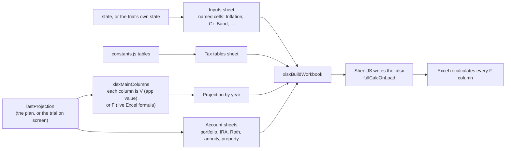

**How the workbook is verified.** The Node tests check structure and cached values; the LibreOffice run checks the formulas themselves.

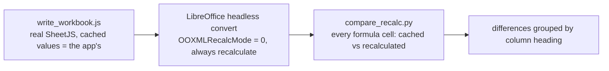

**State tax in the workbook.** `xlsxSelectedState()` returns `'CA'`, `'WA'` or `null` (state tax off). Only that state's scalars, brackets (CA), Projection columns (`stN`/`caTI` for CA, `waGain` for WA) and a single `stateTax` formula are written; the `State_Code` name no longer exists (Inputs shows the state's name as text, `State_On` stays).

**Guardrails and the medical shock in the workbook.** *Inputs* lists both (the guardrail band is the defined name `Gr_Band`, written only when guardrails are on). *Projection by year*: with `proj.rows[0].guard` present, the columns `gMult`, `gDraw`, `gBal0`, `gIwr`, `gMove`, `gCutAmt` are app values and `gWr` (spending ÷ start balance), `gLine` (`IWR × (1 + Gr_Band/100)`), `gTrip` (`gDraw ÷ gLine`) and `gOver` ("Yes"/"No", the rate above the cut line; a zero start balance with spending counts as Yes, as in the engine) are live formulas, so changing the band on Inputs moves the line, the tripwire and the flags (the cuts themselves, and so `expLiving`, stay app values like the rest of the solver's output). With any `expMed` the column `expMed` shows the shock; it is already inside the per-person LTC cost columns, `expLtc` and the `item` (itemized deduction) formula. Tests: `tests/mc/xlsx_guardrail_test.js` (structure, formulas, cached values) and `tests/xlsx_e2e/` (LibreOffice recalculates the file; all ~2,800–3,000 formula cells compared; only three older columns differ, by rounding: *Effective tax rate* 0.0005, *Funding check* and *Income tax paid as expense* under half a cent). **Gotcha:** `soffice --convert-to` does not recalculate an .xlsx unless *Recalculation on file load* is set to *Always* (`OOXMLRecalcMode = 0`); without that a wrong formula passes unnoticed, so check the setup with a planted wrong value (see `tests/xlsx_e2e/README.md`).
(Annuities: summary-sheet columns for taxable / tax-exempt payouts, account value, the taxable part embedded in it and the passing benefit with its split; plus one sheet per enabled annuity via `xlsxAnnuitySheet`.)
Projection-by-year columns for the Taxable Qualified Income chart (before `Qualified tax`): `qLine0` / `qLine15` (the qualified bracket limits by filing status — the chart's two dashed lines; `QD_MFJ_1/2`, `QD_SGL_1/2` names), `qRoom0` / `qRoom15` (limit − `ordTI`, floored at 0) and `qAt0` / `qAt15` / `qAt20` (qualified income in each tier; they sum to `qual` and price to `Qualified tax`). The Formulas page documents the same equations.

Number formats: dollars `$#,##0.00` (9.2), ages `0.0` and percents `0.0%` (3.1; percent-unit numbers such as growth % use `0.0"%"`), years and counts `0`; inflation keeps 2 decimals (its slider moves in 0.25% steps). A numeric table column with no format named defaults to dollars. Column widths are computed (`xlsxAutoWidths`, `xlsxFmtLen`) from the widest formatted number in each column; text-only columns use their longest text (max 70); title and header rows never set a width, so long headers are clipped (SheetJS community edition cannot wrap cells).

`exportToExcel()` — the **📊 Export Excel** button (topbar, right of **Notes**) downloads the plan as a
**live-formula `.xlsx` model** via the SheetJS (`XLSX`) library (pinned CDN `<script>` in `index.html`).
`xlsxBuildWorkbook(proj)` builds every sheet (also used by a Node test harness); the workbook sets `fullCalcOnLoad`.
Sheets, in order (a property gets its own `(real estate)` sheet, `xlsxRealEstateSheet`: value, cost basis, unrealized gain, end-of-year value and, in a sale year, basis at sale, exemption, taxable gain, tax and the amount forwarded; the main sheet's `reVal` / `reGainU` columns sum them by Year; the Inputs sheet lists each property's value, basis, exemption, growth, joint flag and sell settings):
- **Inputs** — every assumption and input value of the saved plan (household, inflation, living, SCGL, AUM fee, future-NIIT,
  LTC, and per person: birth, passing age, wage, Social Security, pension, pre-tax IRA, Roth, every portfolio, annuity, rental,
  real estate). Named cells used by formulas: `BaseYear`, `Inflation`, `SCGL_Start`, `Pass_1`/`Pass_2`, `FutNIIT_On/Start/SGL/MFJ`.
- **Tax tables** — standard / senior deduction, itemized floor, NIIT, SS thresholds, qualified-dividend tiers, ordinary brackets
  (with rate-step column) and IRMAA tiers, all as defined names (`Std_MFJ`, `MFJ_Lo`/`MFJ_dR`, `QD_*`, `IR_*`, …).
- **Projection by year** — one row per year. Row 3 labels each column **formula** or **app value**. App values are what the
  iterative solver produces (income sources, dividends, LTCG gross, SCGL used, foreign tax credit, living / LTC / AUM amounts,
  expense-funding split, excess income, senior-eligible count). Everything downstream is an Excel formula, including SST and the marginal rate (the no-SS and `MargBump` +$100 hypotheticals, columns `sstTI`/`sstTax`/`sst` and `mProv`/`mTSS`/`mTI`/`mTax`/`marg`, built from the same `tssFml`/`senFml`/`ordTaxFml`/`qualTaxFml` builders as the main chain):
  per-category totals, total income, taxable SS, provisional income, AGI, MAGI, deductions (standard / itemized / senior),
  ordinary taxable income, ordinary tax (SUMPRODUCT over brackets), qualified tax, NII, NIIT, Total Tax, effective rate,
  inflation deflator, SCGL remaining, people on Medicare, IRMAA (tier of MAGI two years back × people on Medicare),
  total expenses, expenses paid by income, a funding check, and the IRA / Roth / brokerage balances and unrealized gains
  (`SUMIFS` by Year into the account sheets).
- **One sheet per enabled portfolio / annuity / IRA / Roth** (person order). Portfolio: unrealized gain, basis %, and a
  rolled-forward next-year balance; IRA / Roth: EOY balance roll-forward `(prior − RMD − conversion − expense draw) × (1 + growth)`
  (Roth: `(prior + converted in − sold) × (1 + growth)`) including the 10 stretch years; the real growth rate is derived from the
  Inputs growth mode / value and `Inflation`. A roll-forward formula is written only where it reproduces the app's balance
  (e.g. an account that ends at death stays a value). Annuity sheets are values.
**Monte Carlo trial (`xlsxTrialContext()`, `xlsxTrialSheet()`).** While a trial is on screen (`viewContext().showing`, `display/trialView.js`), `exportToExcel()` calls `xlsxBuildWorkbook(lastProjection, xlsxTrialContext())`. The Inputs sheet reads the trial's own copy of the scenario (`mcTrialView.state`: drawn passing ages, LTC, inheritance). `xlsxTrialSheet()` adds the **MC trial** sheet from `proj.inflRate` and `proj.rates` (recorded by `computeProjection`): `pi` (trial input), `cpi` = prior × (1 + prior `pi`), `defl` = 1 / `cpi`, and per asset (`pf:` / `re:` / `ira:` / `roth:` / `inh:` keys, the same keys `gk()` records) a shock factor `F` (trial input, = (1 + recorded rate) / (1 + scenario rate)) and `g` = (1 + scenario rate) × `F` − 1, where the scenario rate is a formula of the Inputs growth cell (`fixed` / `custom` use that year's `pi`, `offset` uses `Inflation`). The main sheet's `f` (deflator) column reads `defl`; each account sheet gets a `g` column linked to `g` and uses it in place of `$B$2` (so `predicted` in the IRA / Roth / inherited-IRA sheets compares against the per-year rate and the balance chain stays a formula). Heirs' stretch rows keep `$B$2` (the engine compounds them at the constant rate). Two inherited IRAs with the same name share a recorded rate and keep the constant-rate treatment. A scenario (or view A) passes `trial=null` and the workbook is unchanged. Test: `tests/mc/xlsx_trial_test.js`.
Ages are exported unrounded so the 65+ Medicare test is exact. Verified by recalculating the exported workbook in LibreOffice
and comparing every formula cell with the app's value (three scenarios, ~7,000 formula cells, no differences).
Read-only: reads `lastProjection` (§7.1), never writes into `state`. If
`lastProjection` has no rows (no income source enabled) or the `XLSX` library failed to load, shows an
`alert()` instead of downloading an empty/broken file. Sheet names are sanitized and de-duplicated by `xlsxSheetName`
(≤31 chars, no `[]:*?/\\`).

**Limitation:** `fetch` of a sibling file only works when the app is served over `http(s)` (GitHub
Pages, any local static server); Chrome blocks it under `file://`. On failure the new tab shows an
explanation and the two workarounds instead of failing silently. The file also lives at a fixed path
(`misc/Note4User.md`), so it must ship alongside `index.html`.

### 6.12 `chat.js` — "Ask about this scenario" chat box
Three files: `chatSnapshot.js` (the plan as text and the system prompt), `chatProviders.js` (the provider-neutral message list and each provider's request / response shapes, error wording, retry timing) and `chat.js` (settings, the panel UI, sending and streaming).

A floating **💬 Ask about this scenario** button (bottom-right, markup `#chatDock` in `index.html`, hidden in print) opens a
chat panel. Each message goes straight from the browser to the chosen provider's API (`fetch`, streamed — there is no
backend) together with a system prompt that holds a **text snapshot of the current scenario**, so the model can discuss the
user's own numbers. It reads `state` and `lastProjection` (§7.1) and never writes `state` or the main charts; nothing from it
is added to the saved plan file. The model can also **run what-ifs**: it calls scenario tools (§12), the app runs them on a private
copy of the scenario and draws the results as cards under the reply. A scenario reaches the scenario only when the user clicks a button on a card.

**Providers** (`CHAT_PROVIDERS`): **Anthropic Claude** (`x-api-key` + `anthropic-dangerous-direct-browser-access`, paid key)
and **Google Gemini** (`streamGenerateContent?alt=sse` on `generativelanguage.googleapis.com`, `x-goog-api-key` header —
never in the URL; the free AI Studio tier covers Flash / Flash-Lite models only, roughly 10–15 requests/min). The Model box
is free text with per-provider suggestions (`models`), because vendors rename and retire model ids often (e.g. Gemini
`-preview` ids) — when a provider returns "model not found", type the current id. Adding a provider = an entry in
`CHAT_PROVIDERS` + a branch in `chatBuildRequest` and `chatParseEvent`. **Gemini is the default provider** (first in the list); both providers support the scenario tools.

| Export | Contract |
|---|---|
| `buildChatSnapshot(includeNames)` | Household assumptions (JSON: filing status, inflation, living expenses, SCGL, AUM fee, passing ages, and the future-tax threshold when on — `longTermCare` — per-person start age and cost plus the post-1st / post-2nd-LTC living expenses — only when LTC is enabled, only as many people as the household has), each person's **enabled** income sources (JSON, `hidden`/`id` stripped; disabled ones only named), then one **CSV row per projection year** (year, ages, filing, income by type, AGI, taxable SS, marginal %, total tax, IRMAA, expense components incl. `exp_ltc`, unfunded expenses, brokerage / IDGT / IRA / Roth balances — 28 columns, whole dollars, today's $) plus the IRA-stretch tail. Built fresh on **every send**, so answers reflect the inputs as they are now |
| `buildChatSystemPrompt(includeNames)` | Instructions (ground answers in the snapshot, explain rather than recompute, say which input to change for "what if", concise, not financial advice) + a few model facts + the snapshot. Anthropic: one system block with `cache_control: ephemeral`; Gemini: `systemInstruction` |
| `chatBuildRequest(prov,model,key,system,history)` / `chatParseEvent(prov,j)` / `chatReadStream(res,prov,onText)` | Provider-specific request and SSE-event shapes; the reader handles CRLF separators and events split across chunks, ignores Gemini `thought` parts, and normalises the stop reason to `end` / `length` / `blocked:<why>` |
| `sendChat()` / `stopChat()` | Streams the reply into the last bubble; **Stop** keeps the partial text; a failed turn (HTTP error, network, blocked/empty reply) is dropped and the question restored to the input. Errors get plain-language messages (`chatFriendlyError`: key rejected, model not found, free-tier quota). History is in memory only (last 20 messages, always starting on a user turn; Gemini maps `assistant` → `model`) |
| `chatMarkdown(text)` | The shared converter `mdToHtml` (core/markdown.js) with chat options (line breaks, flat headings, scrolling tables, no links). **Everything is HTML-escaped first** — model output is never inserted as raw HTML |
| `chatGetKey(prov)` / `chatSetKey(prov,key,remember)` / `chatLoadPrefs` / `chatSavePrefs` | One API key **per provider** (`CHAT_KEY_KEYS`) in `sessionStorage` (forgotten when the tab closes) or `localStorage` if **Remember** is ticked; prefs `{provider, models:{…}, includeNames, remember}` in `localStorage` under `CHAT_PREFS_KEY` (prefs saved before Gemini support migrate). **Never in `state`**, so never in a plan file or autosave |

**Privacy rules (don't weaken):** the panel says every message sends the scenario to the selected provider; for Gemini it also
states that on Google's free tier prompts/replies may be used to improve Google's products (paid tier: not) — that text is
`CHAT_PROVIDERS.gemini.privacy`; **Preview exactly what is sent** shows the full system prompt; names are withheld
("Person 1/2", portfolio names generic) and birth year/month are never sent (only current age) unless **Send names** is
ticked. **Adding a projection field the model should see** = add a column in `buildChatSnapshot` (header, the row array,
and the "Columns:" line) — the model only knows what the snapshot contains.

---

## 7. App (`js/app.js`, `index.html`)

### 7.1 `app.js`
| Export | Contract |
|---|---|
| `recompute()` | `computeProjection()` → `renderCharts()` — the one place Compute and Display meet |
| `recomputeDebounced` / `saveDebounced` | 80ms / 500ms debounced wrappers, for slider/typing inputs (checkboxes and add/remove buttons call the un-debounced versions directly) |
| `destroyCharts()` | `destroyAllCharts()` (§6.1) plus clearing `lastProjection` — tears down every Chart.js instance — called before a full state restore so no stale tooltip/plugin/hover state survives into a newly loaded plan |
| `renderCharts()` | Calls every §6 chart builder, in this fixed order: SS controls/section, income, TSS, tax, expenses, asset, IDGT |
| `renderAll()` | Full re-render: household setup, passing sliders, inflation/living/SCGL fields, AUM fee, future-tax panel, LTC panel, income forms, footer, then `recompute()` — called on boot and on a full state restore |
| *(boot)* | On `DOMContentLoaded`: load autosave if present, else `defaultState()`, then `renderAll()` |

**Update cycle.**

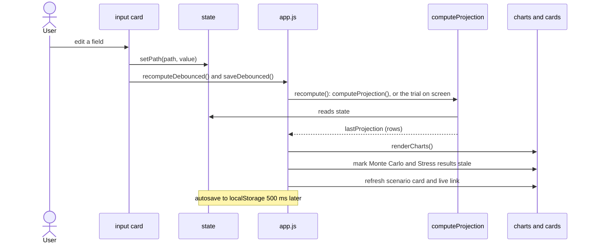

### 7.2 `index.html`

**Script load order** (plain scripts in one global scope, no build step; a file may only use names defined above it):

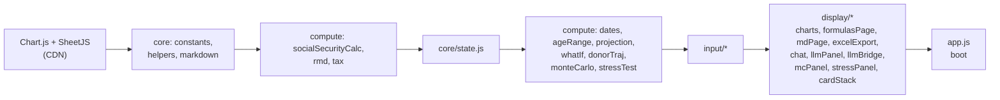

- Page markup only: styling lives in `css/styles.css` (linked in `<head>`), behavior in `js/`.
- Layout: independent-scrolling input column (left, one pane per person) and output column (right,
  the charts) — see §1 for the overall shape. The topbar holds, in order: **Save**, **Load file ▾**
  (dropdown, §5.6), **Reset to defaults**, **Usage** (§6.10), **Formulas** (§6.9), **Tips** (§6.10), **Notes** (§6.6c), **Export Excel**
  (§6.11), and the `show_details` checkbox.
- The chart column starts with `<div class="chart-sticky" id="chartSticky">` (`position:sticky; top:0`, `.chart-col{padding-top:0}`): it holds the Monte Carlo trial card (`#mcTrialBanner`, hidden until a trial is loaded) above the scale-button row, so both stay in view while the charts scroll. `<section id="mcPanel">` (the Monte Carlo card, §6.13) follows the chart grid.
- **Script load order** (dependency-driven — a file may only use a name defined by a file *earlier* in
  this list):
  `core/constants → core/helpers → core/markdown → compute/socialSecurityCalc → compute/rmd → compute/tax →
  core/state → compute/dates → compute/ageRange → compute/projection → compute/whatIf → compute/donorTraj → compute/monteCarlo → compute/stressTest → compute/marketScenario → compute/scenarioSpec → compute/scenarioApi →
  input/controls → input/household → input/assumptions → input/wage → input/socialSecurity →
  input/pension → input/rental → input/brokerage → input/ira → input/roth → input/incomeForms →
  input/loadMenu →
  display/chartHelpers → display/chartPanels → display/chartInfo → display/overlayPlugin → display/ssChart → display/incomeChart →
  display/tssChart → display/taxChart → display/expenseChart → display/assetChart → display/iraLtcgChart → display/inhIncomeChart → display/footer →
  display/formulasPage → display/mdPage → display/excelExport → display/scenarios → display/userNotes → display/print → display/chat → display/llmPanel → display/llmBridge → display/mcPanel → display/stressPanel → display/cardStack → app.js`
- **Adding a file:** insert its `<script>` tag after everything it reads from and before everything
  that reads from it. The `<script>` tags of `index.html` are the *only* script list: `server/scripts.js` reads them for the Node engine (`server/engine.js`), the MCPB build and the tests. A file the headless engine also needs carries `data-engine="base"` (calculation engine) or `data-engine="scenario"` (scenario / run-registry layer); untagged files are browser-only. Function *calls* deferred to a later event (a click, `DOMContentLoaded`) don't
  need this — only code that runs immediately when the script loads (top-level `let`/`const`
  initializers, immediate `addEventListener` calls) does.
- Save/restore UI (buttons for save-to-file, load-from-file, reset) call into `js/core/state.js`
  (§3.3).

---

## 8. Cross-Cutting Conventions

These apply everywhere, not to one file — listed once here instead of repeated in every section above.

- **Today's dollars.** Every number Display ever shows is in today's dollars. A value entered as a
  future year's dollars is converted via `realGrowth()` (§4.6); nothing in Display re-converts.
- **Filing status switches on death.** The moment either spouse has died, `filing` becomes `'single'`
  for that row forward (`projection.js`, step 9) — every tax/IRMAA calculation for that year uses the
  single brackets/thresholds/deduction.
- **Survivor benefit ("bene").** Any income source with a `bene` flag continues to the surviving
  spouse using the *deceased's own age-range rule*, evaluated at the deceased's last living age — not
  cut off by an `endMode: 'passing'` that would otherwise equal the deceased's own passing age.
- **Enable vs. Hide (§2, §5.1).** Every income-source item has both an `enabled` flag (compute/display
  inclusion) and a `hidden` flag (visual collapse only) — fully independent. Compute (§4) and Display
  (§6) only ever check `enabled`; nothing there ever reads `hidden`. Input (§5) only ever uses `hidden`
  to decide whether a card body is open; it never uses `hidden` to skip rendering a field's value into
  its input, since a hidden card's data must remain editable.
  **Reset to defaults** (`applyDefaultHiddenFromEnabled()` in `core/state.js`, §3.3) starts with
  `hidden = true` on every income-source and asset card (enabled or not, and the Inheritance card), and the
  chart grid on 3 columns (`GRID_COLS_DEFAULT = 3`); the charts that start hidden are `CHART_DEFAULT_HIDE_KEYS`. A first-ever boot with no autosave uses `defaultState()` as is.
  **A saved plan is different:** **Load file** and autosave-restore keep every Hide flag exactly as it was
  saved (per card, and `state.ui.chartHidden` per chart panel) — they are never re-derived from `enabled`.
  Only a legacy file that has no `hidden` flag falls back to `!enabled` (§3.3, `fillLegacyHide`).
  A brand-new brokerage portfolio (via **+ Add**) starts enabled and visible.
  **Single source of truth:** every Hide checkbox and the card/section it collapses are derived from `state`;
  nothing reads the checkbox's own DOM state back.
- **`show_details`.** A single global flag (`chartHelpers.js`) every chart's tooltip reads live —
- **Input Element.** Global flag `inputInfo` (`input/inputInfo.js` logic, `input/inputInfoText.js` texts, checkbox `#inputInfoToggle` ("Input Tooltip"), default on, left of the Chart Tooltip menu). Delegated `mouseover` on `II_ROOTS` (`.input-col`, `.chart-col`, `.topbar`) finds the hovered control, derives its label (own label, caption, or card title; card Enable boxes are keyed `ENABLE:<card>`; label-less inputs by element id in `II_IDS`) and looks the text up in `II_FIELDS` (label regex + kind s/c/n). `<select>`s open a custom list (`#iiMenu`) instead of the native popup so each choice shows its `II_OPTIONS` text; picking sets the select and fires `change`. A new input label or drop-down choice needs an entry in those tables. Popup `#inputTip` uses `tipTheme()`; styles are in `styles.css`.
- **Chart Tooltip.** A menu (`#chartTipSelect`: None / Components / Complete; `setChartTip` in `chartInfo.js`) sets the flags `chartInfo` (Components, the default), `chartTipOff` (None) and `showDetails` (Complete). While Components is on, `externalTooltip` draws nothing and `chartInfo.js` shows a text description of the hovered element (found from pointer height) in the same `#extTooltip` div. The text comes from the dataset itself: a dataset carries `info` (a string), and `ciDescribe` just returns it. Each chart file owns its wording and passes `upsertLineChart` an `info(dataset)` resolver (`infoIncome`, `infoTax`, `infoAsset`, … next to the code that builds and labels the datasets; `infoFromTable` in `chartHelpers.js` serves the label-keyed [regex, text] tables), which stamps `ds.info` on every dataset that does not set one; the Inflation, Market and Social Security charts set `info` directly on each dataset. `chartInfo.js` therefore holds no per-chart wording: only the hit-testing, owner / value / age lines and the popup. A new chart or dataset kind gets its text where it is built; `tests/mc/mc_ui_test.js` fails if any line of any chart has none. On a stacked chart, a pointer slightly above the top edge of the stack (`CI_TOP_PX`, 12 canvas pixels, above only, so a thin top band can still be hit) shows the stack total: `ciElementAt` sums the filled datasets of the top band's stack group at that year (not the dashed or cost-basis lines) and `ciShow` titles it from `CI_TOTAL_NAME[chart key]`. A new stacked chart needs an entry in `CI_TOTAL_NAME`; a chart without one never shows a total. Lines within 9 px still win. The popup also shows, when the element has one: the owner of an asset (`ciOwnerText()`, from the dataset's `ciOwnerInfo` `{own, bene, joint}`: both names while joint owners live, the survivor, then `Owner: heirs`), and the value at the hovered year (`ciValueLine()`; `ds.ciValues` overrides `ds.data` where the plotted height is not the value, i.e. the cost-basis lines) with the age of the oldest person alive and their name, or "n years since X passed" (`ciAgeText()`). The Asset Value chart marks the IRA stretch years with a red bar above the plot (`stretchTint` plugin in `overlayPlugin.js`, same row as the LTC bars), and its band fills are opaque so a band keeps one shade wherever the bands above it end. **Overlay elements** (`ciOverlayAt`): the LTC bar (owner line from `ciLtcStartText`: each person on care with their age this year and the age / year care starts), a passing line (`ciPassingAt`, within 4.5 px of the line, from `ageAxisInfo`: name, age at passing, year), the IRMAA tier lines, the stretch bar and the inheritance triangle; the faded red unfunded band (`ciUnfundedAt`) is tried last in `ciShow`, only where no dataset element is under the pointer. **Popup Verbose** (`popupVerbose`, off by default): `ciRender` shows `info.text` in full when on; when off it shows `info.brief` if the element sets one (`''` = no paragraph), else the first sentence (`ciFirstSentence`). A dataset can set `infoBrief` (Inflation and Market lines do) and `ciShow` passes it as `brief`. Ages shown are whole numbers (the projection's ages carry a .75 fraction, so they are floored).
  toggling it needs no chart rebuild, just re-hovering.
- **Locked scales + Rescale.** Every chart's Y axis (and the SS/income charts' X axis) is locked so
  moving a slider doesn't make the chart jump; a per-chart "Rescale" control clears the lock of every chart sharing its scale so the
  next recompute re-fits it.
- **Smooth animation.** Every chart update goes through `upsertLineChart()` / `updateChartInPlace()` (§6.1) rather than
  replacing the Chart.js instance, so points animate from their previous value.

---

## 9. Adding a New Feature — Checklist

Use this order; skipping ahead usually means redoing work.

1. **State (§2):** add the new field(s) to the relevant shape in `core/state.js`'s `default*()`
   functions (this doc's §2 tables need the same addition).
2. **Input (§5):** add the field to the matching card file (or a new one, if it's a new income type —
   see §5.4's table for the pattern), wired via `onFieldInput`/`onNumberInput`/`setPath`.
3. **Compute (§4.6):** thread the new field through `computeProjection()` and add whatever it produces
   to the row schema table.
4. **Display (§6):** if the new number should be visible, add it to the relevant chart's dataset
   and/or tooltip, and note it in that chart's section here.
5. **This doc:** update every section you touched, plus §1's file tree if you added a file.


### 6.7b `inhIncomeChart.js` — Inheritance asset income chart (+ asset-chart warning, IRA chart change)
- `buildInhIncomeChart()`: `charts.inhIncome`, `#inhIncomeChart`, panel key `inhIncome` ("Inheritance asset income"). Stacked by income component (`INH_INC_KINDS`), summed over the inherited assets: inherited IRA RMD / final withdraw (`inhIraByPerson[i][j].wd`), inherited IRA annual withdraw (holder's `rothConvByPerson − convMainByPerson`, shared by balance), inherited Roth withdraw, ordinary (non-qualified) dividends, qualified dividends (`divUsed + divReinvested` split by `qdivPct`), `taxExempt`, realized LTCG (`ltcg`), and real estate sale gain (`realEstateByPerson[i][j].sale.gain` of an inherited property). The popup adds the total per asset. An unsold property adds nothing. Part of the income Same-scale groups. No bracket lines; own Y scale (no Same-scale group); no panel when nothing is drawn.
- `inhIncomeAssets(proj)` (the inherited portfolios, properties and IRAs) and `inhIncomeComps(asset,row)` (that asset's components in a row) are global helpers shared by the chart and the Excel export.
- Default placement: 2×N right of MAGI (r4,c1); 3×N right of IDGT (r4,c2). A saved layout lacking the key gets its default cell when free (`normalizeChartPos`).
- **Asset-chart warning** (`buildAssetAlert`, `#assetAlert`, same red style as the unfunded-expenses alert): shown when an enabled pre-tax / Roth IRA that holds a balance has *IRA stretch* NOT checked (not forwarded to heirs at the last passing); names the IRAs.
- **IRA chart** now has separate bands for inherited IRAs: RMD / final withdraw (`inhIraWdByPerson`), annual withdraw (`rothConvByPerson − convMainByPerson`) and inherited Roth withdraw (`inhRothWdByPerson`); the own-IRA RMD / annual withdraw bands exclude them.


## 10. Monte Carlo (add-on)

Files: `compute/monteCarlo.js` (seeded RNG, samplers, trial runner `mcRunTrial`, `mcReplayTrial`, `mcSummarize`, `mcFailureReasons`, `mcMeasure`; no DOM), `compute/donorTraj.js` (`buildDonorBlock`, `sanitizeDonorBlock`), `display/mcPanel.js` (the card). Notes and the model are in `docs/MONTE_CARLO.md`; the user-facing description is in `misc/Usage.md`.

**One trial.** Every random draw comes from the seed and the trial number, so a trial can be replayed exactly and nothing is stored.

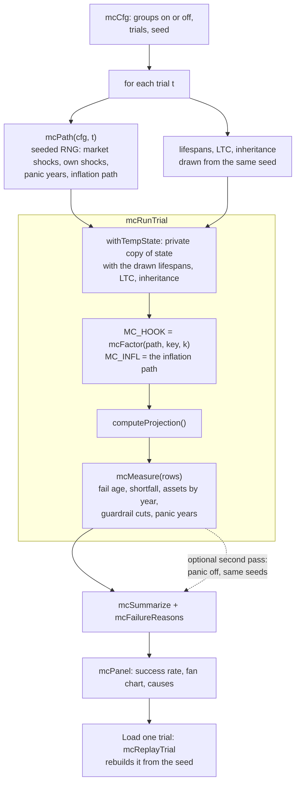

### 10.1 Engine hooks (`projection.js`)
`computeProjection()` re-runs on a temporary copy of `state` (`withTempState`). `MC_HOOK` + `gk()` sit at every growth site (random returns); `MC_INFL` + `cpiAt()/infAt()/growIdx()` replace every constant-rate inflation formula. Both are null in normal use, so the deterministic output is unchanged. Random lifespans, Long Term Care and inheritance replace the matching fields of the private state copy.

### 10.2 Inheritance donor table (`donorTraj.js`)
At import and at every live-link update (`inheritance.js`, `liveLink.js`) the source plan is run once more on a private copy with its LTC off and its last person alive to 110, and `inheritance.sources[].donor` stores each asset's value at the end of every year plus birth dates, planned passing ages and LTC settings (no names). Sources without it stay as planned. See `docs/MONTE_CARLO.md`.

### 10.3 The card (`mcPanel.js`)
- `buildMcPanel()` builds `<section id="mcPanel">`: Hide box (starts collapsed), five setting groups (returns, lifespans, LTC, inheritance, inflation), Trials / Seed, Run / Cancel, then the results (summary, "Why trials ran short", the *Study one trial* row, a fan chart and a funded-share chart). Settings (`MC_DEFAULTS`, plus the Hide box) live in `state.ui.mcCfg` (null = the defaults), so they are saved with the plan file / autosave and restored on load; `mcSaveCfg()` writes them, `mcSyncCfg()` keeps every edit in the card in the scenario, `mcRestore()` (from `renderAll()`) rebuilds the card when the scenario on screen holds different settings than the card shows. `mcStart()` runs trials in ~40 ms chunks on the main thread (so `file://` works). `mcMarkStale()` (called from `recompute()`) flags results that no longer match the scenario (`mcScenarioKey()` = `state` without `ui`).
- `mcResetCard(settings)` drops the results (`mcResults`, `mcStateAtRun`), the loaded trial (`mcTrialClear`), the card's two charts and any run in progress (`mcRun.discard`, so `mcFinish` shows nothing). `applyLoadedFileText()` (file and sample loads) calls it with `true` (results dropped and the card rebuilt from the defaults, collapsed; `renderAll()` then restores the settings the loaded file holds via `mcRestore()`); `resetState()` calls it with `true` too (and `state.ui.mcCfg` goes back to null). Scenario switches do not call it: the stale note covers them.
- The card's two canvases are not chart panels (no Hide / drag / Same-scale); `MC_NO_OVERLAYS` turns the app's overlay plugins off for them.

### 10.4 Trial view: A / B / C

**The four chart views** (display only; nothing is saved with the plan):

```mermaid
stateDiagram-v2
  state "A  Plan as entered" as A
  state "B  Monte Carlo failure" as B
  state "C  Monte Carlo success" as C
  state "D  Stress test" as D
  [*] --> A
  note right of A: Internal view ids; the buttons show other letters (see MC_LET)
  A --> B: load a failed trial
  A --> C: C key, load a success
  A --> D: D key or D button
  B --> A: B key or Back to plan
  C --> A: B key or Back to plan
  D --> A: B key or Back to plan
  B --> B: arrows step failures
  C --> C: C or Shift+C
  D --> D: D or Shift+D
  B --> C: C key
  B --> D: D key
  C --> D: D key
  D --> C: C key
  note right of A: editing the plan or starting<br/>a new run also ends the trial view
```
- `mcLoadTrial(trial)` / `mcLoadSuccess(trial)` call `mcReplayTrial(cfg, i)` (same seed and trial number give the same draws; nothing is stored) and keep it in `mcTrialView = {scenarioProj, key, view, cur, b, c, …}`: `scenarioProj` = A (the scenario as entered), `b` = the failed trial loaded from the study row, `c` = the successful run of the C button. `view` is `'A' | 'B' | 'C'`; `cur` is whichever of B / C was shown last. `mcLoadTrial` is the single entry for "load trial #n": a trial that failed becomes B, a trial that stayed funded (`results[n].failK<0`) is handed to `mcLoadSuccess` and becomes C (a view that does not exist yet is created with `b:null`). The fields of the shown trial (`trial, proj, state, cap, pos, cause`) are also copied onto the view (`mcUseTrial`), so code that reads `mcTrialView.state` / `.cap` works for both.
- `recompute()` (`app.js`): if a trial is loaded and `mcTrialStillValid()` is false (the scenario was edited) it calls `mcTrialClear()`; otherwise `lastProjection = mcTrialShown()` (A → `scenarioProj`, else the trial's `proj`). A new run, editing the plan or **Back to scenario** (`mcTrialExit`) ends the view.
- `mcFitBoth()` fits every chart's Y scale to the largest of A, B and C (a dry pass: `window.dryPass`); `mcCaptureGhosts()` keeps A's lines for the `abGhost` plugin; `chartHelpers.js` never saves a trial's scales into the plan. Rescale refits one chart to what is showing.
- `mcOkTrials()` lists the successful trials (`failK<0`, trial order); `mcCPress()` / key **C** → next, **Shift+C** → previous (`mcCStep`, wraps); key **F** shows it (user-facing letters; internal id `C`). The button letters are remapped in `mcPanel.js` (`MC_LET` internal→shown, `MC_KEY` shown→internal): **A** Scenario, **B** stress test (internal `D`), **C** stress + MC failure (`F`), **D** stress + MC success (`E`), **E** MC failure (`B`), **F** MC success (`C`). Internal ids, `mcTrialView.view/cur`, saved code and tests keep the old ids. Keys follow the shown letters (A = scenario, `mcBPress` / `mcBStep` for E). `mcTrialStep(±1)` (◀ ▶) steps through failed trials while B is on and through successful runs while C is on (greyed out when none).
- The banner (`mcShowBanner`, `#mcTrialBanner`, inside `.chart-sticky`) is one layout for B and C: row 1 is the A · Scenario / B · Failure #N / C · Success switch, ◀ ▶ and Back to scenario; below it is a message block that always has room for two lines, including how many other failed trials share this one's main cause. It stays at the top of the chart column.
- **Who reads the view.** `mcTrialView` is declared in `display/trialView.js` and assigned only by `mcPanel.js`. Everything else (charts, `overlayPlugin.js`, `chartHelpers.js`, `scenarioView.js`, `app.js`, the Excel export) calls `viewContext()` → `{loaded, showing, view, trial, state, ltc, label, fileName}` and never inspects view letters; `trialLabel(v)` / `trialFileName(v)` name a trial for titles and downloads.
- **D (stress tests).** `mcTrialView` also holds `d` (`{trial:-1, proj, state, cap, idx, id, label}`) next to `b` / `c`; `mcUseTrial(v,'D')` copies its fields onto the view like B / C, and `cur` is `'B'|'C'|'D'`. `mcLoadStress(idx)` (D click, ◀ ▶ while D is on, the table's *Show in charts*) calls `stEnsureFresh()` (runs the stress tests when there are no results for the scenario as it is now) then `stReplay(cfg, id)` (compute/stressTest.js: the scenario's projection with rates recorded, a private copy of the scenario, the scenario's inflation path as `cap.infl`, `cap.meanInfl`, `cap.scen`, `cap.start`, `cap.measure`) and loads it as view `D`. It works without Monte Carlo results (B / C are then disabled). `mcDList()` = `stResults.results`; `mcDStep(±1)` wraps; key **D** / **Shift+D**. `mcViewProjs(v)` lists A plus every loaded view for `mcFitBoth` and the Market return chart's scale. Button labels: **A · Scenario, B · Monte Carlo Failure, C · Monte Carlo Success, D · Stress Test**; the card's name is *Stress test card*. The Excel export of D is named `retirement-plan-stress-test.xlsx` (`trialFileName()` in `trialView.js`).

### 10.5 Tests (`tests/mc/`, Node, real engine in a `vm`)
Run from the app folder; plan files are supplied by the caller (no plan data is stored in the tests).
```
PLAN=your-plan.json node tests/mc/mc_test.js
HEIR=heir.json DONOR=donor.json node tests/mc/mc_inherit_test.js
PLANNER_ROOT=. PLAN=Samples/Couple_Heir.json node tests/mc/mc_replay_test.js
node tests/mc/mc_ui_test.js        # card, banner, A/B/C, inflation / market charts, arrival markers, with a stub DOM
```
`mc_runplan.js`, `mc_sweep.js` and `mc_infl_cmp.js` are run-and-print helpers; `mc_harness.js` loads the engine.

### 10.6 Systemic panic: correlation convergence (`returns.panic`)
`MC_DEFAULTS.returns.panic = {enabled:false, rhoPanic:0.9, trigger:-1.5, holdYears:1, includeRE:true, rhoRE:0.5, compare:false}` (the card: group `mcPanic`, `mcReadCfg()` keeps the whole object).
**What `mcFactor` does in a year.** The panic branch is the only place the factor differs from the plain formula.

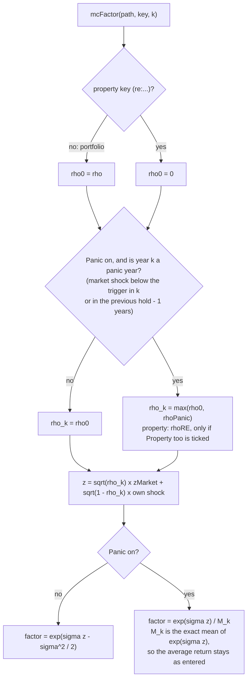

- **`mcPath`** sets `path.panic` (a `Uint8Array`): year k is a panic year if `zMkt[k] < trigger` in k or in one of the previous `holdYears−1` years. It depends only on the pre-drawn market shocks, so `mcFactor(path, key, k)` stays a pure function of `(key, k)` inside one trial (the rule the hooks need).
- **`mcFactor`**: in a panic year portfolios use `rho_k = max(rho, rhoPanic)` and property (with `includeRE`) `max(0, rhoRE)`: `z = √rho_k zMkt + √(1−rho_k)·idio` (property: `zRe` instead of `idio`). Because `rho_k` depends on `zMkt`, `z` is not standard normal and `exp(σz − σ²/2)` would drift off mean 1 (a silent change of the average return). The factor is `exp(σz) / M_k`, `M_k = e^{σ²/2}·[u(Φ(t−σ√ρp) + 1 − Φ(t−σ√ρ)) + 1 − u]`, `u = (1−Φ(t))^{min(k, H−1)}` (`mcPanicNorm`, `mcPhi` by Simpson's rule, both cached). With the group off the original formula runs, so every result is bit-identical to before.
- **Reading ρ.** ρ is the factor-model correlation; measured only inside crash years it looks lower (conditioning on a big drop shrinks the market's variance): with ρ 0.95 two portfolios' realised correlation in those years rises from 0.36 (off) to 0.73 (on). The panic mostly matters through property and through clustered crashes: with all non-property assets at the same volatility and drawn pro rata, raising ρ among portfolios alone barely moves their total. A bond / cash sleeve with its own rising correlation is **not** built.
- **Measures:** `mcMeasure` adds `panicOn` and `panic10` (panic years among the first 10); `mcSummarize` adds `S.panic = {pFirst10, meanFirst10}`; `mcFailureReasons` a factor "A market panic in the first 10 years". `mcStart()` runs, with `compare` ticked, a second pass of the same trial numbers with `panic.enabled=false` (`run.results2`, `mcResults.cmp`) and `mcPanicRows` prints "Same trials without panic".
- **Tests:** `PLANNER_ROOT=. PLAN=Samples/Couple_Heir.json node tests/mc/panic_test.js` (off == old formula; the normalizer equals direct integration; mean factor 1 at several years, hold 1 and 3, portfolios and property; panic frequency; loadings √ρ and residual variance 1−ρ; hold-window frequency; `includeRE` off; a panic ρ below ρ changes nothing; summary / failure factor only when on; reproducible; panic never raises the success rate in aggregate), `medshock_ui_test.js` (card, paired pass, rows).

## 11. Stress tests (add-on)

Deterministic sequence-of-returns / inflation scenarios. Where Monte Carlo (§10) asks "how likely is a shortfall", this asks "does the scenario survive *this* bad decade". Files: `compute/stressTest.js` (no DOM), `display/stressPanel.js` (the card, `<section id="stressPanel">` under `#mcPanel`), `tests/mc/stress_test.js`.

### 11.1 Mechanism (reuses the Monte Carlo hooks, no change to `projection.js`)
- A scenario is `{id, label, note, eq:[nominal yearly stock return …], infl:[yearly inflation …] | null}` placed at start row `start` (years from today). Row `k` uses `eq[k-start]` while `0 ≤ k-start < eq.length`.
- `stRun(scen, start, cfg)` runs `computeProjection()` on a `withTempState` clone with `MC_HOOK = stHook(...)` and `MC_INFL = stInflation(...)`, and restores both (and `REC_RATES`) in `finally`. `stRun(null, …)` is the scenario as entered (hooks null).
- The engine is in today's $, so a nominal return `r` in a year of inflation `π` enters as the real rate `(1+r)/(1+π)−1`; the scenario's price level is the engine's `MC_INFL`, so nominal-fixed items (no-COLA pension, un-indexed thresholds, cost basis, depreciation) follow it. Living expenses, Social Security COLA and indexed brackets are flat in today's $, i.e. they rise with the scenario's inflation in nominal terms.
- Hit assets: every growth key except property (`re:`). `equityShare` % earns the scenario's stock return; the rest keeps the scenario's own *nominal* rate (`fixed` / `custom` growth stay nominal; `inflation ± x` follows the year's inflation, i.e. keeps its real rate). Outside the window the scenario's own real rate is returned unchanged.
- Start row (`start.mode`): `retire` = first row after the last row with `wageTotal > 0` (0 if the scenario has no wages), `now` = 0, `custom` = `start.years`. A start beyond the projection leaves the scenario unaffected (the card says so).

**One scenario run:**

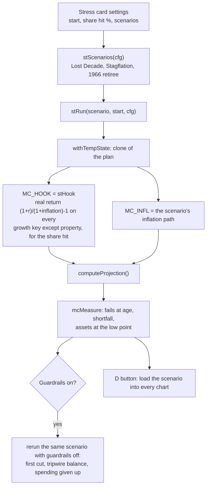

### 11.2 Scenarios (`stScenarios(cfg)`)
| id | what | data |
|---|---|---|
| `lost` | Lost Decade, 2000–2009 | S&P 500 total return (Damodaran, NYU Stern); inflation = the scenario's, or CPI-U if *actual inflation* is ticked |
| `stag` | Synthetic stagflation | `years` (default 10) of a fixed nominal stock return (default 0%) with inflation ramping linearly `inflStart → inflEnd` (default 6% → 11%) |
| `y1966` | 1966 retiree, 1966–1981 | S&P 500 total return and CPI-U Dec/Dec (BLS), both actual |
Historical arrays live in `ST_HIST` (rounded as published, %); defaults in `ST_DEFAULTS`.

### 11.3 Output (`stRunAll(cfg)`)
`{start, startAge, startCovered, base, baseEstate, results[]}`; each result: `m` (the `mcMeasure` summary — `failK`, `failAge`, `shortfall`, `fin[]`, `re[]`…), `atEnd` / `scenarioAtEnd` (invested assets at the end of the shock vs the scenario), `low` / `lowAge` (lowest invested assets from the start on), `gapYears` (years with unpaid expenses), `estate`.

### 11.4 The card
`buildStressPanel()` (Hide box, starts collapsed; start-mode, share-hit, per-scenario groups; Run), `stRender()` (the results table only; the card has no chart of its own, the D button shows each scenario in the real charts), `stMarkStale()` (called from `recompute()` and on any edit in the card), `stResetCard(settings)` (called from `resetState` and `applyLoadedFileText` next to `mcResetCard`). Settings (`ST_DEFAULTS` plus the Hide box) are stored in `state.ui.stressCfg` (null = the defaults), saved with the plan like the Monte Carlo card's; `stSaveCfg()` / `stSyncCfg()` / `stRestore()` mirror `mcSaveCfg()` / `mcSyncCfg()` / `mcRestore()`. Runs are synchronous (about 4 projections).

### 11.5 Tests
`PLANNER_ROOT=. PLAN=Samples/Couple_Heir.json node tests/mc/stress_test.js`: null scenario == deterministic; `equityShare 0` == deterministic; a crash lowers assets; bad-first beats good-first ordering; exact real-rate arithmetic of the hook; inflation path placement; flat stocks with high inflation end lower; state and hooks restored. The scenarios can be loaded into the chart grid with the D button of the Stress test card (§10.4). Not yet built: guardrail spending rules, correlation convergence in the Monte Carlo draw, and a Long Term Care liquidity / tax-shock scenario.

### 11.6 Card stack (`display/cardStack.js`)
`<div id="cardStack">` holds `#stressPanel` then `#mcPanel` (default order). Each card's `.mc-head` is draggable (`cardStackDecorate()`, also called at the end of `buildMcPanel` / `buildStressPanel` because a reset rebuilds the header); while a card is dragged `dragover` / `drop` are handled on the document (not on the other card), so the pointer can be anywhere: above the other card's middle inserts before it, below inserts after it, and the page scrolls near the window's top and bottom edge. The header gets the same ⠿ `.cp-grip` as the chart panels. Spacing: `--card-gap` (`:root`, 12px) is the chart grid's gap, the margin between the grid and `#cardStack`, and the stack's own gap; the spare drop row under the last chart (`.chart-cell.tail`, `layoutChartGrid`) is `display:none` until a chart is dragged (`body.chart-dragging`), so it adds no space. Order is stored in `state.ui.cardOrder` (null = default; saved with the plan); `cardStackReset()` (called by `stResetCard(true)`) restores the default and `cardStackRestore()` (from `renderAll()`) applies the order the scenario holds. Not a chart-grid citizen: the cards cannot be dropped among the chart panels.

### 11.6a Spending guardrails in the stress card
With `state.guardrail.enabled`, every scenario runs with the guardrail (it is in the engine), and `stRunAll` adds to each result `guard = {firstCutAge, firstCutBal (the balance that tripped the first cut), tripwire, minMult, cutYears, cutTotal, off: {failAge, shortfall, estate}}`, where `off` re-runs the same scenario with `guardrail.enabled = false` (`withTempState`). `stRender` prints the second table (without vs with, first cut, tripwire balance, deepest cut, years cut, spending given up).

### 11.7 Late-life medical shock (`stMedRun(cfg)`, `cfg.med = {enabled, person, age, years, cost, orders}`)
Independent of the market scenarios (the card can run it alone: `stStart` accepts `cfg.med.enabled` as the only item). `stMedRunOne` runs the scenario under `withTempState`, once with `state.medShock` switched off and once with the card's numbers (the scenario's own `medShock` is ignored here), always with `stRun(null, 0, cfg)`; `stMedSummary` compares the rows of the two runs over the shock years `[k0, k1]`: who paid (`expFromIncome / Div / Sales / Ira / Roth / Re` differences), `ltcgGross` realised, `embeddedGain` at the start, `taxShockYears`, `taxThroughTail` (to `k1 + 2`), `taxLifetime`, `irmaaLifetime`, itemized deduction and years itemizing, peak AGI, `taxIters`, `notConverged` (rows with `taxConverged === false`), fail age, shortfall and estate with / without. A shock outside the projection returns `{covered:false}`.
With `orders`, the same comparison is repeated under four withdrawal orders built by `stMedKeys()` (the household's portfolios that pay expenses, IRAs, Roths): the scenario's own order if `withdrawOrder.enabled` (else built-in taxable → IRA → Roth), IRA first, Roth first, taxable → Roth → IRA (duplicates dropped). The result is `stRunAll(cfg).med` and `stMedHtml()` renders it (the best final estate is starred). Test: `tests/mc/medshock_test.js`. The card's *Whose age* select (`#stMedWho`) is filled by `stSyncMedWho()` with `displayPersonName` for each person in the filing (one for a single filer), is refreshed from `stMarkStale()` (so after every recompute) and keeps the choice; the result line uses `stPersonName()`; the Excel Inputs row uses the same names.

**One medical-shock run.**

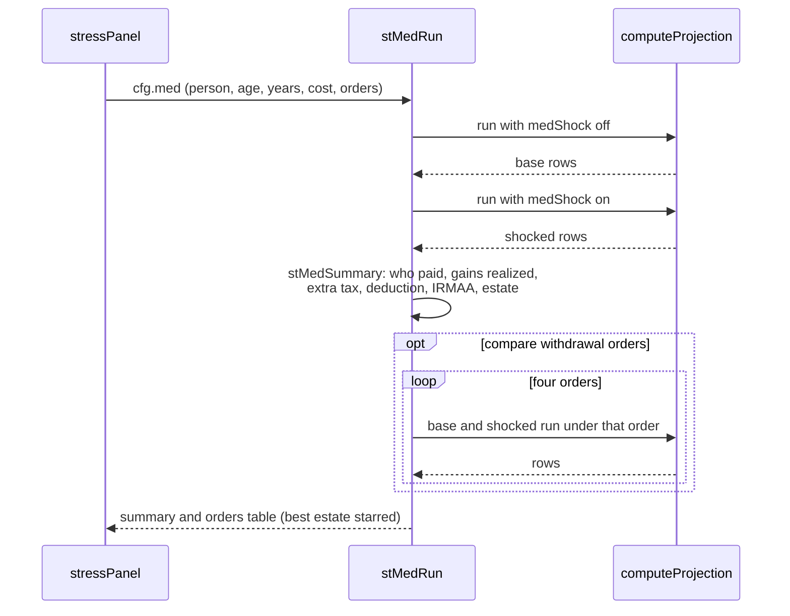

## 12. Chat scenario tools (add-on)

The chat can answer "what if" questions with numbers and charts instead of advice. Principle: **the model describes, the engine computes, the display draws.**
The model never writes raw state paths, numbers or code; it picks named *levers*, the app runs them through `computeProjection()` on a private clone of the
scenario (`withTempState`, §4), and the cards show only engine output.

```
question → model → tool call (levers) → scenarioSpec.js validates + runs on a copy → compact result back to the model
                                       └→ chatTools.js makes card descriptors → chatCharts.js draws them under the reply
                                          (Save as Scenario / Open in main charts: user click only → scnAddFromState, scenarios.js)
```

### 12.1 `compute/scenarioSpec.js` (no DOM; loaded after `stressTest.js`)
| Export | Contract |
|---|---|
| `SPEC_LEVERS` | The catalog: `ssClaimAge, living, inflation, returns, passingAge, stopWorking, pension, rothConversion, ltc, medShock, guardrail, portfolioSales, stateTax, marketStress`. Each has `params` (type, min, max, description), `req`, optional `check`, a `label` and an `apply(s, args)` that sets **every dependent field together** (a fixed conversion also sets `convMode:'fixed'`, `convToRoth`, and switches the Roth IRA on) and returns `applied` or `ignored` + reason. The catalog drives the tool schema, validation, the changes list and the tests. There is **no conversion end age** in the engine, so `rothConversion.endAge` is rejected as an unknown parameter. |
| `specValidateLevers(levers)` | → `{errors, levers}`; numeric strings are coerced; unknown lever / unknown parameter / missing / out-of-range each give a message the model can act on. |
| `specRunBatch(scenarios)` / `specSweep(template, param, values)` | Runs your scenario as entered (`base`) plus up to 6 scenarios (a sweep: 2 to 12 values, run in chunks). Every applied lever is then checked: if the scenario's results equal the base the lever becomes `noEffect`; with several levers each is re-run alone (`specFingerprint`). **Never writes `state`; MC hooks are restored.** |
| `specBuildState(levers)` | The live plan with levers applied, as a plain plan object (for Save / Open). A `marketStress` lever is a hook (`stHook`), not state, so it is reported in `market` and not saved. |
| `specKpis`, `SPEC_KPIS` | Headline numbers: assets at the end, lifetime federal tax, peak IRMAA, conversions, lifetime SS, unfunded total / years / first age, lowest assets. |
| `specChartData(chart, runs, opts)`, `specSweepChartData` | Chart data only (`SPEC_CHARTS`: assets, annualTax, cumulativeTax, unfundedExpenses, magi, irmaa, socialSecurityCumulative, incomeBySource, outcomes). |
| `specModelSummary`, `specRowsCsv`, `specToolSchemas` | What goes back to the model (KPIs, lever statuses, assets and tax sampled every 5 years), drill-down CSV (whitelisted fields, 40 rows) and the four tool declarations (plain JSON-schema subset that both Gemini and Anthropic accept). |
| `specScenarioKey()` | Fingerprint of the scenario (`state` without `ui`); cards and runs compare it to flag "scenario edited since". |

### 12.2 `display/chatTools.js`
`chatExecTool(name, args)` → `{isError, response, cards}` for `run_scenarios`, `sweep`, `show_chart`, `get_rows`. Keeps finished runs in memory (`chatRuns`, ids `base`, `r1`, `r2` …; never saved). Every failure is returned to the model as `{error}` so it can correct itself. `run_scenarios` draws the summary card plus `charts` (default assets and annualTax) in the same call, so a normal question needs only two API requests (important on the Gemini free tier). A sweep template has no value for the swept parameter, so it is validated per value, not alone.

### 12.3 `display/chatCharts.js`
Cards: **summary** (headline-numbers table with deltas, "Changes vs your scenario" list with applied / ignored / no-effect, and the buttons) and **chart** (Chart.js line / area / bar / sweep, ⤢ enlarge, PNG). Cards keep their own data; `chatMarkStale()` (called from `recompute()`) badges cards whose scenario was edited since. The app's overlay plugins are switched off per chart (`CHAT_NO_OVERLAYS`). Buttons: **Open in main charts** and **Save as Scenario** rebuild the plan from the lever list on the plan *as it is now* (after a confirm if it changed) and call `scnAddFromState()` in `scenarios.js`; **Copy spec** copies the levers as JSON. Market-stress runs cannot be saved.

### 12.4 `display/chat.js` additions
Provider-neutral history (`user`, `assistant` + `calls`, `tool` + `results`) mapped by `chatGeminiContents` / `chatAnthropicMessages`; Gemini's own `functionCall` part is kept verbatim (Gemini 3 needs its `thoughtSignature` back; a call from another provider gets Google's documented dummy signature). `chatParseEvent` assembles Anthropic's streamed `input_json_delta` pieces; a cut-off call becomes an error result. `chatHistoryForRequest` trims by whole turns (a call is never split from its result) and shortens old tool results. The loop in `sendChat` allows `CHAT_MAX_TOOL_ROUNDS` (4) rounds, then asks for a plain answer; a Gemini 429 whose message says "retry in N s" (N ≤ 30) is waited out once. A failure after tools ran keeps the cards and closes the turn with a plain assistant message so roles alternate. **Wide** toggle (⇔) widens the panel; Settings collapse once a question is sent.

### 12.5 Tests
`node tests/chat/spec_test.js` (engine layer, both samples: base equals `computeProjection()`, live state deep-equal after runs, every lever changes results or is flagged, validation, sweep, chart data), `node tests/chat/tools_test.js` (dispatcher), and `node tests/chat/e2e_browser.js` (real Chromium with a scripted Gemini and Anthropic API; needs `playwright-core` and `chart.js` installed in `tests/chat/`).


## 13. Market scenarios and the tool API (add-on)

One data model for "what if the market and inflation did *this*, year by year", one hook for the engine, and one transport-neutral tool surface. The chat and the MCP server (with its optional live bridge, §13.7) use it; any other host, can drive the same functions tomorrow without touching the engine or the display.

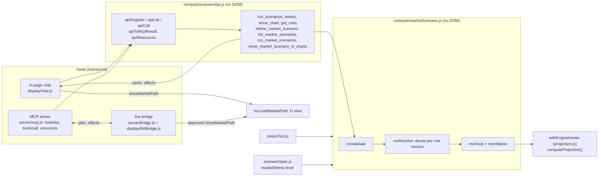

### 13.1 `compute/marketScenario.js` — the MarketPath
```js
MarketPath = { schema:1, id, label, note, source:'builtin'|'chat'|'user'|'mcp',
  from:{ mode:'retire'|'now'|'year', year? },          // where returns[0] lands
  returns:[ nominal stock return per year, fraction ],   // 1..60 values
  inflation:[ nominal inflation per year ] | null,        // same length, or null = the plan's own rate
  tail:{ returnPct, inflationPct },                       // every LATER year to the end of the plan (null = the plan's own rate)
  equityShare: 0..100 }                                   // % of each non-property asset that takes the return
```
| Export | Contract |
|---|---|
| `msValidate(raw, opts)` | → `{errors, path}`. Takes the stored form **or** the friendly form a model or API client sends (`returnsPct`, `inflationPct`, `startsAt`, `startYear`, `afterReturnPct`, `afterInflationPct`; percent). Every problem is a sentence the caller can act on. |
| `msResolve(path, ctx)` | **Full-horizon vectors for the whole projection** (`MS_ROWS` = 120 rows): `eq[k]` (NaN = the scenario's own rate), `pi[k]` (the path's inflation, the tail's, or the scenario's), price level `cpi[k]`, `start`, `window`. This is the only place that decides which year gets which value. |
| `msHook(res)` / `msInflation(res)` | The engine hook (`MC_HOOK`, `gk()` in projection.js) and inflation object (`MC_INFL`). Same arithmetic the stress tests always used: a nominal return `r` in a year of inflation `π` enters as the real rate `(1+r)/(1+π)−1`; `fixed` / `custom` growth are nominal, `inflation ± x` keeps its real rate; property is never hit. |
| `msRun(path, {record})` | The scenario under a path (or as entered with `null`) on a private clone. → `{proj, m, res, start}`. |
| `msFromWindow`, `msToStress` | Adapters from / to the older window form `{eq, infl}` + start row used by `stRun` and `mcRunTrial`'s `stress` argument. |
| registry: `msGet`, `msList`, `msSessionAdd`, `msSave`, `msRemove`, `msSanitizeList` | **Session** paths (a model's or MCP client's definitions) live in memory (`msSession`). **Saved** paths live in `state.ui.marketPaths`; `msSave` is called only by a user click (a card button). `hydrateState` drops malformed or out-of-range saved paths. |

`withEngineHooks(hook, infl, record, fn)` (projection.js) is the one way to run the engine under an overlay; it always restores `MC_HOOK`, `MC_INFL` and `REC_RATES`. `stRun`, `msRun` and the `marketStress` lever use it. The Monte Carlo trial runner still sets its own hooks (it combines random draws with the overlay, §10); it accepts a stress overlay built from a path with `msToStress`.

### 13.2 `compute/scenarioApi.js` — the tool registry (MCP-shaped)
| Export | Contract |
|---|---|
| `apiRegister({name, description, inputSchema, handler(args, host)})` | A handler returns `{isError, response, cards?, effects?}`: `response` is the compact JSON the model sees; `cards` are display descriptors for a host that can draw them; `effects` are requests to change what is on screen (`{type:'showMarketPath', id}`). A headless host ignores cards and effects it does not support. |
| `apiList('neutral' \| 'mcp')` | Declarations: `{name, description, parameters}` for the chat providers, `{name, description, inputSchema}` exactly as an MCP `tools/list` entry. |
| `apiCall(name, args, host)` / `apiToMcpResult(r)` | Never throws (a failure is `{isError:true, response:{error}}`); the second turns a result into an MCP `tools/call` result. `host.source` (`'chat'`, `'mcp'`) is stamped on every scenario a call defines. |
| `apiResources()` / `apiReadResource(uri)` | Read-only context: `planner://scenario/summary`, `planner://market-scenarios`, `planner://levers`. |

Tools: the four lever tools (`run_scenarios`, `sweep`, `show_chart`, `get_rows`, moved here from `display/chatTools.js` unchanged in behaviour) and four market tools. **`define_market_scenario`** takes `returnsPct` (one nominal stock return per year), optional `inflationPct`, `startsAt` / `startYear`, `afterReturnPct` / `afterInflationPct` (carry a long-run rate to the end of the scenario), `equityShare` and `showInCharts`; it validates, keeps the scenario in memory, runs it against the scenario as entered, and returns the KPIs, the first years *as placed on the scenario* (so the model can check it was read correctly) and, with `showInCharts`, a `showMarketPath` effect. `list_market_scenarios`, `run_market_scenarios` (presets `lost`, `stag`, `y1966`, saved and session ids) and `show_market_scenario_in_charts` complete the set.
**Rules:** nothing a handler does writes `state`; every run is on a private clone; the run store (`API_STORE.runs`) is memory only. A model can *ask* to show a scenario; the screen change is applied by the host (`chatApplyEffects` in `display/chatTools.js` → `mcLoadMarketPath`), and the plan is never changed (the D view is a replay with **Back to scenario**). Saving into the plan is a user click only.

### 13.3 Display
- **D view generalised.** `mcDList()` = the Stress card's results, then every other known market scenario (saved, or defined in the chat). `mcLoadMarketPath(id)` / `mcShowD(id, idx, label)` (mcPanel.js) replay any of them through `stReplay` with no stress-test run needed; the D key and ◀ ▶ step through the list. The Market return and Inflation charts show the scenario's yearly values (recorded rates, `cap.infl`).
- **Chat card `market`** (`chatRenderMarketCard`, chatCharts.js): what was asked, as the engine read it, with **Show in main charts**, **Add to Stress test card** (`stAddPath` → `msSave`) and **Copy JSON**.
- **Stress test card:** a *Saved market scenarios* group (`cfg.custom.enabled`, default on) lists `state.ui.marketPaths` with Remove; each saved path is a row of the table (`stPathScenario`), placed by its own `from` and `equityShare` (`stPlace`), and a row of the combined Monte Carlo run with its own start and share.

### 13.4 MCP server (`server/engine.js`, `server/mcp.js`)
`engine.js` loads the engine files plus `scenarioSpec/Api`, `runRegistry`, `runJobs` into a Node `vm` with a stub DOM (logs go to stderr) and loads a saved plan with `hydrateState`. `mcp.js` speaks newline-delimited JSON-RPC 2.0 on stdio: `initialize`, `ping`, `tools/list` = `apiList('mcp','mcp')`, `tools/call` = `apiToMcpResult(apiCall(name,args,{source:'mcp'}))`, `resources/list|read`; stdout carries protocol only. `RR_TOOL_NAMES=false` masks names unless `--names`. The plan file is re-read when its mtime changes (runs then report `stale`); it is never written. After `import_scenarios` the held proposals are written to `<plan>.proposals.json` (`planner.scenarios/1`) for the page's Import tab. The 🆎 scenario set lives in browser storage, so the server sees only the plan. Test: `tests/llm/mcp_test.js` (spawns it).

### 13.5 Run registry, analysis bundle and LLM panel (`compute/runRegistry.js`, `display/llmPanel.js`)
Design and phases: `docs/LLM_INTEGRATION_DESIGN.md` (phases 1, 2 and 3 built). `rrEntries()` reads every store and returns one **Run** shape: `plan` (live scenario), `user` (the other 🆎 scenarios, run on a state swap), `lever` (`apiRuns`), `market` (`msList()`), `stress` (`stResults.results`; KPIs from the stored measure `m`, yearly values via `stReplay`), `stress_mc` (`stResults.mc.rows`) and `monte_carlo` (`mcResults`). Page-only stores are read behind `typeof`, so a headless host (tests, a future MCP server) sees scenario + lever + market. A Run has `id` (`plan`, `scn:B`, `lev:r1`, `mkt:<id>`, `st:<scenario>`, `stmc:<scenario|none>`, `mc:run`), `kind`, `label`, `source`, `spec`, `scenarioKey` (8-hex `rrHash` of the scenario), `stale` (the scenario was edited since), `kpis` (the `SPEC_KPIS` vector) or `distribution` (funded share, final-asset and lifetime-tax percentiles, failure causes, risk factors, and with detail the funded-through-age and percentile bands by age), plus `stress` extras.
- `rrBuildBundle({tier,runs,names,round})` → `planner.analysis/1`: instructions, engine fingerprint, privacy block, plan section (structured, plus the chat snapshot text when the page is loaded), glossary, runs, `comparison` (KPI changes against the scenario), `stochastic` table, lever catalog, notes; the *standard* tier adds `series` (`{columns,rows}`, scenario + up to 3 runs, never stale runs) and `exemplarSeries` (replayed earliest failure and typical success of up to 2 stochastic runs). Money goes through `rrM` (rounding step set per build), labels through `rrClean` (control characters out, 80 chars, names masked unless allowed).
- `rrImport(text|object, host)` → `{accepted, rejected, warnings}`: finds the JSON in a pasted reply (`rrExtractJson`), requires `planner.scenarios/1`, rejects unknown fields and kinds, validates levers with `specValidateLevers` and paths with `msValidate`, runs them (`specRunBatch`, `apiRunMarketPaths`) and stores **proposals** in memory (`rrProposals`, max 30). Nothing in it writes `state`.
- Tools (same registry as §13.2): `list_runs`, `get_run`, `compare_runs`, `get_mc_summary`, `get_trial` (seeded replay via `mcRunTrial`; refused for a stale run), `get_stress_results`, `import_scenarios` (effect `showProposals` → `chatApplyEffects` opens the panel). Resources `planner://runs` and `planner://analysis/summary`. Declarations avoid objects without `properties` and union types (Gemini rejects both); `tests/llm/runs_test.js` checks that.
- Display: `llmPanel.js` is a popup like the Scenario card (button `#llmBtn`), not a card in the stack, so `state.ui` / `cardOrder` are untouched. Export tab builds the bundle on click only; Import tab → proposals with Show / Add / Copy / Dismiss; the only writes are `scnAddFromState` and `stAddPath` from those clicks.
- `compute/runJobs.js` (phase 2): `RJ_MC_SPEC` / `RJ_ST_SPEC` validate settings (bounds, unknown fields rejected, no late-life medical shock); `rjBase` starts from the card settings. `rjRunStress` runs the stress rows synchronously (`stl:` runs, `includePathIds` → `cfg.extraPaths` appended by `stScenarios`). Monte Carlo runs as a **job**: a snapshot clone of `state`, ~40 ms `setTimeout` slices, one running and the rest queued, ids `mcj:<job>[:<scenario>]`; limits chat / import 2000 trials per row and 6000 total, mcp 5000 / 20000. `rjImportStress` / `rjImportMc` back the import kinds `stress` and `montecarlo`; `llmApplyCfg` writes proposal settings to `state.ui.stressCfg/mcCfg` (click only). Tools `define_stress_config`, `define_mc_config`, `run_stress_tests`, `run_monte_carlo`, `get_job`, `cancel_job` carry `hosts:['mcp']`: `apiList(fmt,host)` hides them and `apiCall` refuses them for the chat.
- Phase 3 (the live bridge and an OpenAI-compatible chat provider) is §13.7; the live bridge there is still in development.
Tests: `node tests/llm/runs_test.js` (73 checks: every kind, KPI parity with the cards, bundle tiers / size / rounding / privacy / staleness, import rules, every tool, plan byte-identical) and `node tests/llm/llm_ui_test.js` (the popup: export, import, proposals, the click-only writes, stress / MC proposals and apply-to-card), `node tests/llm/jobs_test.js` (53 checks: validation, stress runs, job slicing / queue / cancel, limits, host gating) and `node tests/llm/mcp_test.js` (the server over a real pipe).

### 13.6 Tests
`node tests/market/market_test.js` (validation, dense full-horizon resolution and tail, row-for-row parity with the stress-test arithmetic, hooks restored, every tool, MCP shapes, saving, hydrate sanitising, the `marketStress` lever) and `node tests/market/market_ui_test.js` (chat tool → effect → D view → banner; chat cards; Add to Stress test card; the table's Show in charts).

### 13.7 Live bridge and the OpenAI-compatible provider (phase 3)
> **Status: the live bridge is still in development.** The code described here is built and tested (`tests/llm/bridge_*`), but the protocol (message types, effect vocabulary, `planVersion` / `planChanged` / `pageSync` fields, the `replaced` flag, page-run sync), the Live bridge tab and the extension settings may still change, and the page and the server must come from the same build. Nothing else depends on it: the engine, the tool registry (§13.2), the run registry and bundle (§13.5) and the file-based MCP server (§13.4) work without a bridge, and the bridge adds no calculation. When changing it, update this section, Usage (*Live bridge*), the Formulas page (`f-llm`) and `mcpb/manifest.json` together.
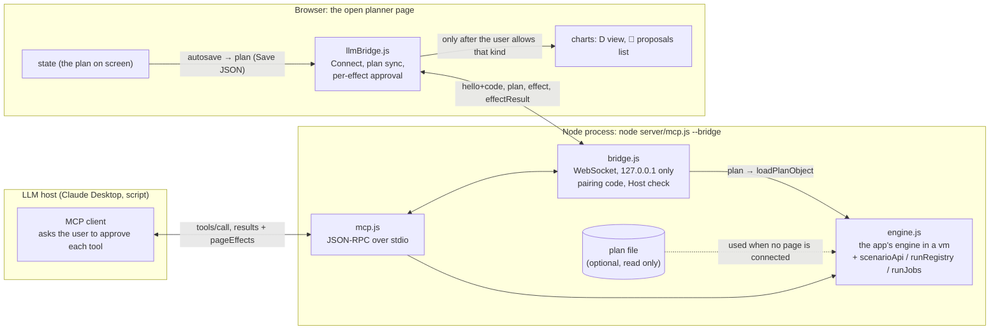

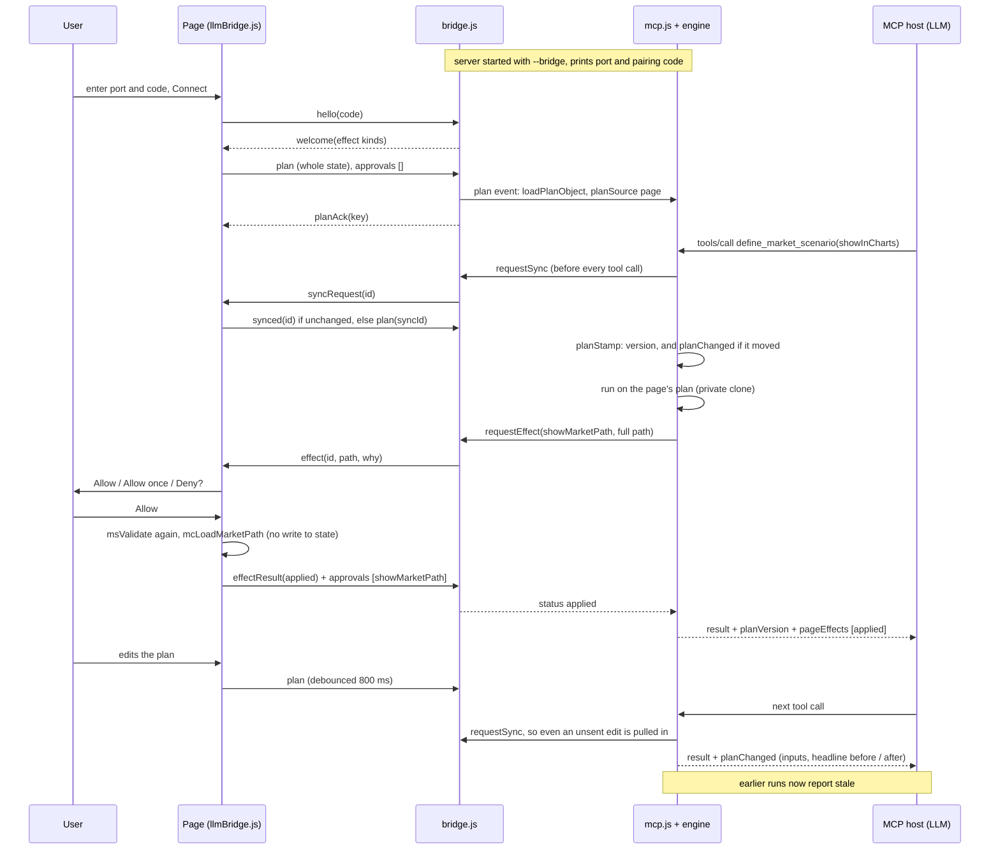

**Bridge server — `server/bridge.js`** (no packages). A WebSocket server (RFC 6455: text frames, fragmentation, ping / pong, close; client frames must be masked; binary refused) bound to `127.0.0.1` only. Rules: the `Host` header must be `127.0.0.1:<port>`, `localhost:<port>` or `[::1]:<port>` (DNS-rebinding guard) and the path `/`; the first frame must be `{type:'hello', token}` within 5 s and ≤ 1 KB (`preAuthMs`), compared in constant time (`tokenOk`, case / dashes ignored); after 5 wrong codes the code is **replaced** (`rotate`), so a page cannot keep guessing; at most 4 unauthenticated sockets; one authenticated page at a time (a newer authenticated page replaces it, a failed login never does); the server pings every 20 s. Messages: page → server `hello`, `plan` (≤ 8 MB, the Save JSON), `approvals`, `effectResult`, `bye`; server → page `welcome` (session, effect kinds), `denied`, `planAck`, `effect` (id, effect, why), `effectCancel`. `requestEffect(effect,{why,timeoutMs})` → `Promise<{status,note}>` with status `applied | denied | unsupported | error | timeout | noPage | disconnected | busy` (max 8 waiting; 30 s wait; the page is sent `effectCancel` on timeout). Unknown message types are ignored (a newer page may send more).

**Wiring — `server/mcp.js --bridge [--bridge-port 8765] [--bridge-token CODE] [--bridge-hide-code] [--plan file]`.** `--plan` becomes optional; with neither a plan nor a page the tools answer "No plan is loaded yet". The `plan` event runs `E.loadPlanObject` (`engine.js`; `hydrateState` sanitises it) and sets `planSource='page'`; while a page is connected the file is not re-read; on disconnect the file is used again (or, with no file, the last page plan stays, labelled `page (disconnected)`). The engine is still the server's (every tool call runs there, on the page's scenario; runs made before an edit report `stale` through the scenario key). A tool result's `effects` are turned into page payloads (`effectForPage`): `showMarketPath` → the full validated MarketPath (not an id, which the page would not know), `showProposals` → a `planner.scenarios/1` object holding only the proposals that call accepted, with the scenario key; the tool's JSON gains `pageEffects:[{type,status,note}]` (also `noPage`), so the LLM learns what the user allowed. Extra tool `bridge_status` (listed only with `--bridge`): connection, port, scenario source / key / last sync, effects the user has approved, and how to connect (the pairing code is included only while no page is connected and unless `--bridge-hide-code`). **Staying in step:** before every tool call `syncFromPage` sends `syncRequest` and waits up to 1 s; the page answers `synced` (scenario unchanged since it was last sent) or `plan` with the same `syncId` (it also cancels its pending debounced send), so a call never runs on a scenario still inside the 800 ms debounce; a silent page adds `pageSync:{status:'timeout'}` to the result. `planStamp()` puts `planVersion` (the 8-hex scenario key) on every object result, and when it differs from the version of the host's previous result adds `planChanged:{from,to,source,changedInputs,planHeadline:{before,after},note}`: `changedInputs` are paths only (≤ 3 levels, ≤ 15, `ui` excluded, never values); the "before" headline is computed by loading the remembered old state into the engine for one projection and putting the current state back. It works for a plan file edited on disk too (`source:'file'`). Without `--bridge` the bridge parts do nothing (no port, no extra tool). Sidecar `<plan>.proposals.json` is still written when there is a plan file.

**Page — `display/llmBridge.js`** (+ the **Live bridge** tab in `llmPanel.js`; `autosave()` calls `llmBridgeNotify()`). Off until the user enters port and code and presses Connect (`lbConnect`: port 1024–65535, `ws://127.0.0.1:<port>` only). After `welcome` it sends the scenario (`JSON.stringify(state)`, re-sent 800 ms after an autosave that changed it) and its approvals. The code is kept only in a form variable, cleared once used, never in storage, `state` or a file. Incoming messages are capped (2 MB) and untrusted. `LB_EFFECTS` is the whole vocabulary: `showMarketPath` (`msValidate` again, a unique id so no saved or preset path is replaced, `msSessionAdd`, `mcLoadMarketPath` → the D view, shown as B) and `showProposals` (`rrImport(spec,{source:'mcp'})` re-validates and re-runs everything, then opens the Import tab). A kind that is not in the table is answered `unsupported` without asking. **Approval:** the first request of a kind on a connection is not applied; it is listed in the tab (escaped text, the LLM's reason) with **Allow** (this kind for this connection; the server is told through `approvals`; same-kind requests already waiting are applied), **Allow once** and **Deny** (answers `denied`, remembers nothing). At most 5 wait. Approvals are forgotten on Disconnect or when the socket drops, and can be revoked in the tab. No effect writes `state`.

**OpenAI-compatible provider — `display/chat.js`.** `CHAT_PROVIDERS.openai` (label, editable base URL, optional key, free model id; prefs `baseUrl`, key under its own storage key). `chatOpenAIEndpoint(base)` → `<base>/chat/completions`; plain `http` is accepted only for `localhost`, `127.x.x.x` and `[::1]` (the key is never sent in clear to another host), user info, query and fragment are refused, and a remote server needs a key (a local one does not). `chatBuildRequest('openai',…,{baseUrl})`: `messages` (system first; assistant `tool_calls` with JSON-string arguments; one `tool` message per result; ids cut to 40 characters), `tools` as `{type:'function',function}`, `tool_choice` `auto` / `none`, `stream:true`, **no** `max_tokens` (OpenAI's newer models want `max_completion_tokens`, older servers want `max_tokens`). `chatParseEvent('openai')` collects tool-call pieces by `index` in `st.tc` and emits the calls at `finish_reason` (or at the end of the stream, `chatOpenAIFlush`, for servers that send none); `[DONE]` and comment lines are skipped; arguments given as an object are accepted; a cut-off call becomes an `__error` call the model can correct. Error bodies in both `{error:{message}}` and `{error:"text"}` form are read. The browser calls the server directly, so the server must allow the page's origin (CORS).
Docs: Usage (*Connecting an MCP host* incl. macOS steps, *Live bridge*), the Formulas page (§ *Scenarios from an outside LLM and the live bridge*, `f-llm`). No calculation changed, so the Excel export is unchanged: a path shown through the bridge is the D view and exports as a stress test (`xlsxTrialContext`).
Tests: `node tests/llm/bridge_test.js` (42), `bridge_mcp_test.js` (37), `bridge_ui_test.js`, `openai_test.js`.


### 13.8 Claude Desktop extension (`mcpb/manifest.json`, `server/build-mcpb.js`)
An `.mcpb` bundle (a zip with `manifest.json` at its root; manifest_version 0.2) installs the MCP server in Claude Desktop by drag-and-drop, with no config-file editing. `node server/build-mcpb.js [out]` (no packages, own zip writer, reproducible bytes) packs `manifest.json`, `icon.png`, `LICENSE`, `server/{mcp,engine,bridge}.js`, every `data-engine` script of `index.html` under `js/` (plus `server/scripts.js` and a generated `js/engine-files.json` that gives the load order, since the bundle has no `index.html`; so the list cannot drift) and the sample plans; the manifest's `tools` list is generated from `apiList('mcp','mcp')` plus `bridge_status`. Claude Desktop runs `node ${__dirname}/server/mcp.js` with its own Node. The settings form (`user_config`: `plan_file`, `live_bridge` default on, `bridge_port` 8765, `bridge_token` sensitive, `show_names`) reaches the server as environment variables (`PLANNER_PLAN`, `PLANNER_BRIDGE`, `PLANNER_BRIDGE_PORT`, `PLANNER_BRIDGE_TOKEN`, `PLANNER_NAMES`; also `PLANNER_BRIDGE_HIDE_CODE`, `PLANNER_PROPOSALS`): `mcp.js` treats an empty value or an unresolved `${…}` placeholder as not set, a flag as on only for true / 1 / yes / on, a pairing code under 12 characters as not given (a random one is used), a bad port as 8765. The command-line forms are unchanged. With nothing filled in the bridge starts with no scenario, so the install works with zero setup and Claude can tell the user the port and code (`bridge_status`). Checked with the reference `@anthropic-ai/mcpb validate` / `info` / `unpack`; `tests/llm/mcpb_test.js` builds, unpacks into an empty folder and runs the result.
